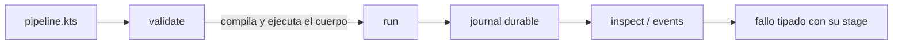
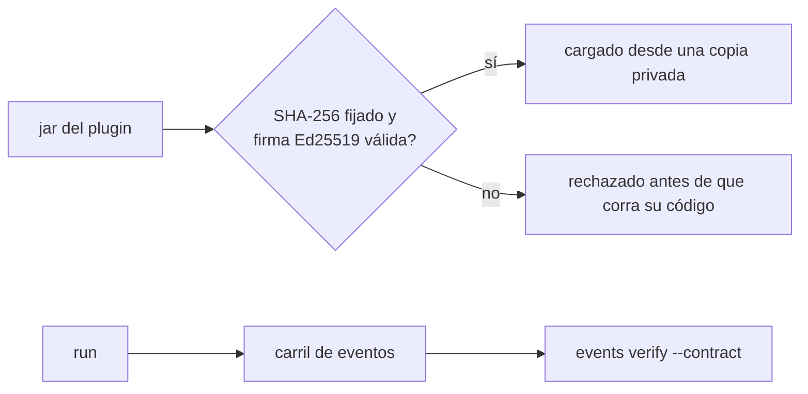
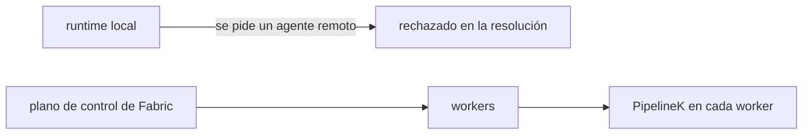
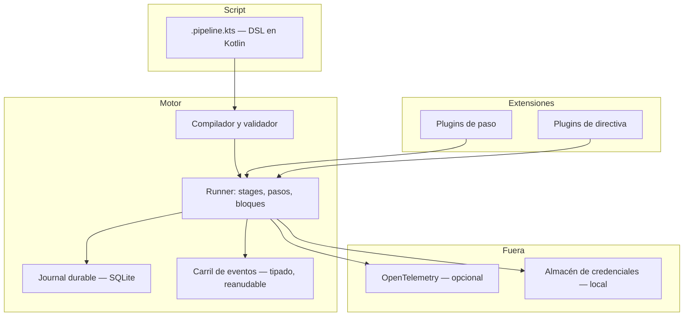

# PipelineK — Construye, verifica y ejecuta con confianza

[](https://github.com/Rubentxu/pipeline-kotlin/releases)
[](LICENSE)
[](https://adoptium.net/)
[](https://kotlinlang.org/)

**Un motor de CI/CD local primero, con un DSL en Kotlin familiar para Jenkins.**
PipelineK compila, valida y ejecuta tus pipelines en tu propia máquina, con un journal durable y eventos tipados: sin controlador, sin agente y sin estado remoto.

**[English](README.md) | Español**

**[→ Primeros pasos](#primeros-pasos) · [→ Características](#capacidades-principales) · [→ Ecosistema](#ecosistema-de-plugins)**

---

## ¿Por qué PipelineK?

Tres problemas aparecen en casi todos los equipos que ejecutan CI.

**El feedback llega tarde.** El pipeline se ejecuta a minutos de distancia, en la máquina de otro, y descubres qué se rompió cuando el job ya ha desaparecido. PipelineK ejecuta ese mismo pipeline en tu propia máquina, en segundos, antes de hacer el push.

**La automatización queda atada a un proveedor.** El pipeline es un fichero YAML en el dialecto de un proveedor, y moverlo significa reescribirlo. El pipeline de PipelineK es un fichero Kotlin que te pertenece, y el runner es un único binario sin ningún servicio detrás.

**Los fallos son difíciles de entender.** Una build roja dice "exit code 1" y nada más. PipelineK emite eventos tipados, journaliza cada paso con una huella de sus entradas y atribuye el fallo al stage al que pertenece.

Lo que PipelineK **no** es: no es un planificador y no promete builds byte a byte idénticas entre máquinas distintas. Es un **motor** de pipelines: lo que ejecuta tu pipeline, registra lo que ocurrió y te dice con precisión por qué falló.

---

## Primeros pasos

**Requisitos:** Java 21 o posterior en el `PATH`, y Linux, macOS o Windows (WSL). Nada necesita `sudo`; nada arranca un demonio.

```bash
# La última versión ESTABLE. El digest se publica con la release, así que los
# bytes que ejecutas son los bytes que se firmaron.
TAG=$(curl -fsSL https://github.com/Rubentxu/pipeline-kotlin/releases.atom \
  | sed -n 's#.*releases/tag/\(v[^"]*\)".*#\1#p' | grep -v -- '-rc' | head -1)
BASE="https://github.com/Rubentxu/pipeline-kotlin/releases/download/${TAG}"

curl -fL -o manifest.json "$BASE/manifest.json"
ASSET=$(grep -o '"pipelinek-[^"]*\.zip"' manifest.json | grep -v sdk | head -1 | tr -d '"')

curl -fL -o "$ASSET" "$BASE/$ASSET"
curl -fL -o SHA256SUMS "$BASE/SHA256SUMS"
grep " ${ASSET}$" SHA256SUMS | sha256sum -c -

unzip -q "$ASSET"
PIPELINEK="./$(basename "$ASSET" .zip)/bin/pipelinek"

"$PIPELINEK" version     # → pipeline 0.94.2
"$PIPELINEK" doctor      # jdk / os / workdir / writable / script cache
```

El ZIP trae `bin/pipelinek` (UNIX) y `bin/pipelinek.bat` (Windows). Te queda un directorio `pipelinek-<version>/`: úsalo desde ahí o pon su `bin/` en el `PATH`.

### Tu primer pipeline

```kotlin
// hello.pipeline.kts
pipeline {
    stages {
        stage("hello") {
            echo("PIPELINE-OK")
        }
    }
}
```

```bash
"$PIPELINEK" validate hello.pipeline.kts   # VALIDATION SUCCESSFUL
"$PIPELINEK" run hello.pipeline.kts        # PIPELINE-OK … Pipeline finished with SUCCESS
```

`validate` compila el script **y evalúa su cuerpo**: un `.pipeline.kts` es código de confianza, no datos. Usa `validate --compile-only` cuando solo quieras saber que compila.

### Consultar la ejecución después

Dale a la ejecución un journal y un control root, y cada paso, evento y salida se queda legible:

```bash
"$PIPELINEK" run --db state/pipelinek.db --control-root state/ctl hello.pipeline.kts
# {"schema":"pipelinek.launch/1","runId":"34b28ddc-…","status":"Launched"}

"$PIPELINEK" inspect <runId> --db state/pipelinek.db --control-root state/ctl
"$PIPELINEK" events  --db state/pipelinek.db <runId>          # eventos tipados, un JSON por línea
"$PIPELINEK" observe <runId> --db state/pipelinek.db --control-root state/ctl --view events
```

`inspect` muestra los stages, los pasos y sus resultados; `events` lee el carril de eventos; `observe` lee la consola y el plano de salida de la ejecución. La lista completa de verbos está en `pipelinek --help`.

---

## Capacidades principales

| Capacidad | Qué te da | Estado |
|---|---|---|
| **DSL en Kotlin** | `pipeline { stages { stage { … } } }` y control de flujo real de Kotlin, bloques `script {}`, `parallel`, `retry`, `timeout`, `catchError`, `whenGate` | Disponible |
| **Ejecución local** | Una ejecución por invocación de la CLI, en tu propio directorio de trabajo. Sin controlador, sin agente, sin demonio | Disponible |
| **Journal durable** | Un journal en SQLite (`--db`) más un control root: una ejecución matada deja un registro que puedes inspeccionar, reanudar, cancelar o recuperar | Disponible |
| **Eventos tipados** | `CompilationStarted`, `RunStarted`, `StageStarted`, `StepStarted`, `StepFinished`, `StepFailed`, `RunFinished`, `EchoOutputCaptured`, con el stage del fallo adjunto al propio evento de fallo | Disponible |
| **CLI estructurada** | `validate`, `run`, `observe`, `console`, `events`, `inspect`, `credentials`, `doctor`, `version`, `capabilities`, `sdk-info`, `runs cancel`, `runs recover`: cada verbo imprime su propio uso | Disponible |
| **SDK de plugins** | `StepContract`, códecs tipados, capacidades declaradas, un manifiesto con su rango de API. El autor de un plugin compila contra el SDK publicado, y nada más | Disponible |
| **Confianza en plugins** | `--plugin-trust` admite un plugin solo si sus bytes coinciden con el SHA-256 fijado y llevan una firma Ed25519 válida; `--require-plugin-trust` rechaza lo que no esté avalado, antes de que corra su código | Disponible |
| **OpenTelemetry** | Exportación OTLP opcional de tiempos, recuentos y buckets: nunca cargas útiles. Apagada salvo `PIPELINEK_OTEL_ENABLED=true` | Disponible |
| **Introspección y recuperación** | `inspect`, `runs cancel`, `runs recover`, lecturas digeridas, fijación de salida, retención de rechazos | **Experimental** |

La última fila es la honesta: las capacidades `runtime.inspect.v1`, `runtime.cancel.v1`, `runtime.recover.v1` y `output.pin.v1` se publican como **experimentales**. `pipelinek capabilities` imprime el estado exacto de cada clave que admite esta build.

**Lo que está publicado:** `output.follow.v2`, `events.follow.v3`, `events.stepoutcome.v1`, `events.failurestage.v1`.

### Telemetría

La telemetría es opcional, y lo que transporta son **tiempos, recuentos y buckets: nunca cargas útiles**. Ni el texto del script, ni la orden, ni la transcripción viajan en una señal: ese contenido vive en el plano de salida y en el journal, y una segunda copia en la telemetría sería un segundo sitio donde esconderse un secreto.

| | |
|---|---|
| Attributes | `run.id`, `stage.index`, `step.index`, `script.origin`, `failure.class` |
| Dimensions | `operation_kind`, `status`, `failure_class` |

Las convenciones son las de CI/CD de OpenTelemetry, fijadas en `1.44.0` y declaradas como candidata a release: el pin es parte de lo que el producto promete, y se lee del producto, no de la carga útil. No se exporta nada salvo `PIPELINEK_OTEL_ENABLED=true`, y el endpoint, el protocolo y las credenciales vienen del entorno: la misma build apunta a un Collector local, a Tempo, a Jaeger o a nada.

---

## Ecosistema de plugins

### Plugins oficiales (incluidos en la distribución)

| Plugin | Claves de paso | Para qué sirve |
|---|---|---|
| **SCM Git** | `scm-git.checkout` | Clonar un repositorio en el workspace, con la transcripción journalizada |
| **HTTP** | `http.request` | Lanzar una petición HTTP; necesita las capacidades `network.egress`, `http.transport` y `credentials.basic` |
| **JUnit** | `junit.results` | Leer informes JUnit XML y publicarlos como resultado de pruebas |
| **Utilities** | `core-utils.findFiles`, `core-utils.readJson`, `core-utils.readYaml`, `core-utils.sha256`, `core-utils.unzip`, `core-utils.zip`, `core-utils.writeJson`, `core-utils.writeYaml` | Ayudas de ficheros y de archivos para los scripts del pipeline |

En la distribución viajan además cuatro plugins que son ejemplos de trabajo del contrato: `example-uppercase-plugin`, `example-directive-plugin`, `example-block-plugin` y `example-saga-plugin`. Sus fuentes están en [`examples/`](examples/).

### Ecosistema extendido

Estos proyectos se construyen alrededor de PipelineK. La **columna 0.94.2** es el rango de SDK que cada uno declara frente a la release vigente: un proyecto fijado a un SDK anterior no carga con ella.

| Proyecto | Qué es | Madurez | 0.94.2 |
|---|---|---|---|
| pipelinek-fabric | Plano de control distribuido: workers, proveedores de podman y Kubernetes. *El repositorio aún no es público* | Preview | Fijado a 0.62.0 |
| [pipelinek-studio](https://github.com/Rubentxu/pipelinek-studio) | UI web, servidor MCP por stdio y extensión de VS Code sobre un proceso real de PipelineK | Preview | Fijado a 0.48.0-rc1 |
| [pipelinek-policy](https://github.com/Rubentxu/pipelinek-policy) | Comprobaciones de política como plugin (`policy.check`) | Preview | Declara `[0.47.0, 0.49.0)` |
| [pipelinek-assurance](https://github.com/Rubentxu/pipelinek-assurance) | Comprobaciones de assurance como plugin | En desarrollo | Declara `[0.48.0, 0.52.0)`; su handler todavía no puede ejecutarse en vivo |
| [pipelinek-saga](https://github.com/Rubentxu/pipelinek-saga) | Contrato de saga para compensaciones | En desarrollo | Todavía no declara rango |
| pipelinek-fabric-backstage | Integración con Backstage para la Control API de Fabric. *El repositorio aún no es público* | En desarrollo | El cliente todavía no está sellado |
| [asdf-pipelinek](https://github.com/Rubentxu/asdf-pipelinek) | Plugin de gestor de versiones para `asdf` y `mise`: resuelve la última versión estable y verifica su SHA-256 | Preview | Resuelve 0.94.2 |

**Escala de madurez:** *Disponible* — publicado y soportado en la release. *Preview* — funciona de extremo a extremo, todavía en movimiento. *En desarrollo* — código real, contrato incompleto. *Exploratorio* — una idea con un spike.

Nada de lo anterior es una promesa de compatibilidad: un proyecto declara el rango de SDK con el que se construyó, y el runtime rechaza un plugin fuera de ese rango antes de que sus clases se carguen.

### Escribir un plugin

Un plugin es un build de Gradle independiente que compila contra el SDK publicado y contra nada más. Declara un `StepContract` — la clave de familia, el descriptor, los códecs tipados y las capacidades que requiere — y un manifiesto con el rango de API con el que se construyó.

El SDK viaja con cada release como `pipelinek-<version>.sdk.zip`: seis artefactos (`pipeline-domain`, `pipeline-events`, `pipeline-output`, `pipeline-runtime-api`, `pipeline-scripting-api`, `pipeline-sdk-bom`) y un BOM que fija sus versiones entre sí. `pipelinek sdk-info` imprime el grupo y las coordenadas exactas contra las que compila un plugin.

Un plugin se carga desde `--plugin-jar`. Con `--plugin-trust <file>` solo se admite si sus bytes coinciden con el SHA-256 fijado por el operador y llevan una firma Ed25519 válida; con `--require-plugin-trust`, un plugin que nadie ha avalado se rechaza antes de que corra su código.

---

## Pensado para desarrolladores, agentes y plataformas

**Para desarrolladores.** Escribe el pipeline en el editor que ya usas, ejecútalo en tu máquina en segundos y recibe un fallo tipado que nombra el stage. Una caché de scripts compilados hace que la segunda ejecución del mismo script sea rápida, y es privada por defecto: un directorio de caché del que no se puede probar la privacidad no se usa.

**Para agentes.** Un pipeline es un artefacto tipado y legible, y cada ejecución deja un rastro legible por máquina: eventos tipados, un cursor reanudable y un journal durable. Un agente puede leer una ejecución, decidir qué hacer después y recibir un rechazo con un motivo preciso cuando la respuesta no está.

**Para equipos de plataforma.** Un binario, sin demonio, sin controlador y sin estado remoto. El runtime está pensado para ser embebido: un plugin declara las capacidades que necesita y el motor rechaza todo lo que no haya declarado. La red está detrás de una capacidad: un plugin que quiere alcanzarla declara `network.egress`, y un paso que la quiere la ha tenido que declarar.

---

## Flujos de trabajo reales

### CI local

El pipeline se ejecuta donde está el código. El bucle es: editar, validar, ejecutar, leer el fallo.



### Verificación con confianza

Un plugin traído de fuera solo se admite contra los bytes que fijaste, y el carril de eventos de una ejecución se puede comprobar contra un contrato que escribiste.



### Ejecución distribuida

**No está en este runtime.** `agent(remoteUri = …)` lo transporta el DSL y se rechaza en la resolución, porque aquí no hay un asignador remoto. La ejecución distribuida vive en **pipelinek-fabric**, un proyecto aparte con su propia línea de releases y cuyo repositorio aún no es público.



---

## Arquitectura de un vistazo



Cada frontera tiene un único dueño. El runner es la autoridad de escritura sobre una ejecución; el journal es el registro durable; el carril de eventos es la cara de lectura que un consumidor pagina por cursor; los plugins se admiten, no se confían por defecto.

- **Superficie de la CLI** — `pipelinek --help`
- **Contratos** — el KDoc de `StepContext.kt` (`:pipeline-step-sdk`), `RunTelemetry.kt` (`:pipeline-runtime-api`), `OutputReadPort.kt` (`:pipeline-output`) y `EventRecordReadPort.kt` (`:pipeline-events`)
- **Referencia de la API** — `./pipelinek/gradlew -p pipelinek apiReferenceHtml`
- **Procedencia de la release** — [RELEASE-SIGNING.md](RELEASE-SIGNING.md)

---

## ¿Por qué elegir PipelineK?

| Si necesitas… | PipelineK… | En lugar de… |
|---|---|---|
| Un pipeline que se pueda leer y comprobar con el compilador | …es un fichero Kotlin, compilado antes de ejecutarse | Un dialecto YAML propiedad de un proveedor |
| Feedback en segundos en tu propia máquina | …se ejecuta en local, un binario, sin servicio | Una cola de jobs remotos con su retardo |
| Un fallo sobre el que poder actuar | …nombra el stage, el paso y el resultado en eventos tipados | "exit code 1" al final de un log |
| Una ejecución auditable | …journaliza cada paso y ofrece un cursor reanudable | Un fichero de logs que nadie puede paginar |
| Extensibilidad sin forkear | …admite plugins por capacidad declarada y rango de API | Forkear el motor para añadir un paso |
| Ejecución distribuida | …**no** es esto: necesita Fabric, en su propia línea de releases | Suponer que un runner local planifica workers |

**Dónde complementa y no sustituye.** PipelineK no pretende ser Jenkins ni GitHub Actions: no tiene controlador, ni protocolo de agente, ni runners alojados. Su sitio natural es junto a ellos, como el motor local que ejecuta el mismo pipeline que ejecuta un desarrollador, y como el runtime que conduce una plataforma distribuida como Fabric.

**Las limitaciones que conserva.** Una ejecución por invocación. Sin planificación incorporada. Sin marketplace específico de proveedor. Sin garantía de builds idénticas en máquinas distintas. La asignación remota se rechaza en este runtime.

---

## Cómo participar

**Pruébalo.** [Descarga una release](https://github.com/Rubentxu/pipeline-kotlin/releases) y sigue los [primeros pasos](#primeros-pasos). El instalador multi-versión mantiene varias releases en paralelo:

```bash
curl -fL -o install-pipelinek.sh \
  "https://raw.githubusercontent.com/Rubentxu/pipeline-kotlin/main/scripts/install-pipelinek.sh"
./install-pipelinek.sh install 0.94.2   # descargar, verificar, instalar
./install-pipelinek.sh use 0.94.2       # cambiar la release activa
export PATH="$HOME/.local/share/pipelinek/current/bin:${PATH}"
```

`asdf` y `mise` instalan PipelineK a través del plugin [asdf-pipelinek](https://github.com/Rubentxu/asdf-pipelinek):

```bash
asdf plugin add pipelinek https://github.com/Rubentxu/asdf-pipelinek
asdf install pipelinek 0.94.2

mise plugins add pipelinek https://github.com/Rubentxu/asdf-pipelinek
mise install pipelinek@0.94.2
```

**Explora.** [`examples/`](examples/) contiene los cuatro plugins de ejemplo y un ejemplo de observabilidad: una configuración local de Collector, consultas PromQL y TraceQL, y un dashboard de Grafana que las ejecuta. El [catálogo de ejemplos](examples/catalogue/) reúne los ejemplos trabajados de las capacidades de arriba: el pipeline que muestra cada uno, y un README que explica sus etapas, sus pasos y qué espera. `pipelinek capabilities` y `pipelinek sdk-info` imprimen lo que admite esta build y contra qué compila un plugin.

**Construye un plugin.** El contrato, el SDK y las banderas de confianza están en [Escribir un plugin](#escribir-un-plugin). Los cuatro ejemplos de `examples/` son exactamente eso, y se construyen fuera del build de este repositorio.

**Cómo se verifica el build.** `scripts/verify-all.sh` ejecuta tres patas: **unit tests** para las reglas del dominio, **integration tests** que componen dos o más módulos reales con cada efecto que saldría del proceso sustituido por un doble, y **mutants** sobre las costuras que los módulos declaran: un mutante superviviente es un agujero en el test que debía matarlo. El gate también lee este README contra el código: `DocumentationDriftTest` falla cuando los dos discrepan, así que este documento no puede prometer lo que el build no hace.

**Informa de un problema.** [Abre un issue](https://github.com/Rubentxu/pipeline-kotlin/issues) con la versión de `pipelinek version` y la salida de `pipelinek doctor`.

**Contribuye.** [AGENTS.md](AGENTS.md) dice cómo se verifica el build y qué queda fuera de alcance. El repositorio tiene licencia MIT: mira [LICENSE](LICENSE).

---

<sub>PipelineK está en desarrollo activo. Las capacidades marcadas como *experimentales* pueden cambiar; las capacidades publicadas que se listan arriba son las que esta release garantiza.</sub>
