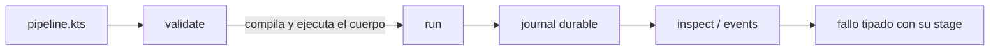
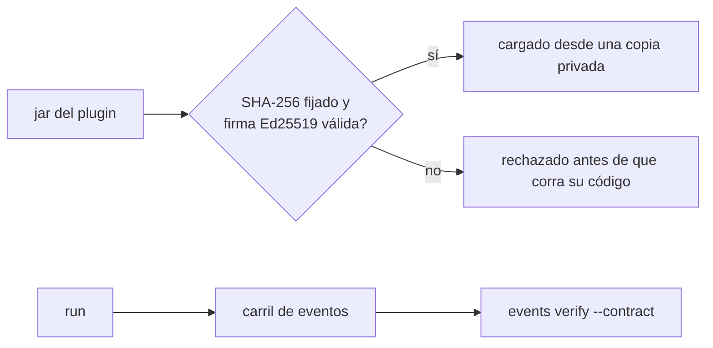
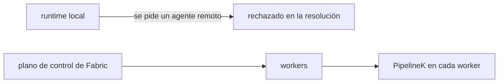
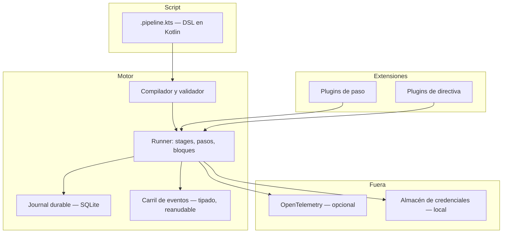

# PipelineK — Construye, verifica y ejecuta con confianza

[](https://github.com/Rubentxu/pipeline-kotlin/releases)
[](LICENSE)
[](https://adoptium.net/)
[](https://kotlinlang.org/)

**Un motor de CI/CD local primero, con un DSL en Kotlin familiar para Jenkins.**
PipelineK compila, valida y ejecuta tus pipelines en tu propia máquina, con un journal durable y eventos tipados: sin controlador, sin agente y sin estado remoto.

**[English](README.md) | Español**

**[→ Primeros pasos](#primeros-pasos) · [→ Características](#capacidades-principales) · [→ Ecosistema](#ecosistema-de-plugins)**

---

## ¿Por qué PipelineK?

Tres problemas aparecen en casi todos los equipos que ejecutan CI.

**El feedback llega tarde.** El pipeline se ejecuta a minutos de distancia, en la máquina de otro, y descubres qué se rompió cuando el job ya ha desaparecido. PipelineK ejecuta ese mismo pipeline en tu propia máquina, en segundos, antes de hacer el push.

**La automatización queda atada a un proveedor.** El pipeline es un fichero YAML en el dialecto de un proveedor, y moverlo significa reescribirlo. El pipeline de PipelineK es un fichero Kotlin que te pertenece, y el runner es un único binario sin ningún servicio detrás.

**Los fallos son difíciles de entender.** Una build roja dice "exit code 1" y nada más. PipelineK emite eventos tipados, journaliza cada paso con una huella de sus entradas y atribuye el fallo al stage al que pertenece.

Lo que PipelineK **no** es: no es un planificador y no promete builds byte a byte idénticas entre máquinas distintas. Es un **motor** de pipelines: lo que ejecuta tu pipeline, registra lo que ocurrió y te dice con precisión por qué falló.

---

## Primeros pasos

**Requisitos:** Java 21 o posterior en el `PATH`, y Linux, macOS o Windows (WSL). Nada necesita `sudo`; ningún demonio se arranca solo.

```bash
# La última versión ESTABLE. El digest se publica con la release, así que los
# bytes que ejecutas son los bytes que se firmaron.
TAG=$(curl -fsSL https://github.com/Rubentxu/pipeline-kotlin/releases.atom \
  | sed -n 's#.*releases/tag/\(v[^"]*\)".*#\1#p' | grep -v -- '-rc' | head -1)
BASE="https://github.com/Rubentxu/pipeline-kotlin/releases/download/${TAG}"

curl -fL -o manifest.json "$BASE/manifest.json"
ASSET=$(grep -o '"pipelinek-[^"]*\.zip"' manifest.json | grep -v sdk | head -1 | tr -d '"')

curl -fL -o "$ASSET" "$BASE/$ASSET"
curl -fL -o SHA256SUMS "$BASE/SHA256SUMS"
grep " ${ASSET}$" SHA256SUMS | sha256sum -c -

unzip -q "$ASSET"
PIPELINEK="./$(basename "$ASSET" .zip)/bin/pipelinek"

"$PIPELINEK" version     # → pipeline 0.95.0
"$PIPELINEK" doctor      # jdk / os / workdir / writable / script cache
```

El ZIP trae `bin/pipelinek` (UNIX) y `bin/pipelinek.bat` (Windows). Te queda un directorio `pipelinek-<version>/`: úsalo desde ahí o pon su `bin/` en el `PATH`.

### Tu primer pipeline

```kotlin
// hello.pipeline.kts
pipeline {
    stages {
        stage("hello") {
            echo("PIPELINE-OK")
        }
    }
}
```

```bash
"$PIPELINEK" validate hello.pipeline.kts   # VALIDATION SUCCESSFUL
"$PIPELINEK" run hello.pipeline.kts        # PIPELINE-OK … Pipeline finished with SUCCESS
```

`validate` compila el script **y evalúa su cuerpo**: un `.pipeline.kts` es código de confianza, no datos. Usa `validate --compile-only` cuando solo quieras saber que compila.

### Consultar la ejecución después

Dale a la ejecución un journal y un control root, y cada paso, evento y salida se queda legible:

```bash
"$PIPELINEK" run --db state/pipelinek.db --control-root state/ctl hello.pipeline.kts
# {"schema":"pipelinek.launch/1","runId":"34b28ddc-…","correlationId":"…","ownerId":"…","startedAtMs":1730000000000,"status":"Launched"}

"$PIPELINEK" inspect <runId> --db state/pipelinek.db --control-root state/ctl
"$PIPELINEK" events  --db state/pipelinek.db <runId>          # eventos tipados, un JSON por línea
"$PIPELINEK" observe <runId> --db state/pipelinek.db --control-root state/ctl --view events
```

`inspect` muestra los stages, los pasos y sus resultados; `events` lee el carril de eventos; `observe` lee la consola y el plano de salida de la ejecución. La lista completa de verbos está en `pipelinek --help`.

### Leer una ejecución desde fuera

Los hechos de una ejecución se leen desde fuera del producto, y sólo por las puertas que el producto abre.

**Qué puede leer un consumidor.** Los puertos de lectura publicados son todo el lado de lectura:

- el carril de eventos, como eventos tipados, paginados por secuencia (`EventRecordReadPort`);
- el plano de salida, como bytes comprometidos, dirigidos por stream y por cursor (`OutputReadPort`);
- el estado de la ejecución, como una observación (`RuntimeObservation`).

**Qué no puede hacer un consumidor.** El lado de escritura del almacén de eventos, el puerto de anexado de salida, la entrada de recuperación y la identidad de la ejecución no forman parte de ningún contrato publicado. Un consumidor que anexara al carril de eventos de una ejecución, o comprometiera bytes en su plano de salida, sería una segunda autoridad sobre los hechos de esa ejecución: el plano se lee, pero no se escribe, no se reserva, no se recupera y no se poda.

**Dos puertas, un hecho.** La línea de órdenes lee una ejecución del almacén; el servicio lee la misma ejecución del mismo almacén y responde por el socket. `pipelinek inspect --state` y `pipelinek inspect --state --endpoint <socket>` imprimen la misma línea y salen con el mismo código, porque el valor que hay detrás de las dos es el mismo `RuntimeObservation`.

---

## Capacidades principales

| Capacidad | Qué te da | Estado |
|---|---|---|
| **DSL en Kotlin** | `pipeline { stages { stage { … } } }` y control de flujo real de Kotlin, bloques `script {}`, `parallel`, `retry`, `timeout`, `catchError`, `whenGate` | Disponible |
| **Ejecución local** | Una ejecución por invocación de la CLI, en tu propio directorio de trabajo. Sin controlador, sin agente, sin demonio que se arranque solo | Disponible |
| **Journal durable** | Un journal en SQLite (`--db`) más un control root: una ejecución matada deja un registro que puedes inspeccionar, reanudar, cancelar o recuperar | Disponible |
| **Eventos tipados** | `CompilationStarted`, `RunStarted`, `StageStarted`, `StepStarted`, `StepFinished`, `StepFailed`, `RunFinished`, `EchoOutputCaptured`, con el stage del fallo adjunto al propio evento de fallo | Disponible |
| **CLI estructurada** | `validate`, `run`, `observe`, `console`, `events`, `inspect`, `credentials`, `doctor`, `version`, `capabilities`, `sdk-info`, `serve`, `runs cancel`, `runs recover`: cada verbo imprime su propio uso | Disponible |
| **SDK de plugins** | `StepContract`, códecs tipados, capacidades declaradas, un manifiesto con su rango de API. El autor de un plugin compila contra el SDK publicado, y nada más | Disponible |
| **Confianza en plugins** | `--plugin-trust` admite un plugin solo si sus bytes coinciden con el SHA-256 fijado y llevan una firma Ed25519 válida; `--require-plugin-trust` rechaza lo que no esté avalado, antes de que corra su código | Disponible |
| **OpenTelemetry** | Exportación OTLP opcional de tiempos, recuentos y buckets: nunca cargas útiles. Apagada salvo `PIPELINEK_OTEL_ENABLED=true` | Disponible |
| **Introspección y recuperación** | `inspect`, `runs cancel`, `runs recover`, lecturas digeridas, fijación de salida, retención de rechazos | **Experimental** |

La última fila es la honesta: las capacidades `runtime.inspect.v1`, `runtime.cancel.v1`, `runtime.recover.v1` y `output.pin.v1` se publican como **experimentales**. `pipelinek capabilities` imprime el estado exacto de cada clave que admite esta build.

**Lo que está publicado:** `output.follow.v2`, `events.follow.v3`, `events.stepoutcome.v1`, `events.failurestage.v1`.

### El servicio local

`pipelinek serve` levanta un servicio local sobre un socket de Unix, para que un cliente pueda preguntar por las ejecuciones de una máquina —y, con el ámbito adecuado, arrancar una. Es opt-in en el sentido literal: nadie lo arranca por ti, y sirve hasta que lo paras. Lo que queda detrás cuando para no es nada que CORRA —el socket se va—, y lo que ESCRIBIÓ se queda: las autorizaciones, el registro de los arranques y el directorio de las ejecuciones supervisadas son ficheros del operador, junto al socket, y no se borran.

```bash
pipelinek serve --db ./state/pipelinek.db --control-root ./state/durable --socket ./state/pipelinek.sock
```

Las tres rutas son obligatorias y ninguna tiene valor por defecto: el servicio lee el sustrato que nombras y escucha donde dices, de modo que lo que el socket dice de una ejecución es comparable con lo que dice `inspect --state` sobre las mismas entradas. El servicio no crea el sustrato que sirve ni el control root que va a leer: un `--db` que no está se rechaza por nombre, en vez de dejar un fichero vacío donde el operador guardaba sus hechos. En el sustrato el servicio escribe UN hecho, y sólo cuando puede cancelar: el terminal de una ejecución que cierra —las ejecuciones que arranca escriben el resto, en el almacén que nombraste—. Abrir ese almacén en lectura-escritura también lo PREPARA: el esquema se crea cuando falta y los ficheros del log aparecen en cada arranque, así que un fichero existente y vacío se convierte en un almacén. Lo que el servicio nunca hace es crear el sustrato que no está. Lo que el servicio escribe aparte es suyo, junto al socket: el fichero de las autorizaciones que posee, el registro de los arranques (`starts`) y el directorio de las ejecuciones supervisadas (`supervisions`).

El socket es un fichero del sistema de ficheros, y su modo es la frontera. El socket queda en `rw-------`, y su directorio tiene que ser privado (`rwx------` cuando el servicio lo crea): si el directorio concede algo al grupo o a otros, el servicio no arranca en vez de publicar un socket que esos usuarios podrían abrir.

Toda petición lleva una **credencial**: un token que el servicio emitió, en el campo `auth`. Una petición sin ella se rechaza por su nombre (`not-authorized`), y también una petición sobre una ejecución que el ámbito de la credencial no cubre (`run-not-authorized`).

Una petición por línea, una respuesta por línea, en JSON, con la versión del protocolo en el campo `schema` y el tipo de la línea en `kind`:

```json
{"schema":"pipelinek.service/2","op":"run.state","runId":"34b28ddc-…","auth":"…"}
{"schema":"pipelinek.service/2","kind":"answer","result":{"state":"terminal","attempt":1,"at":0,"outcome":"succeeded","terminalAt":0}}
{"schema":"pipelinek.service/2","kind":"refused","refusal":{"kind":"unknown-run","runId":"34b28ddc-…"}}
```

El servicio lee tres cosas: `version` (la versión del producto y la del protocolo), `health` (el servicio y el sustrato con el que se compuso) y `run.state` (el estado de una ejecución, la misma respuesta que imprime `inspect --state` sobre el mismo almacén). También puede ARRANCAR una ejecución, CANCELAR una y RESPONDER la pregunta de una, que son una cuarta, una quinta y una sexta puerta, cada una con un derecho propio. Cada rechazo lleva un nombre — `unknown-run`, `incompatible-protocol`, `request-too-large`, `too-many-connections`, `not-authorized`, `run-not-authorized`, `too-many-subscriptions`, `start-not-authorized`, `script-not-admitted`, `workspace-not-admitted`, `idempotency-conflict`, `too-many-supervised-runs`, `run-start-refused`, `run-configuration-refused`, `cancel-not-authorized`, `run-cancel-refused`, `answer-not-authorized`, `input-answer-refused` — para que el cliente lea una palabra y no una frase.

La respuesta de `run.state` lleva la observación ENTERA: el intento, la continuidad y su token de fencing, la posición del journal, las colas de la salida y el terminal con su desenlace. Un cliente que la reconstruye obtiene el mismo `RuntimeObservation` que la línea de órdenes renderiza, y no hay una segunda forma del mismo hecho.

#### Arrancar una ejecución

El servicio también puede ARRANCAR una ejecución. Es una puerta aparte con un derecho propio, porque arrancar una ejecución no es una pregunta sobre una ejecución: el ámbito de un cliente que puede arrancar lo dice con sus propias palabras.

El ámbito de una autorización crece con el sufijo `+start`: `all+start` puede leer todas las ejecuciones Y arrancar ejecuciones; `none+start` puede arrancar ejecuciones y no leer ninguna. Un ámbito sin el sufijo no arranca nada, y el rechazo lleva su propio nombre (`start-not-authorized`) — no `not-authorized`, porque el token se aceptó y lo que le falta es el derecho.

El ámbito gobierna la LECTURA, y el servicio no lo ensancha porque una ejecución haya arrancado: un cliente `none+start` recibe el `runId` de la ejecución que arrancó, y ese identificador es uno que no puede consultar con la misma credencial. Un cliente que tiene que seguir la ejecución que arranca necesita un ámbito que también lea ejecuciones (`all+start`).

El operador declara qué puede arrancar el servicio, y esa declaración es parte de la orden:

```bash
pipelinek serve --db ./state/pipelinek.db --control-root ./state/durable --socket ./state/pipelinek.sock \
  --scripts ./pipelines --workspaces ./scratch \
  --run-deadline-ms 900000 --max-supervised-runs 4
```

`--scripts` es el directorio de los guiones que un cliente puede nombrar y `--workspaces` el de los espacios de trabajo. Un cliente nombra un guion RELATIVO a ese directorio —`sub/build.kts` es un nombre, `/etc/passwd` y `../secret` no lo son— y un nombre que sale del directorio —absoluto, subiendo de nivel, o un enlace que apunta fuera de él— se rechaza por su nombre (`script-not-admitted`, `workspace-not-admitted`). Sin `--scripts` el servicio arranca y no arranca nada: un servicio que pudiera ejecutar lo que se le pidiera sería una línea de órdenes con un socket delante. `--run-deadline-ms` es cuánto puede vivir una ejecución supervisada, `--start-deadline-ms` cuánto espera el servicio a que un hijo tome su continuidad (30 s por defecto — súbelo en una máquina donde arrancar una JVM y compilar un guion tarden más, o el servicio rechazará una ejecución que estaba a punto de arrancar), `--max-supervised-runs` cuántas vigila el servicio a la vez (`too-many-supervised-runs`), y `--run-allow-network` dice si una ejecución supervisada puede llegar a la red.

La petición nombra un guion y, quizá, un espacio de trabajo y una clave de idempotencia:

```json
{"schema":"pipelinek.service/2","op":"run.start","script":"build.kts","workspace":"scratch","idempotencyKey":"order-42","auth":"…"}
{"schema":"pipelinek.service/2","kind":"answer","result":{"runId":"34b28ddc-…","correlationId":"…","ownerId":"…","startedAtMs":0}}
```

La respuesta es la identidad de una ejecución y NO su desenlace: la ejecución sigue viva cuando se escribe la respuesta, y lo que concluya es la respuesta de otra pregunta (`run.state`). La respuesta se escribe solo después de que el hijo tomara su continuidad (su lease) y imprimiera su propio recibo del arranque, así que "arrancada" significa "esta ejecución existe y es dueña de sí misma".
#### Una ejecución con configuración

La petición puede además llevar una **configuración**: los pares NOMBRE/VALOR que los pasos de ESA ejecución verán en su ambiente. Es opcional, y su ausencia significa "sin configuración" — la ejecución es la que siempre fue.

```json
{"schema":"pipelinek.service/2","op":"run.start","script":"build.kts","idempotencyKey":"order-42","configuration":{"BUILD_PROFILE":"release"},"auth":"…"}
{"schema":"pipelinek.service/2","kind":"answer","result":{"runId":"34b28ddc-…","correlationId":"…","ownerId":"…","startedAtMs":0,"configuration":{"BUILD_PROFILE":"release"}}}
```

La respuesta **devuelve** la configuración, y ese es el motivo: el esquema del cable no cambia cuando una operación gana un campo, así que un servicio que no conoce el campo lo ignora en silencio y arranca la ejecución SIN la configuración — y el cliente, que la mandó y vio una respuesta bien formada, cree en una configuración que no está ahí. El eco convierte ese silencio en un hecho, y el cliente tipado que compara el eco con lo que mandó convierte el hecho en un negativo con nombre (`unreadable`: la ejecución EXISTE, así que el operador tiene que poder cancelarla).

La configuración es un **canal público, y lo dice**. No hay oráculo que distinga un secreto de un texto plano, así que el servicio no puede prometer guardar un secreto: los valores se escriben en la instantánea que el servicio posee (modo `0600`, en su propio directorio de supervisión), están en el ambiente de los pasos y, si un paso los imprime, están en la salida de la ejecución. Lo que el servicio rechaza es el vocabulario del producto — `PIPELINE_*`, `PIPELINEK_*` y `DURABLE_SH_*`, los nombres que la caja quita de un ambiente, y `JAVA_HOME`/`M2_HOME`/`PATH`, que el lanzador consume para construir el PATH de un paso — por su nombre, con `run-configuration-refused` y un motivo (`the-configuration-name-is-reserved`, `the-configuration-name-is-denied`, `the-configuration-name-is-a-path-anchor`, …). Una configuración que rompe una regla NO ocupa la clave del cliente: el cliente puede corregirla y repetir con la misma clave.

La configuración es la capa **más baja** del ambiente: el `environment { }` de un stage se compone encima y el ámbito `withEnv` encima de ese, y gana el ámbito más específico. Los valores llegan a los pasos por el ambiente que la ejecución ya compone, así que no hay ninguna regla de precedencia nueva que aprender.


La clave es lo que hace segura un reintento: la misma clave con la misma petición responde con la MISMA ejecución, y la misma clave con otra petición es un conflicto (`idempotency-conflict`). La promesa es duradera mientras el servicio pueda escribir su fichero —el servicio guarda el registro de los arranques en el fichero que posee junto al socket, `starts`—, así que un cliente que reintenta después de un reinicio recibe la ejecución que ya había arrancado. La RECLAMACIÓN de una clave se escribe ANTES de lanzar al hijo, y una reclamación que no se puede escribir no es una reclamación: el arranque se rechaza por nombre (`run-start-refused`, con el motivo `the-start-cannot-be-recorded`) y no se lanza ningún hijo, porque un arranque que no se puede recordar es un arranque que no se puede prometer. Lo que degrada cuando el disco se niega a escribir es el REGISTRO de una ejecución que ya arrancó: el registro se queda en memoria, al cliente se le contesta igualmente, y un reintento DESPUÉS de un reinicio puede arrancar una segunda ejecución con la misma clave.

El hijo es un proceso, lanzado por el puerto que ya existe para lanzar procesos, y es el mismo `pipelinek run` que el operador escribiría en la línea de órdenes. La ejecución escribe en el mismo almacén y el mismo control root que el servicio lee, así que una ejecución arrancada por el socket es una ejecución sobre la que `run.state`, `events.follow` y `output.follow` pueden responder — y sobrevive a la conexión que la pidió.

Una caída es la otra cara de la misma promesa. La reclamación de una clave está en el disco ANTES de lanzar al hijo, así que un servicio que murió en esa ventana deja una clave cuyo efecto es DESCONOCIDO: la ejecución puede seguir viva, y el servicio no puede decir cuál. Un reintento con esa clave se rechaza por nombre (`run-start-refused`, con el motivo `the-effect-of-this-key-is-unknown`) y no se arranca una segunda ejecución —la clave promete una petición, y el servicio no adivina cuál de las dos sería—. Reconciliar esa ejecución es cosa del operador, sobre el sustrato y con los verbos que el producto ya tiene (`runs cancel`, `runs recover`); el servicio guarda la correlación del arranque perdido, que es lo que permite encontrarla. La CLAVE queda reclamada mientras el servicio viva, y ningún verbo la libera: soltarla es cosa del operador, sobre el registro de los arranques que el servicio posee.

#### Cancelar una ejecución

El servicio también puede CANCELAR una ejecución. Es una quinta puerta con un derecho propio, porque cerrar una ejecución no es una pregunta sobre una ejecución: el ámbito de un cliente que puede cancelar lo dice con sus propias palabras.

El derecho crece con el sufijo `+cancel`, y se compone con `+start`: `all+start+cancel` puede leer todas las ejecuciones, arrancar ejecuciones y cancelarlas. Un ámbito que no nombra ninguna ejecución no puede llevar el derecho a cancelar —no hay nada que cancelar— y el servicio se niega a leer un ámbito así. Un cliente sin derecho a cancelar se rechaza por su nombre (`cancel-not-authorized`), y el derecho se pregunta ANTES que el ámbito, así que un cliente que no puede cancelar nada no aprende nada de las ejecuciones que existen.

```json
{"schema":"pipelinek.service/2","op":"run.cancel","runId":"34b28ddc-…","reason":"the operator changed their mind","auth":"…"}
{"schema":"pipelinek.service/2","kind":"answer","result":{"runId":"34b28ddc-…","outcome":"cancelled","terminalAtMs":1730000000000}}
```

Cancelar CIERRA la ejecución: el hijo acaba, el hecho terminal de la ejecución se escribe en los hechos durables, y la ejecución queda terminal para todo lector posterior. El orden es el contrato —el hijo ya está muerto ANTES de que se escriba el terminal, porque solo el dueño de una ejecución puede escribir su terminal, y el dueño de una ejecución viva es su hijo—.

La respuesta es el terminal de la ejecución, y es DURABLE cuando la respuesta viaja: el hecho está confirmado antes de que el servicio conteste, así que un cliente que lee la respuesta y después pregunta por la ejecución lee el mismo terminal, y nunca un EOF donde el producto prometió un hecho.

Cancelar dos veces no es un error. La segunda llamada contesta `already-cancelled` con el MISMO terminal, porque una ejecución se cierra una vez y no dos. Una ejecución que ya alcanzó un terminal propio no se cancela otra vez, y una ejecución que nadie conoce se rechaza por su nombre: ambas son `run-cancel-refused`, y llevan el motivo (`the-run-is-already-terminal`, `the-run-is-unknown`).

Una cancelación nunca cruza una continuidad VIVA: el servicio no toma la continuidad de una ejecución que otro proceso está publicando, y el rechazo nombra a quien la tiene (`the-lease-is-held-by-another`). Por eso el hijo se acaba primero —el hijo ES quien la tiene, y quien está muerto se releva—, y eso es lo que hace que la cancelación sea la RECONCILIACIÓN de una ejecución cuyo escritor murió sin decir nunca cómo terminó. Un escritor que sigue VIVO no lo reconcilia el verbo: tiene el cerrojo, el rechazo lo nombra, y la ejecución se libera sólo cuando ese proceso termina.

Un servicio que no puede cancelar ejecuciones abre el sustrato en SOLO LECTURA y lo dice al arrancar (`substrate read-only`). Un servicio que sí puede las abre en lectura-escritura, porque el terminal de una ejecución cancelada es un hecho y el servicio es quien lo escribe.

El fichero del socket se borra cuando el servicio para. Un socket que dejó una caída se reconoce por lo que es y se reemplaza en el siguiente arranque; un socket en el que ya escucha otro servicio no se desplaza nunca, y una ruta que no sea un socket no se borra nunca.

#### Responder una pregunta de una ejecución

Una ejecución que llega a `input("…")` PUBLICA una pregunta y espera. El servicio la muestra y recibe la respuesta, como una sexta y una séptima puerta con UN derecho propio: `+answer`. Listar y responder están cerradas a un cliente sin él, porque ver una pregunta es ver lo que el pipeline está a punto de hacer.

```json
{"schema":"pipelinek.service/2","op":"inputs.list","runId":"34b28ddc-…","auth":"…"}
{"schema":"pipelinek.service/2","kind":"answer","result":{"inputs":[{"opId":"34b28ddc-…-s0-0","message":"Deploy to production?","ok":"Proceed","publishedAtMs":1730000000000}]}}
{"schema":"pipelinek.service/2","op":"input.answer","runId":"34b28ddc-…","opId":"34b28ddc-…-s0-0","decision":"proceed","auth":"…"}
{"schema":"pipelinek.service/2","kind":"answer","result":{"runId":"34b28ddc-…","opId":"34b28ddc-…-s0-0","decision":"proceed","outcome":"answered"}}
```

La decisión es `proceed` o `abort`, y significa lo que significa en el pipeline: `proceed` deja que se ejecute el cuerpo del paso, `abort` cierra el paso y el cuerpo nunca se ejecuta. El derecho crece con el sufijo `+answer` y se compone con los demás (`all+start+cancel+answer`); un ámbito que no nombra ninguna ejecución no puede llevarlo. Un cliente sin el derecho se rechaza por su nombre (`answer-not-authorized`), y el derecho se pregunta ANTES que el ámbito, así que un cliente que no puede responder nada no aprende nada de las ejecuciones que existen.

QUIÉN respondió es un hecho de la credencial y nunca una afirmación de la petición. La petición no lleva ningún nombre: el servicio escribe, como `submitter` del historial propio de la ejecución, la etiqueta de la autorización a la que pertenece el token. El `declaredSubmitter` que una pregunta puede mostrar es lo que el autor del pipeline ESCRIBIÓ en el paso; dice a quién espera y no autoriza a nadie.

Una pregunta tiene UNA respuesta. Dos clientes que responden a la vez no hacen que la ejecución continúe dos veces: una se registra y la otra se rechaza (`input-answer-refused`, motivo `the-question-was-already-answered`). Repetir la misma respuesta con la misma autorización contesta `already-answered`. Los demás motivos son `the-run-is-unknown`, `the-run-is-already-terminal`, `the-question-is-unknown` y `the-question-expired`, y cada uno es un rechazo y nunca un éxito silencioso.

El estado vive en el disco, junto a la ejecución, así que sobrevive a un reinicio del servicio y a una desconexión del cliente: el servicio nuevo lista la pregunta que sigue esperando y recibe la respuesta una vez, y una pregunta ya respondida no se vuelve a hacer.

Lo que esta puerta NO hace, dicho una vez: el canal entre el servicio y la ejecución es un directorio de la raíz de control, así que cualquier proceso del mismo usuario con escritura sobre ella aún puede responder; una JVM no puede leer el usuario del par de un socket, y el servicio separa las identidades que el operador EMITIÓ, no los procesos de un usuario. El `declaredSubmitter` no es una lista de respondedores que se haga cumplir. Las preguntas publicadas por una compilación anterior (sin `runId`) y los ficheros de más de 16 KiB son invisibles, lo que falla cerrado.

#### Quién puede preguntar, y cuál es la frontera de verdad

El servicio emite una credencial la primera vez que arranca y la guarda en el fichero que posee junto al socket, `authorizations`, con modo `0600`. Una autorización por línea — un token, una etiqueta y un ámbito:

```text
<token> <etiqueta> <ámbito>
```

El ámbito es `all`, `none`, o las ejecuciones que cubre, y puede llevar los sufijos `+start`, `+cancel` y `+answer` cuando el cliente además puede arrancar ejecuciones, cancelarlas y responder sus preguntas. La etiqueta es para el operador y **nunca viaja**: una etiqueta que viaja se puede enumerar con un cliente que va probando tokens hasta que uno pasa.

Dos perfiles, y cada uno dice en voz alta, al arrancar el servicio, qué promete:

- **`trusted-local`** (el de por defecto) guarda la autorización en ese fichero, y el fichero lo puede leer cualquier proceso del mismo usuario. La frontera es el sistema de ficheros, y el perfil lo dice.
- **`isolated`** lee la autorización de la **entrada estándar** del servicio y no la escribe en ningún sitio, así que no hay fichero que otro proceso del mismo usuario pueda leer.

Ninguno de los dos perfiles separa dos procesos del mismo usuario, y el servicio también lo dice: la JVM no expone las credenciales del par de un socket de Unix, así que nada en esta build puede saber quién se conectó. Lo que una credencial separa son las *identidades que el operador nombra* —un cliente que presenta el token y otro que no— y no dos procesos que corren con el mismo usuario. Léelo como una frontera sobre el **servicio**, no sobre los **datos**: el mismo sustrato se puede leer desde la línea de órdenes, sin ninguna autorización.

El servicio sostiene dieciséis conexiones a la vez y sirve ocho suscripciones a la vez, y los dos presupuestos son distintos a propósito: una suscripción ocupa su conexión mientras dura, mientras que una pregunta la ocupa por una línea. Con un solo presupuesto, dieciséis suscriptores podrían quedarse con todas las ranuras y dejar sin respuesta `version` y `health` —las dos preguntas que dicen si el servicio está vivo—. Una suscripción por encima del presupuesto se rechaza por su nombre (`too-many-subscriptions`).

#### Hablar con el servicio desde un programa

El vocabulario del cable es un **artefacto publicado**: `pipelinek-service-client` lleva las peticiones, los rechazos, el códec y un cliente tipado, así que un consumidor no escribe una copia de nada de eso.

```kotlin
val client = ServiceClient(Path.of("/run/pipelinek/service.sock"), token, Duration.ofSeconds(10))

when (val answer = client.runState("34b28ddc-…")) {
    is ServiceAnswer.Answered -> println(answer.value)   // un RuntimeObservation
    is ServiceAnswer.Refused -> println(answer.refusal.kind)
    is ServiceAnswer.Unreachable -> println("no hay ningún servicio")
    is ServiceAnswer.Unreadable -> println("habla otro protocolo")
    ServiceAnswer.TimedOut -> println("no respondió a tiempo")
}
```

El token es OBLIGATORIO: un cliente que se pudiera construir sin él conectaría, escribiría una línea y recibiría `not-authorized`, y un cliente que no puede funcionar no debería compilar.

`runState` devuelve el mismo `RuntimeObservation` que la línea de órdenes renderiza, así que la respuesta que lee un cliente y la línea que ve un operador son el mismo hecho.

`startRun` pide al servicio arrancar una ejecución y devuelve su identidad —el identificador, la correlación, el propietario y el momento en que tomó su continuidad— como un `ServiceRunStart`:

```kotlin
val started = client.startRun("build.kts", workspace = "scratch", idempotencyKey = "order-42")
```

La clave es lo que hace segura un reintento: la misma clave con la misma petición responde con la misma ejecución, y la misma clave con otra petición se rechaza con `idempotency-conflict`. El cliente no posee la ejecución: la respuesta es la identidad de una ejecución que sigue viva después de que se cierre la conexión.

`startRun` también acepta la configuración de la ejecución, y el `ServiceRunStart` devuelto lleva la configuración que la ejecución TENDRÁ:

```kotlin
val started = client.startRun(
    "build.kts",
    idempotencyKey = "order-42",
    configuration = mapOf("BUILD_PROFILE" to "release"),
)
println(started.configuration) // mapOf("BUILD_PROFILE" to "release")
```

El cliente **compara** la configuración devuelta con la que mandó, y una diferencia es una respuesta `unreadable`, no una ejecución que tiene en silencio otra configuración. La misma clave con otra configuración es un `idempotency-conflict`: la huella de una petición cubre su configuración, así que una clave nombra una petición y no un guion.

La línea de órdenes también puede hablar con un servicio, con `--endpoint`:

```bash
pipelinek inspect --state --endpoint ./state/pipelinek.sock 34b28ddc-…
```

`--endpoint` lo admite **un** modo de **un** verbo: `inspect --state`, la única superficie que esta CLI publica y que el servicio responde con la misma renderización. Cualquier otro verbo rechaza la opción **por su nombre**, y no hay alternativa: un servicio que no está se reporta como que no está, nunca se responde desde el almacén local.

La línea de órdenes lee el token de la variable `PIPELINEK_SERVICE_TOKEN`, o del fichero que el servicio posee junto a su socket, o del fichero que nombra `--authorization-file`. Nunca lo imprime: un secreto que esta CLI imprime acaba en un scrollback, en un log y en el historial de la shell.

El plazo del cliente cierra la conexión que abrió y no toca nada más: las preguntas que el servicio responde son de solo lectura, así que un cliente que se va deja la ejecución exactamente como estaba. Una ejecución que el cliente ARRANCÓ sigue viva: la respuesta es la identidad de una ejecución, no su dueño.

#### Lo que cuesta

El servicio ahorra el coste de PREGUNTAR, no el de EJECUTAR. Una pregunta por el socket la responde un proceso que ya está en marcha, así que paga una conexión y una línea; un verbo de la línea de órdenes paga el arranque de una JVM cada vez. Una ejecución que el servicio arranca sigue costando una JVM, porque el servicio lanza el mismo `pipelinek run` que escribirías tú: el socket abarata las preguntas sobre las ejecuciones y evita que quien pregunta sea dueño de la ejecución, pero no la hace más rápida.

Los huecos de `--max-supervised-runs` vuelven cuando el hijo ha SALIDO, un instante después de que su terminal pueda leerse. Un cliente que arranca la siguiente ejecución en cuanto ve el terminal de la anterior puede recibir `too-many-supervised-runs`: ese rechazo significa «lleno por ahora», y volver a preguntar es la respuesta.

Lo que el servicio retiene no crece con el número de peticiones ni de ejecuciones que ha atendido, y cada techo tiene su razón. Los hilos de trabajo son dos pools fijos, uno para las preguntas y otro para los arranques y las cancelaciones, cada uno tan grande como las conexiones que el servicio admite a la vez (`too-many-connections` más allá). La memoria residente de la JVM sube mientras se tocan por primera vez las páginas de su generación joven, y hasta dónde llega depende del heap que la JVM dimensiona a partir de la memoria de la máquina; lo que sigue vivo tras una recolección es plano. Los descriptores sobre el almacén de eventos son las conexiones del pool más las lecturas servidas en el mismo instante: SQLite conserva el descriptor de una conexión que se cerró mientras otra conexión del mismo proceso mantiene el fichero abierto en modo WAL, lo reutiliza para la siguiente y los suelta todos cuando el servicio se para. El techo lo fija, por tanto, el máximo de lecturas que llegaron a ser concurrentes, no cuántas se hicieron.

`scripts/bench-service-cost.py` mide ambos costes en la máquina que tiene delante —el arranque de la línea de órdenes frente a una petición por el socket, `run.start` y una ejecución hasta su terminal, y la memoria, los hilos y los descriptores del servicio antes y después de las ejecuciones, y lo que queda al pararlo— y escribe cada muestra en un informe JSON junto al hardware, el JDK y la revisión en que corrió. Es una medición y no una puerta: no fija ningún umbral, y las cifras son las de la máquina que las produjo.

### Telemetría

La telemetría es opcional, y lo que transporta son **tiempos, recuentos y buckets: nunca cargas útiles**. Ni el texto del script, ni la orden, ni la transcripción viajan en una señal: ese contenido vive en el plano de salida y en el journal, y una segunda copia en la telemetría sería un segundo sitio donde esconderse un secreto.

| | |
|---|---|
| Attributes | `run.id`, `stage.index`, `step.index`, `script.origin`, `failure.class` |
| Dimensions | `operation_kind`, `status`, `failure_class` |

Las convenciones son las de CI/CD de OpenTelemetry, fijadas en `1.44.0` y declaradas como candidata a release: el pin es parte de lo que el producto promete, y se lee del producto, no de la carga útil. No se exporta nada salvo `PIPELINEK_OTEL_ENABLED=true`, y el endpoint, el protocolo y las credenciales vienen del entorno: la misma build apunta a un Collector local, a Tempo, a Jaeger o a nada.

---

## Ecosistema de plugins

### Plugins oficiales (incluidos en la distribución)

| Plugin | Claves de paso | Para qué sirve |
|---|---|---|
| **SCM Git** | `scm-git.checkout` | Clonar un repositorio en el workspace, con la transcripción journalizada |
| **HTTP** | `http.request` | Lanzar una petición HTTP; necesita las capacidades `network.egress`, `http.transport` y `credentials.basic` |
| **JUnit** | `junit.results` | Leer informes JUnit XML y publicarlos como resultado de pruebas |
| **Utilities** | `core-utils.findFiles`, `core-utils.readJson`, `core-utils.readYaml`, `core-utils.sha256`, `core-utils.unzip`, `core-utils.zip`, `core-utils.writeJson`, `core-utils.writeYaml` | Ayudas de ficheros y de archivos para los scripts del pipeline |

En la distribución viajan además cuatro plugins que son ejemplos de trabajo del contrato: `example-uppercase-plugin`, `example-directive-plugin`, `example-block-plugin` y `example-saga-plugin`. Sus fuentes están en [`examples/`](examples/).

### Ecosistema extendido

Estos proyectos se construyen alrededor de PipelineK. La **columna 0.95.0** es el rango de SDK que cada uno declara frente a la release vigente: un proyecto fijado a un SDK anterior no carga con ella.

| Proyecto | Qué es | Madurez | 0.95.0 |
|---|---|---|---|
| pipelinek-fabric | Plano de control distribuido: workers, proveedores de podman y Kubernetes. *El repositorio aún no es público* | Preview | Fijado a 0.62.0 |
| [pipelinek-studio](https://github.com/Rubentxu/pipelinek-studio) | UI web, servidor MCP por stdio y extensión de VS Code sobre un proceso real de PipelineK | Preview | Fijado a 0.48.0-rc1 |
| [pipelinek-policy](https://github.com/Rubentxu/pipelinek-policy) | Comprobaciones de política como plugin (`policy.check`) | Preview | Declara `[0.47.0, 0.49.0)` |
| [pipelinek-assurance](https://github.com/Rubentxu/pipelinek-assurance) | Comprobaciones de assurance como plugin | En desarrollo | Declara `[0.48.0, 0.52.0)`; su handler todavía no puede ejecutarse en vivo |
| [pipelinek-saga](https://github.com/Rubentxu/pipelinek-saga) | Contrato de saga para compensaciones | En desarrollo | Todavía no declara rango |
| pipelinek-fabric-backstage | Integración con Backstage para la Control API de Fabric. *El repositorio aún no es público* | En desarrollo | El cliente todavía no está sellado |
| [asdf-pipelinek](https://github.com/Rubentxu/asdf-pipelinek) | Plugin de gestor de versiones para `asdf` y `mise`: resuelve la última versión estable y verifica su SHA-256 | Preview | Resuelve 0.95.0 |

**Escala de madurez:** *Disponible* — publicado y soportado en la release. *Preview* — funciona de extremo a extremo, todavía en movimiento. *En desarrollo* — código real, contrato incompleto. *Exploratorio* — una idea con un spike.

Nada de lo anterior es una promesa de compatibilidad: un proyecto declara el rango de SDK con el que se construyó, y el runtime rechaza un plugin fuera de ese rango antes de que sus clases se carguen.

### Escribir un plugin

Un plugin es un build de Gradle independiente que compila contra el SDK publicado y contra nada más. Declara un `StepContract` — la clave de familia, el descriptor, los códecs tipados y las capacidades que requiere — y un manifiesto con el rango de API con el que se construyó.

El SDK viaja con cada release como `pipelinek-<version>.sdk.zip`: siete artefactos (`pipelinek-domain`, `pipelinek-events`, `pipelinek-output`, `pipelinek-runtime-api`, `pipelinek-scripting-api`, `pipelinek-service-client`, `pipelinek-sdk-bom`) y un BOM que fija sus versiones entre sí. `pipelinek sdk-info` imprime el grupo y las coordenadas exactas contra las que compila un plugin.

Un plugin se carga desde `--plugin-jar`. Con `--plugin-trust <file>` solo se admite si sus bytes coinciden con el SHA-256 fijado por el operador y llevan una firma Ed25519 válida; con `--require-plugin-trust`, un plugin que nadie ha avalado se rechaza antes de que corra su código.

---

## Pensado para desarrolladores, agentes y plataformas

**Para desarrolladores.** Escribe el pipeline en el editor que ya usas, ejecútalo en tu máquina en segundos y recibe un fallo tipado que nombra el stage. Una caché de scripts compilados hace que la segunda ejecución del mismo script sea rápida, y es privada por defecto: un directorio de caché del que no se puede probar la privacidad no se usa.

**Para agentes.** Un pipeline es un artefacto tipado y legible, y cada ejecución deja un rastro legible por máquina: eventos tipados, un cursor reanudable y un journal durable. Un agente puede leer una ejecución, decidir qué hacer después y recibir un rechazo con un motivo preciso cuando la respuesta no está.

**Para equipos de plataforma.** Un binario, sin demonio que se arranque solo, sin controlador y sin estado remoto. El runtime está pensado para ser embebido: un plugin declara las capacidades que necesita y el motor rechaza todo lo que no haya declarado. La red está detrás de una capacidad: un plugin que quiere alcanzarla declara `network.egress`, y un paso que la quiere la ha tenido que declarar.

---

## Flujos de trabajo reales

### CI local

El pipeline se ejecuta donde está el código. El bucle es: editar, validar, ejecutar, leer el fallo.



### Verificación con confianza

Un plugin traído de fuera solo se admite contra los bytes que fijaste, y el carril de eventos de una ejecución se puede comprobar contra un contrato que escribiste.



### Ejecución distribuida

**No está en este runtime.** `agent(remoteUri = …)` lo transporta el DSL y se rechaza en la resolución, porque aquí no hay un asignador remoto. La ejecución distribuida vive en **pipelinek-fabric**, un proyecto aparte con su propia línea de releases y cuyo repositorio aún no es público.



---

## Arquitectura de un vistazo



Cada frontera tiene un único dueño. El runner es la autoridad de escritura sobre una ejecución; el journal es el registro durable; el carril de eventos es la cara de lectura que un consumidor pagina por cursor; los plugins se admiten, no se confían por defecto.

- **Superficie de la CLI** — `pipelinek --help`
- **Contratos** — el KDoc de `StepContext.kt` (`:pipeline-step-sdk`), `RunTelemetry.kt` (`:pipeline-runtime-api`), `OutputReadPort.kt` (`:pipeline-output`) y `EventRecordReadPort.kt` (`:pipeline-events`)
- **Referencia de la API** — `./pipelinek/gradlew -p pipelinek apiReferenceHtml`
- **Procedencia de la release** — [RELEASE-SIGNING.md](RELEASE-SIGNING.md)

---

## ¿Por qué elegir PipelineK?

| Si necesitas… | PipelineK… | En lugar de… |
|---|---|---|
| Un pipeline que se pueda leer y comprobar con el compilador | …es un fichero Kotlin, compilado antes de ejecutarse | Un dialecto YAML propiedad de un proveedor |
| Feedback en segundos en tu propia máquina | …se ejecuta en local, un binario, sin servicio | Una cola de jobs remotos con su retardo |
| Un fallo sobre el que poder actuar | …nombra el stage, el paso y el resultado en eventos tipados | "exit code 1" al final de un log |
| Una ejecución auditable | …journaliza cada paso y ofrece un cursor reanudable | Un fichero de logs que nadie puede paginar |
| Extensibilidad sin forkear | …admite plugins por capacidad declarada y rango de API | Forkear el motor para añadir un paso |
| Ejecución distribuida | …**no** es esto: necesita Fabric, en su propia línea de releases | Suponer que un runner local planifica workers |

**Dónde complementa y no sustituye.** PipelineK no pretende ser Jenkins ni GitHub Actions: no tiene controlador, ni protocolo de agente, ni runners alojados. Su sitio natural es junto a ellos, como el motor local que ejecuta el mismo pipeline que ejecuta un desarrollador, y como el runtime que conduce una plataforma distribuida como Fabric.

**Las limitaciones que conserva.** Una ejecución por invocación. Sin planificación incorporada. Sin marketplace específico de proveedor. Sin garantía de builds idénticas en máquinas distintas. La asignación remota se rechaza en este runtime.

---

## Cómo participar

**Pruébalo.** [Descarga una release](https://github.com/Rubentxu/pipeline-kotlin/releases) y sigue los [primeros pasos](#primeros-pasos). El instalador multi-versión mantiene varias releases en paralelo:

```bash
curl -fL -o install-pipelinek.sh \
  "https://raw.githubusercontent.com/Rubentxu/pipeline-kotlin/main/scripts/install-pipelinek.sh"
./install-pipelinek.sh install 0.95.0   # descargar, verificar, instalar
./install-pipelinek.sh use 0.95.0       # cambiar la release activa
export PATH="$HOME/.local/share/pipelinek/current/bin:${PATH}"
```

`asdf` y `mise` instalan PipelineK a través del plugin [asdf-pipelinek](https://github.com/Rubentxu/asdf-pipelinek):

```bash
asdf plugin add pipelinek https://github.com/Rubentxu/asdf-pipelinek
asdf install pipelinek 0.95.0

mise plugins add pipelinek https://github.com/Rubentxu/asdf-pipelinek
mise install pipelinek@0.95.0
```

**Explora.** [`examples/`](examples/) contiene los cuatro plugins de ejemplo y un ejemplo de observabilidad: una configuración local de Collector, consultas PromQL y TraceQL, y un dashboard de Grafana que las ejecuta. El [catálogo de ejemplos](examples/catalogue/) reúne los ejemplos trabajados de las capacidades de arriba: cada uno es un pipeline ejecutable, con un README que explica sus etapas, sus pasos y qué espera. El arnés de releasing es quien los ejecuta. `pipelinek capabilities` y `pipelinek sdk-info` imprimen lo que admite esta build y contra qué compila un plugin.

**Construye un plugin.** El contrato, el SDK y las banderas de confianza están en [Escribir un plugin](#escribir-un-plugin). Los cuatro ejemplos de `examples/` son exactamente eso, y se construyen fuera del build de este repositorio.

**Cómo se verifica el build.** `scripts/verify-all.sh` ejecuta tres patas: **unit tests** para las reglas del dominio, **integration tests** que componen dos o más módulos reales con cada efecto que saldría del proceso sustituido por un doble, y **mutants** sobre las costuras que los módulos declaran: un mutante superviviente es un agujero en el test que debía matarlo. El gate también lee este README contra el código: `DocumentationDriftTest` falla cuando los dos discrepan, así que este documento no puede prometer lo que el build no hace.

**Informa de un problema.** [Abre un issue](https://github.com/Rubentxu/pipeline-kotlin/issues) con la versión de `pipelinek version` y la salida de `pipelinek doctor`.

**Contribuye.** [AGENTS.md](AGENTS.md) dice cómo se verifica el build y qué queda fuera de alcance. El repositorio tiene licencia MIT: mira [LICENSE](LICENSE).

---

<sub>PipelineK está en desarrollo activo. Las capacidades marcadas como *experimentales* pueden cambiar; las capacidades publicadas que se listan arriba son las que esta release garantiza.</sub>
