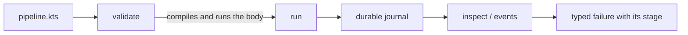
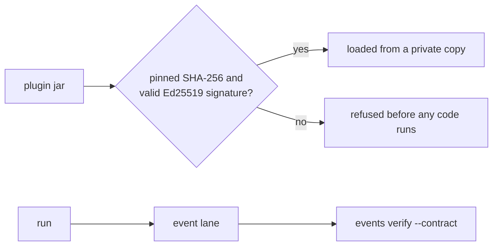
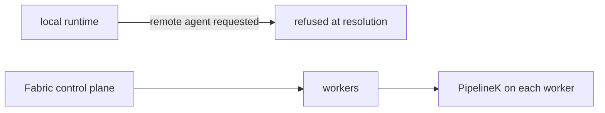
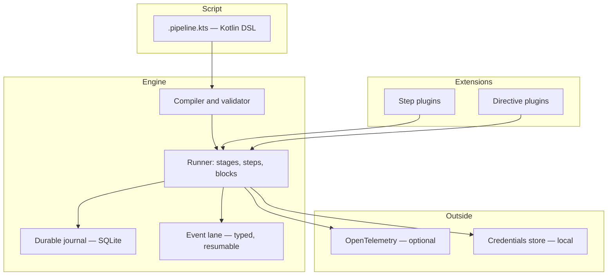

# PipelineK — Build, Verify & Execute with Confidence

[](https://github.com/Rubentxu/pipeline-kotlin/releases)
[](LICENSE)
[](https://adoptium.net/)
[](https://kotlinlang.org/)

**A local-first CI/CD engine with a Jenkins-familiar Kotlin DSL.**
PipelineK compiles, validates and runs your pipelines on your own machine, with a durable journal and typed events — no controller, no agent, no remote state.

**English | [Español](README.es.md)**

**[→ Quickstart](#quickstart) · [→ Features](#core-capabilities) · [→ Ecosystem](#plugin-ecosystem)**

---

## Why PipelineK?

Three problems show up in almost every team that runs CI.

**Feedback arrives late.** The pipeline runs minutes away, on someone else's machine, and you find out what broke when the job is already gone. PipelineK runs the same pipeline on your own machine, in seconds, before you push.

**Automation is locked to a provider.** The pipeline is a YAML file in a vendor's dialect, and moving it means rewriting it. PipelineK's pipeline is a Kotlin file you own, and the runner is a single binary with no service behind it.

**Failures are hard to understand.** A red build says "exit code 1" and nothing else. PipelineK emits typed events, journals every step with a fingerprint of its inputs, and attributes a failure to the stage it belongs to.

What PipelineK is **not**: it is not a scheduler, and it does not promise byte-identical builds across different machines. It is a pipeline *engine* — the thing that runs your pipeline, records what happened, and tells you precisely why it failed.

---

## Quickstart

**Requirements:** Java 21 or newer on the `PATH`, and Linux, macOS or Windows (WSL). Nothing needs `sudo`; no daemon starts itself.

```bash
# The newest STABLE release. The digest is published with the release, so the
# bytes you run are the bytes that were signed.
TAG=$(curl -fsSL https://github.com/Rubentxu/pipeline-kotlin/releases.atom \
  | sed -n 's#.*releases/tag/\(v[^"]*\)".*#\1#p' | grep -v -- '-rc' | head -1)
BASE="https://github.com/Rubentxu/pipeline-kotlin/releases/download/${TAG}"

curl -fL -o manifest.json "$BASE/manifest.json"
ASSET=$(grep -o '"pipelinek-[^"]*\.zip"' manifest.json | grep -v sdk | head -1 | tr -d '"')

curl -fL -o "$ASSET" "$BASE/$ASSET"
curl -fL -o SHA256SUMS "$BASE/SHA256SUMS"
grep " ${ASSET}$" SHA256SUMS | sha256sum -c -

unzip -q "$ASSET"
PIPELINEK="./$(basename "$ASSET" .zip)/bin/pipelinek"

"$PIPELINEK" version     # → pipeline 0.95.0
"$PIPELINEK" doctor      # jdk / os / workdir / writable / script cache
```

The ZIP ships `bin/pipelinek` (UNIX) and `bin/pipelinek.bat` (Windows). You are left with a `pipelinek-<version>/` directory: use it from there, or put its `bin/` on your `PATH`.

### Your first pipeline

```kotlin
// hello.pipeline.kts
pipeline {
    stages {
        stage("hello") {
            echo("PIPELINE-OK")
        }
    }
}
```

```bash
"$PIPELINEK" validate hello.pipeline.kts   # VALIDATION SUCCESSFUL
"$PIPELINEK" run hello.pipeline.kts        # PIPELINE-OK … Pipeline finished with SUCCESS
```

`validate` compiles the script **and evaluates its body** — a `.pipeline.kts` is trusted code, not data. Use `validate --compile-only` when you only want to know that it compiles.

### Read the run afterwards

Give the run a journal and a control root, and every step, event and output stays readable:

```bash
"$PIPELINEK" run --db state/pipelinek.db --control-root state/ctl hello.pipeline.kts
# {"schema":"pipelinek.launch/1","runId":"34b28ddc-…","correlationId":"…","ownerId":"…","startedAtMs":1730000000000,"status":"Launched"}

"$PIPELINEK" inspect <runId> --db state/pipelinek.db --control-root state/ctl
"$PIPELINEK" events  --db state/pipelinek.db <runId>          # typed events, one JSON per line
"$PIPELINEK" observe <runId> --db state/pipelinek.db --control-root state/ctl --view events
```

`inspect` shows the stages, the steps and their outcomes; `events` reads the event lane; `observe` reads the run's console and output plane. The full verb list is `pipelinek --help`.

### Reading a run from outside

A run's facts are readable from outside the product, and only through the doors the product opens.

**What a consumer may read.** The published read ports are the whole of the read side:

- the event lane, as typed events, paged by sequence (`EventRecordReadPort`);
- the output plane, as committed bytes, addressed by stream and by cursor (`OutputReadPort`);
- the run's state, as an observation (`RuntimeObservation`).

**What a consumer may not do.** The write side of the event store, the output append port, the recovery entry point and the run's identity are not part of any published contract. A consumer that appended to a run's event lane, or committed to its output plane, would be a second authority over the facts of that run: read the plane, but do not write it, do not reserve it, do not recover it and do not prune it.

**Two doors, one fact.** The command line reads a run from the store; the service reads the same run from the same store and answers on a socket. `pipelinek inspect --state` and `pipelinek inspect --state --endpoint <socket>` print the same line and exit with the same code, because the value behind both is the same `RuntimeObservation`.

---

## Use the SDK from Maven or Gradle

The SDK is seven coordinates under the group `dev.rubentxu.pipelinek`:

| Coordinate | What it is |
|---|---|
| `pipelinek-domain` | the contracts: steps, events, outputs and the domains around them |
| `pipelinek-scripting-api` | the Kotlin DSL that writes a pipeline |
| `pipelinek-events` | the typed event lane |
| `pipelinek-output` | the output plane |
| `pipelinek-runtime-api` | the runtime API a plugin talks to |
| `pipelinek-service-client` | the client of the local service, and the vocabulary of its wire |
| `pipelinek-sdk-bom` | the BOM: pins the six above at one version |

The six contracts are **experimental** — the maturity of each one is declared in
`pipelinek/contract/published-contract-maturity.json` and printed by
`pipelinek capabilities`.

### Where the SDK is today

The SDK travels as `pipelinek-<version>.sdk.zip`, an asset of the GitHub release: a
Maven repository inside a ZIP. Unzip it and point your build at the directory.

```bash
curl -fL -o sdk.zip \
  https://github.com/Rubentxu/pipeline-kotlin/releases/download/v0.95.0/pipelinek-0.95.0.sdk.zip
unzip -q sdk.zip -d sdk
```

```kotlin
// build.gradle.kts
repositories {
    maven { url = uri("file://${System.getProperty("user.dir")}/sdk") }
}
dependencies {
    implementation("dev.rubentxu.pipelinek:pipelinek-domain:0.95.0")
    implementation("dev.rubentxu.pipelinek:pipelinek-scripting-api:0.95.0")
}
```

```xml
<!-- pom.xml -->
<repository>
  <id>pipelinek-sdk</id>
  <url>file://${project.basedir}/sdk</url>
</repository>
```

### The two remote channels

Both are wired, measured and fail-closed, and they serve the same seven coordinates
with the same bytes.

- **Maven Central**, through its portal. The bundle carries `sources.jar`,
  `javadoc.jar` and a detached signature for every artifact, signed with the key
  whose fingerprint this repository publishes (`RELEASE-SIGNING.md`). It needs a
  namespace and a token in the publisher's account, and the promotion certification
  of the candidate.
- **The Maven registry of GitHub Packages**, at
  `https://maven.pkg.github.com/Rubentxu/pipeline-kotlin`. The same coordinates and
  the same bytes; a build proves it before publishing that the bytes it serves are
  the bytes the signed bundle carries. It needs a token with `write:packages`.

**This release renames the coordinates.** The artifacts of the release before this
one were published as `dev.rubentxu.pipeline.v2:pipeline-*`; from this release they
are published as `dev.rubentxu.pipelinek:pipelinek-*`. One release has one name for the same
contracts, and this one carries the name of the solution: a build that depended on
the old names has to move to the new ones.

Both channels are measured the same way, and the measurement is what the channel
is worth: every published file matches the digest of the signed artifact byte for
byte, an independent consumer compiles against the published coordinates, the same
consumer fails to resolve when the SDK's group is withheld, and the admission gate
refuses to publish a version that is already published — a published version is
never replaced. A published coordinate is verifiable against the fingerprint in
`RELEASE-SIGNING.md`.

This is how a consumer resolves the seven coordinates from each channel, with Maven
and with Gradle:

```kotlin
// build.gradle.kts — Maven Central
repositories { mavenCentral() }

// build.gradle.kts — the GitHub Packages registry
repositories {
    maven {
        url = uri("https://maven.pkg.github.com/Rubentxu/pipeline-kotlin")
        credentials {
            username = System.getenv("GITHUB_ACTOR")
            password = System.getenv("GITHUB_TOKEN")
        }
    }
}
```

```xml
<!-- pom.xml — Maven Central -->
<repository>
  <id>central</id>
  <url>https://repo.maven.apache.org/maven2</url>
</repository>

<!-- pom.xml — the GitHub Packages registry -->
<repository>
  <id>github-packages</id>
  <url>https://maven.pkg.github.com/Rubentxu/pipeline-kotlin</url>
</repository>
```

The dependency block is the same in all four cases:

```kotlin
dependencies {
    implementation("dev.rubentxu.pipelinek:pipelinek-domain:0.95.0")
}
```

The GitHub Packages registry asks for a token even to read a public package, so
that channel is for consumers who already hold one; Central is the channel that
needs none.

---

## Core capabilities

| Capability | What it gives you | Status |
|---|---|---|
| **Kotlin DSL** | `pipeline { stages { stage { … } } }` plus real Kotlin control flow, `script {}` blocks, `parallel`, `retry`, `timeout`, `catchError`, `whenGate` | Available |
| **Local execution** | One run per CLI invocation, in your own working directory. No controller, no agent, no daemon that starts itself | Available |
| **Durable journal** | A SQLite journal (`--db`) plus a control root: a killed run leaves a record you can inspect, resume, cancel or recover | Available |
| **Typed events** | `CompilationStarted`, `RunStarted`, `StageStarted`, `StepStarted`, `StepFinished`, `StepFailed`, `RunFinished`, `EchoOutputCaptured` — with the failure's stage attached to the failure event | Available |
| **Structured CLI** | `validate`, `run`, `observe`, `console`, `events`, `inspect`, `credentials`, `doctor`, `version`, `capabilities`, `sdk-info`, `serve`, `runs cancel`, `runs recover` — each verb prints its own usage | Available |
| **Plugin SDK** | `StepContract`, typed codecs, declared capabilities, a manifest with an API range. Plugin authors build against the published SDK alone | Available |
| **Plugin trust** | `--plugin-trust` admits a plugin only if its bytes match the pinned SHA-256 and carry a valid detached Ed25519 signature; `--require-plugin-trust` refuses anything unvouched, before its code runs | Available |
| **OpenTelemetry** | Optional OTLP export of timing, counts and buckets — never payloads. Off unless `PIPELINEK_OTEL_ENABLED=true` | Available |
| **Introspection & recovery** | `inspect`, `runs cancel`, `runs recover`, digested reads, output pinning, refusal retention | **Experimental** |

The last row is the honest one: the capabilities `runtime.inspect.v1`, `runtime.cancel.v1`, `runtime.recover.v1` and `output.pin.v1` are published as **experimental**. `pipelinek capabilities` prints the exact status of every key this build admits.

**What is published:** `output.follow.v2`, `events.follow.v3`, `events.stepoutcome.v1`, `events.failurestage.v1`.

### The local service

`pipelinek serve` runs a local service on a Unix domain socket, so a client can ask about the runs of a machine —and, with the right scope, start one of them or cancel one that is going. It is opt-in in the literal sense: nothing starts it for you, and it serves until you stop it. What it leaves behind when it stops is nothing that RUNS — the socket goes — and what it WROTE stays: the authorizations, the record of the starts and the directory of the supervised runs are the operator's files, next to the socket, and they are not deleted.

```bash
pipelinek serve --db ./state/pipelinek.db --control-root ./state/durable --socket ./state/pipelinek.sock
```

All three paths are required and none of them has a default: the service reads the substrate you name and listens where you say, so what the socket says about a run is comparable with what `inspect --state` says over the same inputs. The service does not create the substrate it serves and does not create the control root it is about to read; a `--db` that is not there is refused by name instead of leaving an empty file where the operator kept their facts. The service writes ONE fact in the substrate, and only when it may cancel: the terminal of a run it closes — the runs it starts write the rest, in the store you named. Opening that store read-write also PREPARES it: the schema is created when it is missing and the write-ahead sidecars appear on every run, so an existing but empty file becomes a store. What the service never does is create the substrate that is not there. What the service writes besides that is its own, next to the socket: the file of the authorizations it owns, the record of the starts (`starts`) and the directory of the supervised runs (`supervisions`).

The socket is a file of the filesystem, and its mode is the boundary. The socket is `rw-------`, and its directory has to be private (`rwx------` when the service creates it) — if the directory grants anything to the group or to others, the service refuses to start rather than publish a socket those users could open.

Every request carries a **credential**: a token the service issued, in the `auth` field. A request without one is refused by name (`not-authorized`), and so is a request about a run the credential's scope does not cover (`run-not-authorized`).

One request per line, one answer per line, in JSON, with the version of the protocol in the `schema` field and the kind of the line in `kind`:

```json
{"schema":"pipelinek.service/2","op":"run.state","runId":"34b28ddc-…","auth":"…"}
{"schema":"pipelinek.service/2","kind":"answer","result":{"state":"terminal","attempt":1,"at":0,"outcome":"succeeded","terminalAt":0}}
{"schema":"pipelinek.service/2","kind":"refused","refusal":{"kind":"unknown-run","runId":"34b28ddc-…"}}
```

The service reads three things: `version` (the version of the product and of the protocol), `health` (the service and the substrate it was composed with) and `run.state` (the state of one run, the same answer `inspect --state` prints over the same store). It can also START a run, CANCEL one and ANSWER the question of one, which are a fourth, a fifth and a sixth door, each with a right of its own. Every refusal carries a name — `unknown-run`, `incompatible-protocol`, `request-too-large`, `too-many-connections`, `not-authorized`, `run-not-authorized`, `too-many-subscriptions`, `start-not-authorized`, `script-not-admitted`, `workspace-not-admitted`, `idempotency-conflict`, `too-many-supervised-runs`, `run-start-refused`, `run-configuration-refused`, `configuration-provider-refused`, `credential-provider-refused`, `cancel-not-authorized`, `run-cancel-refused`, `answer-not-authorized`, `input-answer-refused` — so a client reads a word and not a sentence.

#### Who may ask, and what the boundary really is

The service issues one credential itself the first time it starts and keeps it in the file it owns next to the socket, `authorizations`, mode `0600`. One authorization per line — a token, a label and a scope:

```text
<token> <label> <scope>
```

The scope is `all`, `none`, or the run ids it covers, and it may carry the suffixes `+start`, `+cancel` and `+answer` when the client may also start runs, cancel them and answer their questions. The label is for the operator and **never travels**: a label that travels can be enumerated by a client that presents tokens until one is accepted.

A line may end with a fourth field, `credentials=<id>:<kind>,...`, that names the credentials the runs started by that token may ask for. The kind is the FORM in which the credential may be handed over: `string` (one secret), `file` (a file and the name it had), `private-key` (a key and the passphrase it may carry), `keystore` (a keystore and the password it may carry) and `archive` (an archive of entries). The GRANT says the form and the request does not: a run asks for a credential by name and the authorization says how it may travel, so a controller is never asked for a form the operator did not grant. A credential that is not of the form its grant names is refused (`credential-kind-not-brokered`) instead of being handed over in another one. The field is the allowlist of the broker each run gets: a run receives no secret when it starts and asks for one only when it enters `withCredentials`, over a private socket below `brokers/` next to the service socket. A credential the line does not name is refused by name (`credential-not-granted`) even when the local store holds it, and a run that was started with the broker never falls back to the local store.

A service whose authorizations grant no credential never opens the store and never asks for its passphrase. A service that grants one opens the local store when it starts and **does not start** if the store is missing, cannot be made private to its owner, fails its integrity check or does not unlock with `PIPELINE_STORE_PASSPHRASE` (exit code `4`): a service that waited for the first request would be alive and would refuse every credential of every run. It never asks at a terminal. The limit of the section below applies to the broker too: the token of the run and the socket separate runs from each other, not two live processes of the same user.

Two profiles, and each one says out loud, when the service starts, what it promises:

- **`trusted-local`** (the default) keeps the authorization in that file, and the file is readable by every process of the same user. The boundary is the file system, and the profile says so.
- **`isolated`** reads the authorization from the service's **standard input** and writes it nowhere, so there is no file for another process of the same user to read.

Neither profile separates two processes of the same user, and the service says that too: the JVM does not expose the credentials of the peer of a Unix socket, so nothing in this build can tell who connected. What a credential separates is the *identities the operator names* — a client that presents the token and a client that does not — and not two processes running as the same user. Read it as a boundary over the **service**, not over the **data**: the same substrate is readable from the command line, with no authorization at all.

The service holds sixteen connections at once and serves eight subscriptions at once, and the two budgets are separate on purpose: a subscription occupies its connection while it lasts, while a question occupies it for a line. With one budget, sixteen subscribers could take every slot and deny `version` and `health` — the two questions that say whether the service is alive. A subscription over the budget is refused by name (`too-many-subscriptions`).

A slot is given back when its client is gone, and the service does not wait for the client to say so. Every line the service writes has a deadline (ten seconds): a client that stops reading is closed once one write has waited that long, and its connection and its subscription slot go back to the budget. A street whose run has nothing to say checks, between two rounds, that its client is still there, so a subscriber that leaves while the run is quiet is noticed within a few tens of milliseconds and not at the next frame. The check has one consequence worth knowing: a client that shuts down the sending half of its connection while it keeps reading is, for the service, a client that has left. A subscriber keeps its end open until it has read what it wants.

The `run.state` answer carries the WHOLE observation: the attempt, the lease and its fencing token, the journal position, the tails of the output and the terminal with its outcome. A client that rebuilds it gets the same `RuntimeObservation` the command line renders, and there is no second shape of the same fact.

#### Starting a run

The service can also START a run. It is a separate door with a right of its own, because starting a run is not a question about a run: the scope of a client that may start says so in its own words.

The scope of an authorization grows with the suffix `+start`: `all+start` may read every run AND start runs, `none+start` may start runs and read nothing. A scope without the suffix starts nothing, and the refusal is a name of its own (`start-not-authorized`) — not `not-authorized`, because the token was accepted and what it lacks is the right.

The scope governs READING, and the service does not widen it because a run was started: a `none+start` client receives the `runId` of the run it started, and that identifier is one it cannot ask about with the same credential. A client that has to follow the run it starts needs a scope that reads runs as well (`all+start`).

The operator declares what the service may start, and the declaration is part of the command:

```bash
pipelinek serve --db ./state/pipelinek.db --control-root ./state/durable --socket ./state/pipelinek.sock \
  --scripts ./pipelines --workspaces ./scratch \
  --run-deadline-ms 900000 --max-supervised-runs 4
```

`--scripts` is the directory of the scripts a client may name and `--workspaces` the directory of the workspaces. A client names a script RELATIVE TO that directory —`sub/build.kts` is a name, `/etc/passwd` and `../secret` are not— and a name that leaves the directory —absolute, walking up, or a link that points out of it— is refused by name (`script-not-admitted`, `workspace-not-admitted`). Without `--scripts` the service starts and starts nothing: a service that could run whatever it is asked to run would be a command line with a socket in front of it. `--run-deadline-ms` is how long a supervised run may live, `--start-deadline-ms` how long the service waits for a child to take its lease (30 s by default — raise it on a machine where starting a JVM and compiling a script takes longer, or the service refuses a run that was about to start), `--max-supervised-runs` how many the service watches at once (`too-many-supervised-runs`), and `--run-allow-network` says whether a supervised run may reach the network.

The request names a script and, maybe, a workspace and an idempotency key:

```json
{"schema":"pipelinek.service/2","op":"run.start","script":"build.kts","workspace":"scratch","idempotencyKey":"order-42","auth":"…"}
{"schema":"pipelinek.service/2","kind":"answer","result":{"runId":"34b28ddc-…","correlationId":"…","ownerId":"…","startedAtMs":0}}
```

The answer is the identity of a run and NOT its outcome: the run is still going when the answer is written, and what it concludes is another question's answer (`run.state`). The answer is written only after the child took its lease and printed its own receipt of the launch, so "started" means "this run exists and owns itself".

#### A run with a configuration

The request may also carry a **configuration**: the NAME/VALUE pairs that the steps of THAT run will see in their environment. It is optional, and its absence means "no configuration" — the run is the run it always was.

```json
{"schema":"pipelinek.service/2","op":"run.start","script":"build.kts","idempotencyKey":"order-42","configuration":{"BUILD_PROFILE":"release"},"auth":"…"}
{"schema":"pipelinek.service/2","kind":"answer","result":{"runId":"34b28ddc-…","correlationId":"…","ownerId":"…","startedAtMs":0,"configuration":{"BUILD_PROFILE":"release"}}}
```

The answer **echoes** the configuration, and that is the point: the schema of the wire does not change when an operation gains a field, so a service that does not know the field ignores it in silence and starts the run WITHOUT the configuration — and the client, which sent it and saw a well formed answer, believes in a configuration that is not there. The echo turns that silence into a fact, and the typed client that compares the echo with what it sent turns the fact into a named negative (`unreadable`: the run EXISTS, so the operator has to be able to cancel it).

The configuration is a **public channel, and it says so**. There is no oracle that tells a secret from a plain text, so the service cannot promise to keep a secret: the values are written in the snapshot the service owns (mode `0600`, in its own supervision directory), they are in the environment of the steps, and if a step prints them they are in the output of the run. What the service refuses is the vocabulary of the product — `PIPELINE_*`, `PIPELINEK_*` and `DURABLE_SH_*`, the names the sandbox removes from an environment, and `JAVA_HOME`/`M2_HOME`/`PATH`, which the launcher consumes to build the PATH of a step — by name, with `run-configuration-refused` and a reason (`the-configuration-name-is-reserved`, `the-configuration-name-is-denied`, `the-configuration-name-is-a-path-anchor`, …). A configuration that breaks a rule does not take the client's key: the client can fix it and repeat with the same key.

#### A run whose configuration a controller supplies

The values do not have to travel in the request: the run may name a **provider** and the keys it wants, and the service asks the controller that registered that provider for them BEFORE it launches anything. The controller is a client of the same socket, and its session is made of four operations, each one a line, each one on a connection of its own:

```json
{"schema":"pipelinek.service/2","op":"config.provider.register","provider":"vault","keys":[{"name":"BUILD_PROFILE","type":"string","sensitivity":"non-secret"}],"auth":"…"}
{"schema":"pipelinek.service/2","kind":"answer","result":{"sessionId":"8c3f…","leaseMillis":15000}}
{"schema":"pipelinek.service/2","op":"config.provider.poll","sessionId":"8c3f…","waitMillis":5000,"auth":"…"}
{"schema":"pipelinek.service/2","kind":"answer","result":{"state":"asked","requestId":"b71d…","keys":["BUILD_PROFILE"]}}
{"schema":"pipelinek.service/2","op":"config.provider.answer","sessionId":"8c3f…","requestId":"b71d…","revision":"r7","values":{"BUILD_PROFILE":"release"},"auth":"…"}
{"schema":"pipelinek.service/2","op":"run.start","script":"build.kts","idempotencyKey":"order-42","configurationProvider":{"provider":"vault","keys":["BUILD_PROFILE"]},"auth":"…"}
```

`config.provider.close` ends the session. Every one of them needs the right to START runs, because a session is how a start gets its values. The service never calls the controller: the controller **polls**, holding a call for at most `waitMillis` (the service caps it), and the poll is also what renews the lease of the session. A session that is not renewed lapses, and a run that was waiting for it is refused.

A refusal of any operation of the session has the kind `configuration-provider-refused` and a reason; a start that could not get its values is refused with `run-configuration-refused` and a reason, and it releases the key, so the client can repeat the request with the same key once the controller is back. What the service promises about the answer:

- **Exactly the asked keys, with the declared type.** An answer with a key nobody asked for, or without one that was asked, or with a value that is not a `string`, an `integer` or a `boolean` as declared, is refused to the controller (`answer-key-unexpected`, `answer-key-missing`, `answer-value-wrong-type`) AND fails the run that asked (`provider-answer-refused`): a controller is not given a second try with another value.
- **No secret is configuration.** A key declares a sensitivity, and the only one the service accepts is `non-secret`: a key labelled as a secret is refused when the session registers (`a-secret-is-not-configuration`), and a label the service does not know is not read as `non-secret` (`sensitivity-label-unknown`). The label is a declaration and not a detector — the same warning as before applies to what the controller chooses to send.
- **No fallback.** A provider name belongs to the credential that registered it, and a live duplicate is refused (`provider-name-taken`). A run asks the session of ITS credential and nobody else's: if that session is not there, the run is refused (`provider-not-registered`), and if it closes while the run waits, the refusal is at once (`provider-gone`). A controller that is silent is a `provider-timeout` after a deadline of 10 seconds, and no run was started.
- **One snapshot per run.** The answer is merged under the explicit `configuration` of the request, goes through the same rules, and the run keeps exactly that snapshot. The snapshot gains a `provenance` — the provider, its revision, the digest of what the source gave and the origin and type of each key — and the run re-checks that the digest it carries is the digest of its values.

All of it is askable afterwards, without a value:

```json
{"schema":"pipelinek.service/2","op":"run.configuration","runId":"34b28ddc-…","auth":"…"}
{"schema":"pipelinek.service/2","kind":"answer","result":{"runId":"34b28ddc-…","digest":"…","precedence":["request","provider"],"entries":[{"name":"BUILD_PROFILE","origin":"provider","type":"string"}],"provider":"vault","revision":"r7","sourceDigest":"…"}}
```

`run.configuration` is a read of the run, with the same authorization as `run.state`, and it answers from the snapshot the run itself reads — there is no second store to drift. A provider that took no part leaves `provider`, `revision` and `sourceDigest` out. The service keeps at most four sessions, so the polls that wait cannot fill the threads that answer questions; a fifth registration is refused (`too-many-provider-sessions`). The typed client has one method for each operation (`registerProvider`, `pollProvider`, `answerProvider`, `closeProvider`, `runConfiguration`) and `startRun` takes the reference to the provider.

The configuration is the **lowest** layer of the environment: the `environment { }` of a stage is composed on top of it and the `withEnv` scope on top of that, and the more specific scope wins. The values reach the steps through the environment the run already composes, so there is no new precedence rule to learn.

#### A run whose credentials a controller keeps

The values above were not secrets. A credential is, and the service does not want to hold one: a service that keeps a secret hands it out over a socket to a run that asks for it, and the operator would rather the secret never arrived at all. The controller that starts the run can keep it, and the service asks for it at the moment the run needs it.

```bash
pipelinek serve --db ./state/pipelinek.db --control-root ./state/durable --socket ./state/pipelinek.sock --credential-sessions
```

`--credential-sessions` is an OPT-IN, and it changes what the service holds: with it the service does **not** open the local credential store at all —not the file, not the passphrase— so the only source of a credential is the controller that registered the session of the run. Without it the store is the only source, the four operations of the session are refused by name (`credential-sessions-not-composed`), and a start that names a credential provider is refused before it becomes a claim. The alternative considered and rejected: opening both and preferring the controller —it would make a controller that is gone fall back, in silence, to a secret on disk, which is the one thing this capability promises not to do.

The session is made of four operations, like the configuration one, and the controller **polls** for the requests:

```json
{"schema":"pipelinek.service/2","op":"credential.provider.register","provider":"controller","auth":"…"}
{"schema":"pipelinek.service/2","kind":"answer","result":{"sessionId":"c1d2…","leaseMillis":15000}}
{"schema":"pipelinek.service/2","op":"credential.provider.poll","sessionId":"c1d2…","waitMillis":5000,"auth":"…"}
{"schema":"pipelinek.service/2","kind":"answer","result":{"state":"asked","requestId":"a91f…","correlationId":"34b2…","credentialId":"deploy-key","kind":"string"}}
{"schema":"pipelinek.service/2","op":"credential.provider.answer","sessionId":"c1d2…","requestId":"a91f…","decision":"grant","value":"czNjcjN0…","auth":"…"}
{"schema":"pipelinek.service/2","op":"run.start","script":"build.kts","idempotencyKey":"order-42","credentialProvider":"controller","auth":"…"}
```

`credential.provider.close` ends the session. The value travels as Base64 and is capped at 32 KiB. Every one of the four operations needs the right to START runs, because a session is how a run gets its credentials. What the service promises about the answer:

- **The run asks for it when it needs it, and only then.** The run holds no secret until it enters `withCredentials`; the ask is bound to the run that asked, to the credential that started it and to the credential the operator granted to it.
- **One answer per request, by the session it was handed to.** A second answer to the same `requestId` is refused (`request-unknown`), and so is an answer from another credential or another session (`provider-session-unknown`): the name of the provider belongs to the credential that registered it, and nobody else can answer what it was asked.
- **No fallback, ever.** A controller that denies makes the run fail with `credential-provider-denied`; one that closes its session while the run waits is refused at once (`provider-gone`); one that is silent is a `provider-timeout` after eight seconds. In no case is the credential looked up in the local store or in another provider.
- **The secret travels by the private socket and is written nowhere else.** It is in the request line of the answer, in the socket of the broker of the run and in the environment of the step that asked for it —and nowhere else: not in the store of the events, not in the output plane, not in the observation of the run, not in the argv of the child. The service never renders it: the type that carries it redacts its own `toString`.

Neither profile separates two processes of the same user, and the credential sessions do not change that: what separates identities is the TOKEN the operator issued, and the JVM cannot see the UID of the peer of a Unix socket. The session adds one rule on top of it —a session belongs to the credential that registered it, so a client that presents another one can neither register the name, nor receive what was asked, nor answer the request.

The key is what makes a retry safe: the same key with the same request answers with the SAME run, and the same key with another request is a conflict (`idempotency-conflict`). The promise is durable while the service can write its file — the service keeps the record of the starts in the file it owns next to the socket, `starts` — so a client that retries after a restart gets the run that already started. The CLAIM of a key is written BEFORE the child is launched, and a claim that cannot be written is not a claim: the start is refused by name (`run-start-refused`, with the reason `the-start-cannot-be-recorded`) and no child is launched, because a start that cannot be remembered is a start that cannot be promised. What degrades when the disk refuses the write is the RECORD of a run that already started: the record stays in memory, the client is still answered, and a retry AFTER a restart may start a second run for the same key.

The child is a process, launched through the port that already exists for launching processes, and it is the same `pipelinek run` the operator would write on the command line. The run writes in the same store and the same control root the service reads, so a run started over the socket is a run that `run.state`, `events.follow` and `output.follow` can answer about — and it outlives the connection that asked for it.

A crash is the other side of the same promise. The claim of a key is on the disk BEFORE the child is launched, so a service that died in that window leaves a key whose effect is UNKNOWN: the run may be alive, and the service cannot tell which. A retry with that key is refused by name (`run-start-refused`, with the reason `the-effect-of-this-key-is-unknown`) and no second run is started — the key promises one request, and the service does not guess which of the two it would be. Reconciling that run is the operator's, over the substrate and with the verbs the product already has (`runs cancel`, `runs recover`); the service keeps the correlation of the lost start, which is what lets it be found. The KEY stays claimed while the service lives, and no verb releases it: freeing it is the operator's, over the record of the starts the service owns.

#### Cancelling a run

The service can also CANCEL a run. It is a fifth door with a right of its own, because closing a run is not a question about a run: the scope of a client that may cancel says so in its own words.

The right grows with the suffix `+cancel`, and it composes with `+start`: `all+start+cancel` may read every run, start runs and cancel them. A scope that names no run may not carry the right to cancel — there is nothing for it to cancel — and the service refuses to read such a scope. A client with no right to cancel is refused by name (`cancel-not-authorized`), and the right is asked BEFORE the scope, so a client that may cancel nothing learns nothing about the runs that exist.

```json
{"schema":"pipelinek.service/2","op":"run.cancel","runId":"34b28ddc-…","reason":"the operator changed their mind","auth":"…"}
{"schema":"pipelinek.service/2","kind":"answer","result":{"runId":"34b28ddc-…","outcome":"cancelled","terminalAtMs":1730000000000}}
```

Cancelling CLOSES the run: the child is ended, the run's terminal fact is written in the durable facts, and the run is terminal for every reader afterwards. The order is the contract — the child is gone BEFORE the terminal is written, because only the owner of a run may write its terminal, and the owner of a live run is its child.

The answer is the terminal of the run, and it is DURABLE when the answer travels: the fact is committed before the service answers, so a client that reads the answer and then asks about the run reads the same terminal, and never an EOF where the product promised a fact.

Cancelling twice is not an error. The second call answers `already-cancelled` with the SAME terminal, because a run is closed once and not twice. A run that reached a terminal of its own is not cancelled again, and a run nobody knows is refused by name: both are `run-cancel-refused`, carrying the reason (`the-run-is-already-terminal`, `the-run-is-unknown`).

A cancel never crosses a LIVE lease: the service does not take the lease of a run another process is publishing, and the refusal names the holder (`the-lease-is-held-by-another`). That is why the child is ended first — the child IS the holder, and a holder that is dead is taken over, which is what makes the cancel the RECONCILIATION of a run whose writer died without ever saying how it ended. A writer that is still ALIVE is not reconciled by the verb: it holds the lock, the refusal names it, and the run is freed only when that process ends.

A service that may not cancel runs opens the substrate READ-ONLY and says so when it starts (`substrate read-only`). A service that may cancel them opens it read-write, because the terminal of a cancelled run is a fact and the service is the one that writes it.

#### Answering a question of a run

A run that reaches `input("…")` PUBLISHES a question and waits. The service shows it and takes the answer, as a sixth and a seventh door with ONE right of their own: `+answer`. Listing and answering are both closed to a client without it, because to see a question is to see what the pipeline is about to do.

```json
{"schema":"pipelinek.service/2","op":"inputs.list","runId":"34b28ddc-…","auth":"…"}
{"schema":"pipelinek.service/2","kind":"answer","result":{"inputs":[{"opId":"34b28ddc-…-s0-0","message":"Deploy to production?","ok":"Proceed","publishedAtMs":1730000000000}]}}
{"schema":"pipelinek.service/2","op":"input.answer","runId":"34b28ddc-…","opId":"34b28ddc-…-s0-0","decision":"proceed","auth":"…"}
{"schema":"pipelinek.service/2","kind":"answer","result":{"runId":"34b28ddc-…","opId":"34b28ddc-…-s0-0","decision":"proceed","outcome":"answered"}}
```

The decision is `proceed` or `abort`, and means what it means in the pipeline: `proceed` lets the body of the step run, `abort` closes the step and the body never runs. The right grows with the suffix `+answer` and composes with the others (`all+start+cancel+answer`); a scope that names no run may not carry it. A client without the right is refused by name (`answer-not-authorized`), and the right is asked BEFORE the scope, so a client that may answer nothing learns nothing about the runs that exist.

WHO answered is a fact of the credential and never a claim of the request. The request carries no name: the service writes, as the `submitter` of the run's own history, the label of the authorization the token belongs to. The `declaredSubmitter` a question may show is what the pipeline author WROTE in the step; it says whom they expect and it authorizes nobody.

A question has ONE answer. Two clients that answer at the same time do not make the run continue twice: one is recorded and the other is refused (`input-answer-refused`, reason `the-question-was-already-answered`). Repeating the same answer with the same authorization answers `already-answered`. The other reasons are `the-run-is-unknown`, `the-run-is-already-terminal`, `the-question-is-unknown` and `the-question-expired`, and each one is a refusal and never a silent success.

The state lives on the disk, next to the run, so it survives a restart of the service and a disconnection of the client: the new service lists the question that still waits and takes the answer once, and a question already answered is not asked again.

What this door does NOT do, said once: the channel between the service and the run is a directory of the control root, so any process of the same user with write access to it can still answer; a JVM cannot read the user of the peer of a socket, and the service separates identities that the operator ISSUED, not processes of one user. The `declaredSubmitter` is not an enforced list of responders. Questions published by an older build (no `runId`) and files above 16 KiB are invisible, which fails closed.

#### Subscriptions

A subscription is a connection that stays open and receives a **street** of lines. There are two, and they are never mixed: the events of a run and the console of a run are two different positions with no total order between them, so a client that wants both opens two connections.

```json
{"schema":"pipelinek.service/2","op":"events.follow","runId":"34b28ddc-…","auth":"…","after":"evt-cursor-v1:34b28ddc-%E2%80%93:12"}
{"schema":"pipelinek.service/2","kind":"record","cursor":"evt-cursor-v1:34b28ddc-%E2%80%93:13","hasMore":true,"record":{"type":"event","kind":"RunStarted","sequence":13}}
{"schema":"pipelinek.service/2","kind":"end","reason":"terminal-observed","cursor":"evt-cursor-v1:34b28ddc-%E2%80%93:19"}
```

The console street is the same shape with `op` `output.follow` and a cursor of the other family, `out-frame-ord-v1:<ordinal>`.

`after` is optional: absent means "from the beginning". The cursor is the position the client resumes from, and it travels **decoded**: a token of the other plane, a token that does not decode, and a token minted for another run are three different facts, and all three are refused by name (`invalid-cursor`) before the street opens. The server keeps no state per client — the cursor lives in the client — so reconnecting from the last cursor you persisted loses nothing the store still retains, and two clients of the same run never see each other.

`hasMore` says whether more of that lane follows the record. It does **not** say the run is over: the only end of a street is the `end` line, and a page with `hasMore: false` is not an ending.

The end of a street carries one word, `terminal-observed`: the run's terminal fact was observed. It says nothing about whether the run **succeeded** — that is `run.state`'s answer, or the `outcome` of the terminal event, and a street that carried it would be a second opinion about the run's fate. A street that cannot observe the terminal fact does not end: it refuses, naming the fact that stopped it (`unknown-run`, `cursor-beyond-tail`, `storage-failed`, `output-plane-refused`).

A row of the event history that this build cannot read is not a hole: it travels as a record of its own, with its position and its kind, so a client can act on it instead of guessing.

The socket file is deleted when the service stops. A socket left behind by a crash is recognised for what it is and replaced on the next start; a socket another service is already listening on is never displaced, and a path that is not a socket is never deleted.

#### Talking to the service from a program

The wire's vocabulary is a **published artifact**: `pipelinek-service-client` carries the requests, the refusals, the codec and a typed client, so a consumer writes no copy of any of them.

```kotlin
val client = ServiceClient(Path.of("/run/pipelinek/service.sock"), token, Duration.ofSeconds(10))

when (val answer = client.runState("34b28ddc-…")) {
    is ServiceAnswer.Answered -> println(answer.value)   // a RuntimeObservation
    is ServiceAnswer.Refused -> println(answer.refusal.kind)
    is ServiceAnswer.Unreachable -> println("there is no service")
    is ServiceAnswer.Unreadable -> println("it speaks another protocol")
    ServiceAnswer.TimedOut -> println("it did not answer in time")
}
```

The token is REQUIRED: a client that could be built without one would connect, write a line and be refused with `not-authorized`, and a client that cannot work should not compile.

`runState` returns the same `RuntimeObservation` the command line renders, so the answer a client reads and the line an operator sees are the same fact.

`startRun` asks the service to start a run and returns its identity — the run id, the correlation, the owner and the moment it took its ownership — as a `ServiceRunStart`:

```kotlin
val started = client.startRun("build.kts", workspace = "scratch", idempotencyKey = "order-42")
```

The key makes the retry safe: the same key with the same request answers with the same run, and the same key with another request is refused with `idempotency-conflict`. The client does not own the run: the answer is the identity of a run that keeps going after the connection closes.

`startRun` also takes the configuration of the run, and the returned `ServiceRunStart` carries the configuration the run WILL have:

```kotlin
val started = client.startRun(
    "build.kts",
    idempotencyKey = "order-42",
    configuration = mapOf("BUILD_PROFILE" to "release"),
)
println(started.configuration) // mapOf("BUILD_PROFILE" to "release")
```

The client **compares** the echoed configuration with the one it sent, and a difference is an `unreadable` answer, not a run that quietly has another configuration. The same key with another configuration is an `idempotency-conflict`: the fingerprint of a request covers its configuration, so a key names one request and not one script.

The command line can speak to a service too, with `--endpoint`:

```bash
pipelinek inspect --state --endpoint ./state/pipelinek.sock 34b28ddc-…
```

`--endpoint` is admitted by **one** mode of **one** verb: `inspect --state`, the only surface this CLI publishes that the service answers with the same rendering. Every other verb refuses the option **by name**, and there is no fallback: a service that is not there is reported as not there, never answered from the local store.

The command line reads the token from the `PIPELINEK_SERVICE_TOKEN` variable, or from the file the service owns next to its socket, or from the file `--authorization-file` names. It never prints it: a secret this CLI prints ends up in a scrollback, in a log and in a shell history.

The client's deadline closes the connection it opened and touches nothing else: the questions the service answers are read-only, so a client that goes away leaves a run exactly as it was. A run the client STARTED keeps going: the answer is the identity of a run, not its owner.

#### What it costs

The service saves the cost of ASKING, not the cost of RUNNING. A question over the socket is answered by a process that is already up, so it pays a connection and a line; a verb of the command line pays a JVM start every time. A run the service starts still costs a JVM, because the service launches the same `pipelinek run` you would type: the socket makes the questions about runs cheap and keeps the asker from owning the run, and it does not make the run faster.

The slots of `--max-supervised-runs` go back when the child has EXITED, which is a moment after its terminal can be read. A client that starts the next run the instant it sees the terminal of the last one can be refused with `too-many-supervised-runs`: that refusal means "full for now", and asking again is the answer.

What the service holds does not grow with the number of requests or runs it has served, and each ceiling has a reason. The worker threads are two fixed pools, one for questions and one for starts and cancels, each as big as the connections the service admits at once (`too-many-connections` beyond it). The resident memory of the JVM rises while the pages of its young generation are touched for the first time, and how far it goes depends on the heap the JVM sizes from the memory of the machine; what stays alive after a collection is flat. The descriptors on the event store are the pooled connections plus the reads served at the same moment: SQLite keeps the descriptor of a connection that closed while another connection of the same process holds the file open in WAL mode, reuses it for the next one, and lets all of them go when the service stops. The ceiling is therefore set by the most reads that were ever concurrent, not by how many were made.

`scripts/bench-service-cost.py` measures both costs on the machine in front of it —the start of the command line against a request over the socket, `run.start` and a run to its terminal, and the memory, threads and descriptors of the service before and after the runs, and what is left when it stops— and writes every sample to a JSON report next to the hardware, the JDK and the revision it ran on. It is a measurement and not a gate: it states no threshold, and the figures belong to the machine that produced them.

### Telemetry

Telemetry is optional, and what it carries is **timing, counts and buckets — never payloads**. No script text, no command and no transcript travel in a signal: that content lives in the output plane and in the journal, and a second copy of it in telemetry would be a second place a secret could hide.

| | |
|---|---|
| Attributes | `run.id`, `stage.index`, `step.index`, `script.origin`, `failure.class` |
| Dimensions | `operation_kind`, `status`, `failure_class` |

The conventions are the OpenTelemetry CI/CD ones, pinned at `1.44.0` and declared a release candidate: the pin is part of what the product promises, and it is read from the product, not from the payload. Nothing is exported unless `PIPELINEK_OTEL_ENABLED=true`, and the endpoint, the protocol and the credentials come from the environment — so the same build points at a local Collector, at Tempo, at Jaeger or at nothing at all.

The local service publishes through the same switch, and it measures what a CLIENT pays, not what happened to a run: that is in the Event Plane, and a second copy of it here could disagree with the first. Each request it serves is one span — `pipelinek.service.query`, `pipelinek.service.mutation` or `pipelinek.service.subscription` — and one measurement whose `operation_kind` is `service.query`, `service.mutation` or `service.subscription`. The `status` of the measurement says who has to act: `success`; `refused` when a rule of the service refused what the client asked (the span ends with `failure.class` `rejected`); `worker_error` when the store the service reads from failed or contradicted itself; and `cancelled` when the answer was never delivered, because the client went away or the service was stopping. The span of the last two ends with `failure.class` `failed`.

A span carries `run.id` only when the request was authorized and named a run. A refused request is counted but never named, because a client that is not authorized chooses that text. The credential of the client, the id of an input question, the idempotency key, the script and the configuration of a start never travel, and `run.id` is never a dimension of a metric: it would make one series per run. The span of a request hangs from the session parent of the process, like every outermost span, so a service started with a well-formed `PIPELINEK_OTEL_TRACEPARENT` in its environment joins that trace. A subscription is measured for as long as its connection lives and ends coarsely: its stream returned, or it failed.

---

## Plugin ecosystem

### Official plugins (bundled with the distribution)

| Plugin | Step keys | What it is for |
|---|---|---|
| **SCM Git** | `scm-git.checkout` | Clone a repository into the workspace, with the transcript journaled |
| **HTTP** | `http.request` | Make an HTTP request; needs the `network.egress`, `http.transport` and `credentials.basic` capabilities |
| **JUnit** | `junit.results` | Read JUnit XML reports and publish them as a test outcome |
| **Utilities** | `core-utils.findFiles`, `core-utils.readJson`, `core-utils.readYaml`, `core-utils.sha256`, `core-utils.unzip`, `core-utils.zip`, `core-utils.writeJson`, `core-utils.writeYaml` | File and archive helpers for pipeline scripts |

Four more plugins ship in the distribution as working examples of the contract: `example-uppercase-plugin`, `example-directive-plugin`, `example-block-plugin` and `example-saga-plugin`. Their sources live in [`examples/`](examples/).

### Extended ecosystem

These projects are built around PipelineK. The **0.95.0 column** is the SDK range each one declares against the current release — a project pinned to an older SDK does not load with it.

| Project | What it is | Maturity | 0.95.0 |
|---|---|---|---|
| pipelinek-fabric | Distributed control plane: workers, podman and Kubernetes providers. *Repository not public yet* | Preview | Pinned to 0.62.0 |
| [pipelinek-studio](https://github.com/Rubentxu/pipelinek-studio) | Web UI, MCP stdio server and VS Code extension over a real PipelineK process | Preview | Pinned to 0.48.0-rc1 |
| [pipelinek-policy](https://github.com/Rubentxu/pipelinek-policy) | Policy checks as a plugin (`policy.check`) | Preview | Declares `[0.47.0, 0.49.0)` |
| [pipelinek-assurance](https://github.com/Rubentxu/pipelinek-assurance) | Assurance checks as a plugin | In development | Declares `[0.48.0, 0.52.0)`; its handler cannot execute live yet |
| [pipelinek-saga](https://github.com/Rubentxu/pipelinek-saga) | Saga contract for compensations | In development | Declares no range yet |
| pipelinek-fabric-backstage | Backstage integration for the Fabric control API. *Repository not public yet* | In development | Client is not sealed yet |
| [asdf-pipelinek](https://github.com/Rubentxu/asdf-pipelinek) | Version manager plugin for `asdf` and `mise`: resolves the newest stable release and verifies its SHA-256 | Preview | Resolves 0.95.0 |

**Maturity scale:** *Available* — shipped and supported in the release. *Preview* — works end to end, still moving. *In development* — real code, incomplete contract. *Exploratory* — an idea with a spike.

Nothing above is a promise of compatibility: a project declares the SDK range it was built against, and the runtime refuses a plugin outside that range before its classes load.

### Writing a plugin

A plugin is an independent Gradle build that compiles against the published SDK and nothing else. It declares a `StepContract` — the family key, the descriptor, the typed codecs and the capabilities it requires — and a manifest with the API range it was built against.

The SDK ships with every release as `pipelinek-<version>.sdk.zip`: seven artifacts (`pipelinek-domain`, `pipelinek-events`, `pipelinek-output`, `pipelinek-runtime-api`, `pipelinek-scripting-api`, `pipelinek-service-client`, `pipelinek-sdk-bom`) and a BOM that pins their versions together. `pipelinek sdk-info` prints the group and the exact coordinates a plugin builds against.

A plugin is loaded from `--plugin-jar`. With `--plugin-trust <file>` it is admitted only if its bytes match the SHA-256 the operator pinned and it carries a valid detached Ed25519 signature; with `--require-plugin-trust`, a plugin nobody vouched for is refused before any of its code runs.

---

## Built for developers, agents and platforms

**For developers.** Write a pipeline in the editor you already use, run it on your machine in seconds, and get a typed failure that names the stage. A compiled-script cache makes the second run of the same script fast, and it is private by default: a cache directory that cannot be proven private is not used.

**For agents.** A pipeline is a typed, readable artifact, and every run leaves a machine-readable trail: typed events, a resumable cursor, and a durable journal. An agent can read a run, decide what to do next, and be refused with a precise reason when the answer is not there.

**For platform teams.** One binary, no daemon that starts itself, no controller, no remote state. The runtime is designed to be embedded: a plugin declares the capabilities it needs, and the engine refuses anything it did not declare. The network is behind a capability — a plugin that wants to reach it declares `network.egress`, and a step that wants it must have declared it.

---

## Real-world workflows

### Local CI

The pipeline runs where the code is. The loop is: edit, validate, run, read the failure.



### Trusted verification

A plugin brought from outside is admitted only against bytes you pinned, and a run's event lane can be checked against a contract you wrote.



### Distributed execution

**Not in this runtime.** `agent(remoteUri = …)` is carried by the DSL and refused at resolution, because there is no remote allocator here. Distributed execution lives in **pipelinek-fabric**, a separate project on its own release line whose repository is not public yet.



---

## Architecture at a glance



Each boundary has one owner. The runner owns the write authority over a run; the journal is the durable record; the event lane is the read side a consumer paginates by cursor; plugins are admitted, never trusted by default.

- **CLI surface** — `pipelinek --help`
- **Contracts** — the KDoc on `StepContext.kt` (`:pipeline-step-sdk`), `RunTelemetry.kt` (`:pipeline-runtime-api`), `OutputReadPort.kt` (`:pipeline-output`) and `EventRecordReadPort.kt` (`:pipeline-events`)
- **API reference** — `./pipelinek/gradlew -p pipelinek apiReferenceHtml`
- **Release provenance** — [RELEASE-SIGNING.md](RELEASE-SIGNING.md)

---

## Why choose PipelineK?

| If you need… | PipelineK… | Instead of… |
|---|---|---|
| A pipeline you can read and type-check | …is a Kotlin file, compiled before it runs | A YAML dialect owned by a provider |
| Feedback in seconds on your own machine | …runs locally, one binary, no service | A remote job queue with a queueing delay |
| A failure you can act on | …names the stage, the step and the outcome in typed events | "exit code 1" in a log tail |
| An auditable run | …journals every step and resumes a cursor for reading | A log file nobody can page through |
| Extensibility without a fork | …admits plugins by declared capability and API range | Forking the engine to add one step |
| Distributed execution | …is **not** this: it needs Fabric, on its own release line | Assuming a local runner schedules workers |

**Where it complements rather than replaces.** PipelineK does not try to be Jenkins or GitHub Actions: it has no controller, no agent protocol and no hosted runners. Its natural place is beside them — as the local engine that runs the same pipeline a developer runs, and as the runtime that a distributed platform such as Fabric drives.

**Limitations it keeps.** One run per invocation. No built-in scheduling. No provider-specific marketplace. No guarantee of identical builds on different machines. Remote allocation is refused by this runtime.

---

## Getting involved

**Try it.** [Download a release](https://github.com/Rubentxu/pipeline-kotlin/releases) and follow the [Quickstart](#quickstart). The multi-version installer keeps several releases side by side:

```bash
curl -fL -o install-pipelinek.sh \
  "https://raw.githubusercontent.com/Rubentxu/pipeline-kotlin/main/scripts/install-pipelinek.sh"
./install-pipelinek.sh install 0.95.0   # download, verify, install
./install-pipelinek.sh use 0.95.0       # switch the active release
export PATH="$HOME/.local/share/pipelinek/current/bin:${PATH}"
```

`asdf` and `mise` install PipelineK through the [asdf-pipelinek](https://github.com/Rubentxu/asdf-pipelinek) plugin:

```bash
asdf plugin add pipelinek https://github.com/Rubentxu/asdf-pipelinek
asdf install pipelinek 0.95.0

mise plugins add pipelinek https://github.com/Rubentxu/asdf-pipelinek
mise install pipelinek@0.95.0
```

**Explore.** [`examples/`](examples/) holds the four example plugins and an observability example — a local Collector configuration, PromQL and TraceQL queries, and a Grafana dashboard that runs them. The [catalogue of examples](examples/catalogue/) holds the worked examples of the capabilities above: each one is a pipeline you can run, with a README that explains its stages, its steps and what it expects. The release harness is what runs them. `pipelinek capabilities` and `pipelinek sdk-info` print what this build admits and what a plugin builds against.

**Build a plugin.** The contract, the SDK and the trust flags are in [Writing a plugin](#writing-a-plugin). The four examples under `examples/` are exactly that, and they build outside this repository's build.

**How the build is verified.** `scripts/verify-all.sh` runs three legs: **unit tests** for the domain rules, **integration tests** that compose two or more real modules with every effect that would leave the process replaced by a fake, and **mutants** over the seams the modules declare — a surviving mutant is a hole in the test that was supposed to kill it. The gate also reads this README against the code: `DocumentationDriftTest` fails when the two disagree, so this document cannot promise what the build does not do.

**Report an issue.** [Open an issue](https://github.com/Rubentxu/pipeline-kotlin/issues) with the version from `pipelinek version` and the output of `pipelinek doctor`.

**Contribute.** [AGENTS.md](AGENTS.md) states how the build is verified and what is out of bounds. The repository is MIT licensed — see [LICENSE](LICENSE).

**Authorship.** The copyright holder declares that every author, committer and contributor name, e-mail address and account in the history of this repository (for example `Ruben`, `Rubentxu`, `RubentxuDev`, `Haizea`, `Ilargia`, `Pablo Cabrera`, `SocketStudio`, `Nomeacuerdo`, `haizea-cg`, `ilargia15` and `JuanNadie74`) is an alias, an additional account or an e-mail address of the copyright holder himself, not of a third party, and that the automated agents and bots in it acted on his instructions. This is the holder's own declaration; it is not checked against any identity record.

---

<sub>PipelineK is under active development. Capabilities marked *experimental* may change; the published capabilities above are the ones this release guarantees.</sub>
