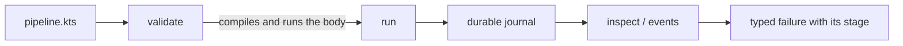
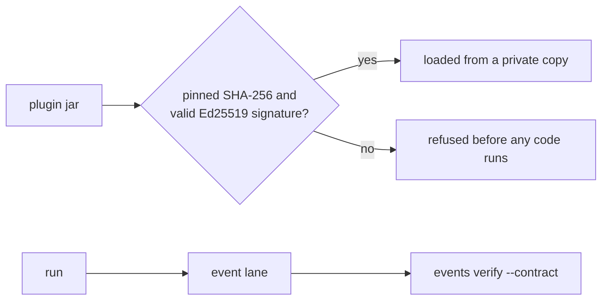
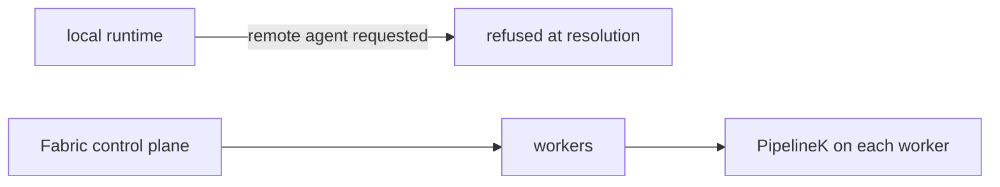
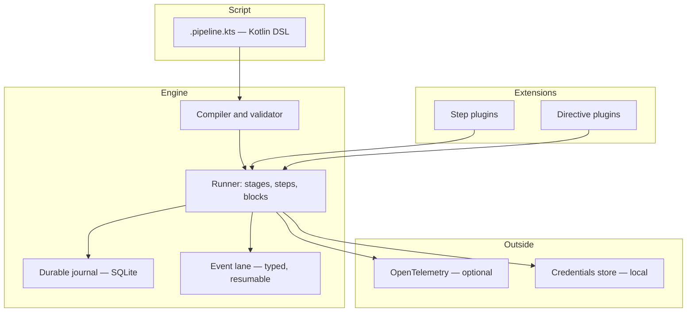

# PipelineK — Build, Verify & Execute with Confidence

[](https://github.com/Rubentxu/pipeline-kotlin/releases)
[](LICENSE)
[](https://adoptium.net/)
[](https://kotlinlang.org/)

**A local-first CI/CD engine with a Jenkins-familiar Kotlin DSL.**
PipelineK compiles, validates and runs your pipelines on your own machine, with a durable journal and typed events — no controller, no agent, no remote state.

**English | [Español](README.es.md)**

**[→ Quickstart](#quickstart) · [→ Features](#core-capabilities) · [→ Ecosystem](#plugin-ecosystem)**

---

## Why PipelineK?

Three problems show up in almost every team that runs CI.

**Feedback arrives late.** The pipeline runs minutes away, on someone else's machine, and you find out what broke when the job is already gone. PipelineK runs the same pipeline on your own machine, in seconds, before you push.

**Automation is locked to a provider.** The pipeline is a YAML file in a vendor's dialect, and moving it means rewriting it. PipelineK's pipeline is a Kotlin file you own, and the runner is a single binary with no service behind it.

**Failures are hard to understand.** A red build says "exit code 1" and nothing else. PipelineK emits typed events, journals every step with a fingerprint of its inputs, and attributes a failure to the stage it belongs to.

What PipelineK is **not**: it is not a scheduler, and it does not promise byte-identical builds across different machines. It is a pipeline *engine* — the thing that runs your pipeline, records what happened, and tells you precisely why it failed.

---

## Quickstart

**Requirements:** Java 21 or newer on the `PATH`, and Linux, macOS or Windows (WSL). Nothing needs `sudo`; no daemon starts itself.

```bash
# The newest STABLE release. The digest is published with the release, so the
# bytes you run are the bytes that were signed.
TAG=$(curl -fsSL https://github.com/Rubentxu/pipeline-kotlin/releases.atom \
  | sed -n 's#.*releases/tag/\(v[^"]*\)".*#\1#p' | grep -v -- '-rc' | head -1)
BASE="https://github.com/Rubentxu/pipeline-kotlin/releases/download/${TAG}"

curl -fL -o manifest.json "$BASE/manifest.json"
ASSET=$(grep -o '"pipelinek-[^"]*\.zip"' manifest.json | grep -v sdk | head -1 | tr -d '"')

curl -fL -o "$ASSET" "$BASE/$ASSET"
curl -fL -o SHA256SUMS "$BASE/SHA256SUMS"
grep " ${ASSET}$" SHA256SUMS | sha256sum -c -

unzip -q "$ASSET"
PIPELINEK="./$(basename "$ASSET" .zip)/bin/pipelinek"

"$PIPELINEK" version     # → pipeline 0.95.0
"$PIPELINEK" doctor      # jdk / os / workdir / writable / script cache
```

The ZIP ships `bin/pipelinek` (UNIX) and `bin/pipelinek.bat` (Windows). You are left with a `pipelinek-<version>/` directory: use it from there, or put its `bin/` on your `PATH`.

### Your first pipeline

```kotlin
// hello.pipeline.kts
pipeline {
    stages {
        stage("hello") {
            echo("PIPELINE-OK")
        }
    }
}
```

```bash
"$PIPELINEK" validate hello.pipeline.kts   # VALIDATION SUCCESSFUL
"$PIPELINEK" run hello.pipeline.kts        # PIPELINE-OK … Pipeline finished with SUCCESS
```

`validate` compiles the script **and evaluates its body** — a `.pipeline.kts` is trusted code, not data. Use `validate --compile-only` when you only want to know that it compiles.

### Read the run afterwards

Give the run a journal and a control root, and every step, event and output stays readable:

```bash
"$PIPELINEK" run --db state/pipelinek.db --control-root state/ctl hello.pipeline.kts
# {"schema":"pipelinek.launch/1","runId":"34b28ddc-…","status":"Launched"}

"$PIPELINEK" inspect <runId> --db state/pipelinek.db --control-root state/ctl
"$PIPELINEK" events  --db state/pipelinek.db <runId>          # typed events, one JSON per line
"$PIPELINEK" observe <runId> --db state/pipelinek.db --control-root state/ctl --view events
```

`inspect` shows the stages, the steps and their outcomes; `events` reads the event lane; `observe` reads the run's console and output plane. The full verb list is `pipelinek --help`.

### Reading a run from outside

A run's facts are readable from outside the product, and only through the doors the product opens.

**What a consumer may read.** The published read ports are the whole of the read side:

- the event lane, as typed events, paged by sequence (`EventRecordReadPort`);
- the output plane, as committed bytes, addressed by stream and by cursor (`OutputReadPort`);
- the run's state, as an observation (`RuntimeObservation`).

**What a consumer may not do.** The write side of the event store, the output append port, the recovery entry point and the run's identity are not part of any published contract. A consumer that appended to a run's event lane, or committed to its output plane, would be a second authority over the facts of that run: read the plane, but do not write it, do not reserve it, do not recover it and do not prune it.

**Two doors, one fact.** The command line reads a run from the store; the service reads the same run from the same store and answers on a socket. `pipelinek inspect --state` and `pipelinek inspect --state --endpoint <socket>` print the same line and exit with the same code, because the value behind both is the same `RuntimeObservation`.

---

## Use the SDK from Maven or Gradle

The SDK is seven coordinates under the group `dev.rubentxu.pipelinek`:

| Coordinate | What it is |
|---|---|
| `pipelinek-domain` | the contracts: steps, events, outputs and the domains around them |
| `pipelinek-scripting-api` | the Kotlin DSL that writes a pipeline |
| `pipelinek-events` | the typed event lane |
| `pipelinek-output` | the output plane |
| `pipelinek-runtime-api` | the runtime API a plugin talks to |
| `pipelinek-service-client` | the client of the local service, and the vocabulary of its wire |
| `pipelinek-sdk-bom` | the BOM: pins the six above at one version |

The six contracts are **experimental** — the maturity of each one is declared in
`pipelinek/contract/published-contract-maturity.json` and printed by
`pipelinek capabilities`.

### Where the SDK is today

The SDK travels as `pipelinek-<version>.sdk.zip`, an asset of the GitHub release: a
Maven repository inside a ZIP. Unzip it and point your build at the directory.

```bash
curl -fL -o sdk.zip \
  https://github.com/Rubentxu/pipeline-kotlin/releases/download/v0.95.0/pipelinek-0.95.0.sdk.zip
unzip -q sdk.zip -d sdk
```

```kotlin
// build.gradle.kts
repositories {
    maven { url = uri("file://${System.getProperty("user.dir")}/sdk") }
}
dependencies {
    implementation("dev.rubentxu.pipelinek:pipelinek-domain:0.95.0")
    implementation("dev.rubentxu.pipelinek:pipelinek-scripting-api:0.95.0")
}
```

```xml
<!-- pom.xml -->
<repository>
  <id>pipelinek-sdk</id>
  <url>file://${project.basedir}/sdk</url>
</repository>
```

### The two remote channels

Both are wired, measured and fail-closed, and they serve the same seven coordinates
with the same bytes.

- **Maven Central**, through its portal. The bundle carries `sources.jar`,
  `javadoc.jar` and a detached signature for every artifact, signed with the key
  whose fingerprint this repository publishes (`RELEASE-SIGNING.md`). It needs a
  namespace and a token in the publisher's account, and the promotion certification
  of the candidate.
- **The Maven registry of GitHub Packages**, at
  `https://maven.pkg.github.com/Rubentxu/pipeline-kotlin`. The same coordinates and
  the same bytes; a build proves it before publishing that the bytes it serves are
  the bytes the signed bundle carries. It needs a token with `write:packages`.

**This release renames the coordinates.** The artifacts of the release before this
one were published as `dev.rubentxu.pipeline.v2:pipeline-*`; from this release they
are published as `dev.rubentxu.pipelinek:pipelinek-*`. One release has one name for the same
contracts, and this one carries the name of the solution: a build that depended on
the old names has to move to the new ones.

Both channels are measured the same way, and the measurement is what the channel
is worth: every published file matches the digest of the signed artifact byte for
byte, an independent consumer compiles against the published coordinates, the same
consumer fails to resolve when the SDK's group is withheld, and the admission gate
refuses to publish a version that is already published — a published version is
never replaced. A published coordinate is verifiable against the fingerprint in
`RELEASE-SIGNING.md`.

This is how a consumer resolves the seven coordinates from each channel, with Maven
and with Gradle:

```kotlin
// build.gradle.kts — Maven Central
repositories { mavenCentral() }

// build.gradle.kts — the GitHub Packages registry
repositories {
    maven {
        url = uri("https://maven.pkg.github.com/Rubentxu/pipeline-kotlin")
        credentials {
            username = System.getenv("GITHUB_ACTOR")
            password = System.getenv("GITHUB_TOKEN")
        }
    }
}
```

```xml
<!-- pom.xml — Maven Central -->
<repository>
  <id>central</id>
  <url>https://repo.maven.apache.org/maven2</url>
</repository>

<!-- pom.xml — the GitHub Packages registry -->
<repository>
  <id>github-packages</id>
  <url>https://maven.pkg.github.com/Rubentxu/pipeline-kotlin</url>
</repository>
```

The dependency block is the same in all four cases:

```kotlin
dependencies {
    implementation("dev.rubentxu.pipelinek:pipelinek-domain:0.95.0")
}
```

The GitHub Packages registry asks for a token even to read a public package, so
that channel is for consumers who already hold one; Central is the channel that
needs none.

---

## Core capabilities

| Capability | What it gives you | Status |
|---|---|---|
| **Kotlin DSL** | `pipeline { stages { stage { … } } }` plus real Kotlin control flow, `script {}` blocks, `parallel`, `retry`, `timeout`, `catchError`, `whenGate` | Available |
| **Local execution** | One run per CLI invocation, in your own working directory. No controller, no agent, no daemon that starts itself | Available |
| **Durable journal** | A SQLite journal (`--db`) plus a control root: a killed run leaves a record you can inspect, resume, cancel or recover | Available |
| **Typed events** | `CompilationStarted`, `RunStarted`, `StageStarted`, `StepStarted`, `StepFinished`, `StepFailed`, `RunFinished`, `EchoOutputCaptured` — with the failure's stage attached to the failure event | Available |
| **Structured CLI** | `validate`, `run`, `observe`, `console`, `events`, `inspect`, `credentials`, `doctor`, `version`, `capabilities`, `sdk-info`, `serve`, `runs cancel`, `runs recover` — each verb prints its own usage | Available |
| **Plugin SDK** | `StepContract`, typed codecs, declared capabilities, a manifest with an API range. Plugin authors build against the published SDK alone | Available |
| **Plugin trust** | `--plugin-trust` admits a plugin only if its bytes match the pinned SHA-256 and carry a valid detached Ed25519 signature; `--require-plugin-trust` refuses anything unvouched, before its code runs | Available |
| **OpenTelemetry** | Optional OTLP export of timing, counts and buckets — never payloads. Off unless `PIPELINEK_OTEL_ENABLED=true` | Available |
| **Introspection & recovery** | `inspect`, `runs cancel`, `runs recover`, digested reads, output pinning, refusal retention | **Experimental** |

The last row is the honest one: the capabilities `runtime.inspect.v1`, `runtime.cancel.v1`, `runtime.recover.v1` and `output.pin.v1` are published as **experimental**. `pipelinek capabilities` prints the exact status of every key this build admits.

**What is published:** `output.follow.v2`, `events.follow.v3`, `events.stepoutcome.v1`, `events.failurestage.v1`.

### The local service

`pipelinek serve` runs a local service on a Unix domain socket, so a supervisor can ask about the runs of a machine without starting a run of its own. It is opt-in in the literal sense: nothing starts it for you, it serves until you stop it, and it leaves nothing behind when it stops.

```bash
pipelinek serve --db ./state/pipelinek.db --control-root ./state/durable --socket ./state/pipelinek.sock
```

All three paths are required and none of them has a default: the service reads the substrate you name and listens where you say, so what the socket says about a run is comparable with what `inspect --state` says over the same inputs. The service never writes to the substrate it serves, and it does not create the control root it is about to read.

The socket is a file of the filesystem, and its mode is the boundary. The socket is `rw-------`, and its directory has to be private (`rwx------`) — if the directory grants anything to the group or to others, the service refuses to start rather than publish a socket those users could open.

One request per line, one answer per line, in JSON, with the version of the protocol in the `schema` field and the kind of the line in `kind`:

```json
{"schema":"pipelinek.service/2","op":"run.state","runId":"34b28ddc-…"}
{"schema":"pipelinek.service/2","kind":"answer","result":{"state":"terminal","attempt":1,"at":0,"outcome":"succeeded","terminalAt":0}}
{"schema":"pipelinek.service/2","kind":"refused","refusal":{"kind":"unknown-run","runId":"34b28ddc-…"}}
```

The service reads three things: `version` (the version of the product and of the protocol), `health` (the service and the substrate it was composed with) and `run.state` (the state of one run, the same answer `inspect --state` prints over the same store). Every refusal carries a name — `unknown-run`, `incompatible-protocol`, `request-too-large`, `too-many-connections` — so a client reads a word and not a sentence.

The `run.state` answer carries the WHOLE observation: the attempt, the lease and its fencing token, the journal position, the tails of the output and the terminal with its outcome. A client that rebuilds it gets the same `RuntimeObservation` the command line renders, and there is no second shape of the same fact.

#### Subscriptions

A subscription is a connection that stays open and receives a **street** of lines. There are two, and they are never mixed: the events of a run and the console of a run are two different positions with no total order between them, so a client that wants both opens two connections.

```json
{"schema":"pipelinek.service/2","op":"events.follow","runId":"34b28ddc-…","after":"evt-cursor-v1:34b28ddc-%E2%80%93:12"}
{"schema":"pipelinek.service/2","kind":"record","cursor":"evt-cursor-v1:34b28ddc-%E2%80%93:13","hasMore":true,"record":{"type":"event","kind":"RunStarted","sequence":13}}
{"schema":"pipelinek.service/2","kind":"end","reason":"terminal-observed","cursor":"evt-cursor-v1:34b28ddc-%E2%80%93:19"}
```

The console street is the same shape with `op` `output.follow` and a cursor of the other family, `out-frame-ord-v1:<ordinal>`.

`after` is optional: absent means "from the beginning". The cursor is the position the client resumes from, and it travels **decoded**: a token of the other plane, a token that does not decode, and a token minted for another run are three different facts, and all three are refused by name (`invalid-cursor`) before the street opens. The server keeps no state per client — the cursor lives in the client — so reconnecting from the last cursor you persisted loses nothing the store still retains, and two clients of the same run never see each other.

`hasMore` says whether more of that lane follows the record. It does **not** say the run is over: the only end of a street is the `end` line, and a page with `hasMore: false` is not an ending.

The end of a street carries one word, `terminal-observed`: the run's terminal fact was observed. It says nothing about whether the run **succeeded** — that is `run.state`'s answer, or the `outcome` of the terminal event, and a street that carried it would be a second opinion about the run's fate. A street that cannot observe the terminal fact does not end: it refuses, naming the fact that stopped it (`unknown-run`, `cursor-beyond-tail`, `storage-failed`, `output-plane-refused`).

A row of the event history that this build cannot read is not a hole: it travels as a record of its own, with its position and its kind, so a client can act on it instead of guessing.

The socket file is deleted when the service stops. A socket left behind by a crash is recognised for what it is and replaced on the next start; a socket another service is already listening on is never displaced, and a path that is not a socket is never deleted.

#### Talking to the service from a program

The wire's vocabulary is a **published artifact**: `pipelinek-service-client` carries the requests, the refusals, the codec and a typed client, so a consumer writes no copy of any of them.

```kotlin
val client = ServiceClient(Path.of("/run/pipelinek/service.sock"), Duration.ofSeconds(10))

when (val answer = client.runState("34b28ddc-…")) {
    is ServiceAnswer.Answered -> println(answer.value)   // a RuntimeObservation
    is ServiceAnswer.Refused -> println(answer.refusal.kind)
    is ServiceAnswer.Unreachable -> println("there is no service")
    is ServiceAnswer.Unreadable -> println("it speaks another protocol")
    ServiceAnswer.TimedOut -> println("it did not answer in time")
}
```

`runState` returns the same `RuntimeObservation` the command line renders, so the answer a client reads and the line an operator sees are the same fact.

The command line can speak to a service too, with `--endpoint`:

```bash
pipelinek inspect --state --endpoint ./state/pipelinek.sock 34b28ddc-…
```

`--endpoint` is admitted by **one** mode of **one** verb: `inspect --state`, the only surface this CLI publishes that the service answers with the same rendering. Every other verb refuses the option **by name**, and there is no fallback: a service that is not there is reported as not there, never answered from the local store.

The client's deadline closes the connection it opened and touches nothing else: the service is read-only, so a client that goes away leaves the run exactly as it was.

### Telemetry

Telemetry is optional, and what it carries is **timing, counts and buckets — never payloads**. No script text, no command and no transcript travel in a signal: that content lives in the output plane and in the journal, and a second copy of it in telemetry would be a second place a secret could hide.

| | |
|---|---|
| Attributes | `run.id`, `stage.index`, `step.index`, `script.origin`, `failure.class` |
| Dimensions | `operation_kind`, `status`, `failure_class` |

The conventions are the OpenTelemetry CI/CD ones, pinned at `1.44.0` and declared a release candidate: the pin is part of what the product promises, and it is read from the product, not from the payload. Nothing is exported unless `PIPELINEK_OTEL_ENABLED=true`, and the endpoint, the protocol and the credentials come from the environment — so the same build points at a local Collector, at Tempo, at Jaeger or at nothing at all.

---

## Plugin ecosystem

### Official plugins (bundled with the distribution)

| Plugin | Step keys | What it is for |
|---|---|---|
| **SCM Git** | `scm-git.checkout` | Clone a repository into the workspace, with the transcript journaled |
| **HTTP** | `http.request` | Make an HTTP request; needs the `network.egress`, `http.transport` and `credentials.basic` capabilities |
| **JUnit** | `junit.results` | Read JUnit XML reports and publish them as a test outcome |
| **Utilities** | `core-utils.findFiles`, `core-utils.readJson`, `core-utils.readYaml`, `core-utils.sha256`, `core-utils.unzip`, `core-utils.zip`, `core-utils.writeJson`, `core-utils.writeYaml` | File and archive helpers for pipeline scripts |

Four more plugins ship in the distribution as working examples of the contract: `example-uppercase-plugin`, `example-directive-plugin`, `example-block-plugin` and `example-saga-plugin`. Their sources live in [`examples/`](examples/).

### Extended ecosystem

These projects are built around PipelineK. The **0.95.0 column** is the SDK range each one declares against the current release — a project pinned to an older SDK does not load with it.

| Project | What it is | Maturity | 0.95.0 |
|---|---|---|---|
| pipelinek-fabric | Distributed control plane: workers, podman and Kubernetes providers. *Repository not public yet* | Preview | Pinned to 0.62.0 |
| [pipelinek-studio](https://github.com/Rubentxu/pipelinek-studio) | Web UI, MCP stdio server and VS Code extension over a real PipelineK process | Preview | Pinned to 0.48.0-rc1 |
| [pipelinek-policy](https://github.com/Rubentxu/pipelinek-policy) | Policy checks as a plugin (`policy.check`) | Preview | Declares `[0.47.0, 0.49.0)` |
| [pipelinek-assurance](https://github.com/Rubentxu/pipelinek-assurance) | Assurance checks as a plugin | In development | Declares `[0.48.0, 0.52.0)`; its handler cannot execute live yet |
| [pipelinek-saga](https://github.com/Rubentxu/pipelinek-saga) | Saga contract for compensations | In development | Declares no range yet |
| pipelinek-fabric-backstage | Backstage integration for the Fabric control API. *Repository not public yet* | In development | Client is not sealed yet |
| [asdf-pipelinek](https://github.com/Rubentxu/asdf-pipelinek) | Version manager plugin for `asdf` and `mise`: resolves the newest stable release and verifies its SHA-256 | Preview | Resolves 0.95.0 |

**Maturity scale:** *Available* — shipped and supported in the release. *Preview* — works end to end, still moving. *In development* — real code, incomplete contract. *Exploratory* — an idea with a spike.

Nothing above is a promise of compatibility: a project declares the SDK range it was built against, and the runtime refuses a plugin outside that range before its classes load.

### Writing a plugin

A plugin is an independent Gradle build that compiles against the published SDK and nothing else. It declares a `StepContract` — the family key, the descriptor, the typed codecs and the capabilities it requires — and a manifest with the API range it was built against.

The SDK ships with every release as `pipelinek-<version>.sdk.zip`: seven artifacts (`pipelinek-domain`, `pipelinek-events`, `pipelinek-output`, `pipelinek-runtime-api`, `pipelinek-scripting-api`, `pipelinek-service-client`, `pipelinek-sdk-bom`) and a BOM that pins their versions together. `pipelinek sdk-info` prints the group and the exact coordinates a plugin builds against.

A plugin is loaded from `--plugin-jar`. With `--plugin-trust <file>` it is admitted only if its bytes match the SHA-256 the operator pinned and it carries a valid detached Ed25519 signature; with `--require-plugin-trust`, a plugin nobody vouched for is refused before any of its code runs.

---

## Built for developers, agents and platforms

**For developers.** Write a pipeline in the editor you already use, run it on your machine in seconds, and get a typed failure that names the stage. A compiled-script cache makes the second run of the same script fast, and it is private by default: a cache directory that cannot be proven private is not used.

**For agents.** A pipeline is a typed, readable artifact, and every run leaves a machine-readable trail: typed events, a resumable cursor, and a durable journal. An agent can read a run, decide what to do next, and be refused with a precise reason when the answer is not there.

**For platform teams.** One binary, no daemon that starts itself, no controller, no remote state. The runtime is designed to be embedded: a plugin declares the capabilities it needs, and the engine refuses anything it did not declare. The network is behind a capability — a plugin that wants to reach it declares `network.egress`, and a step that wants it must have declared it.

---

## Real-world workflows

### Local CI

The pipeline runs where the code is. The loop is: edit, validate, run, read the failure.



### Trusted verification

A plugin brought from outside is admitted only against bytes you pinned, and a run's event lane can be checked against a contract you wrote.



### Distributed execution

**Not in this runtime.** `agent(remoteUri = …)` is carried by the DSL and refused at resolution, because there is no remote allocator here. Distributed execution lives in **pipelinek-fabric**, a separate project on its own release line whose repository is not public yet.



---

## Architecture at a glance



Each boundary has one owner. The runner owns the write authority over a run; the journal is the durable record; the event lane is the read side a consumer paginates by cursor; plugins are admitted, never trusted by default.

- **CLI surface** — `pipelinek --help`
- **Contracts** — the KDoc on `StepContext.kt` (`:pipeline-step-sdk`), `RunTelemetry.kt` (`:pipeline-runtime-api`), `OutputReadPort.kt` (`:pipeline-output`) and `EventRecordReadPort.kt` (`:pipeline-events`)
- **API reference** — `./pipelinek/gradlew -p pipelinek apiReferenceHtml`
- **Release provenance** — [RELEASE-SIGNING.md](RELEASE-SIGNING.md)

---

## Why choose PipelineK?

| If you need… | PipelineK… | Instead of… |
|---|---|---|
| A pipeline you can read and type-check | …is a Kotlin file, compiled before it runs | A YAML dialect owned by a provider |
| Feedback in seconds on your own machine | …runs locally, one binary, no service | A remote job queue with a queueing delay |
| A failure you can act on | …names the stage, the step and the outcome in typed events | "exit code 1" in a log tail |
| An auditable run | …journals every step and resumes a cursor for reading | A log file nobody can page through |
| Extensibility without a fork | …admits plugins by declared capability and API range | Forking the engine to add one step |
| Distributed execution | …is **not** this: it needs Fabric, on its own release line | Assuming a local runner schedules workers |

**Where it complements rather than replaces.** PipelineK does not try to be Jenkins or GitHub Actions: it has no controller, no agent protocol and no hosted runners. Its natural place is beside them — as the local engine that runs the same pipeline a developer runs, and as the runtime that a distributed platform such as Fabric drives.

**Limitations it keeps.** One run per invocation. No built-in scheduling. No provider-specific marketplace. No guarantee of identical builds on different machines. Remote allocation is refused by this runtime.

---

## Getting involved

**Try it.** [Download a release](https://github.com/Rubentxu/pipeline-kotlin/releases) and follow the [Quickstart](#quickstart). The multi-version installer keeps several releases side by side:

```bash
curl -fL -o install-pipelinek.sh \
  "https://raw.githubusercontent.com/Rubentxu/pipeline-kotlin/main/scripts/install-pipelinek.sh"
./install-pipelinek.sh install 0.95.0   # download, verify, install
./install-pipelinek.sh use 0.95.0       # switch the active release
export PATH="$HOME/.local/share/pipelinek/current/bin:${PATH}"
```

`asdf` and `mise` install PipelineK through the [asdf-pipelinek](https://github.com/Rubentxu/asdf-pipelinek) plugin:

```bash
asdf plugin add pipelinek https://github.com/Rubentxu/asdf-pipelinek
asdf install pipelinek 0.95.0

mise plugins add pipelinek https://github.com/Rubentxu/asdf-pipelinek
mise install pipelinek@0.95.0
```

**Explore.** [`examples/`](examples/) holds the four example plugins and an observability example — a local Collector configuration, PromQL and TraceQL queries, and a Grafana dashboard that runs them. The [catalogue of examples](examples/catalogue/) holds the worked examples of the capabilities above: each one is a pipeline you can run, with a README that explains its stages, its steps and what it expects. The release harness is what runs them. `pipelinek capabilities` and `pipelinek sdk-info` print what this build admits and what a plugin builds against.

**Build a plugin.** The contract, the SDK and the trust flags are in [Writing a plugin](#writing-a-plugin). The four examples under `examples/` are exactly that, and they build outside this repository's build.

**How the build is verified.** `scripts/verify-all.sh` runs three legs: **unit tests** for the domain rules, **integration tests** that compose two or more real modules with every effect that would leave the process replaced by a fake, and **mutants** over the seams the modules declare — a surviving mutant is a hole in the test that was supposed to kill it. The gate also reads this README against the code: `DocumentationDriftTest` fails when the two disagree, so this document cannot promise what the build does not do.

**Report an issue.** [Open an issue](https://github.com/Rubentxu/pipeline-kotlin/issues) with the version from `pipelinek version` and the output of `pipelinek doctor`.

**Contribute.** [AGENTS.md](AGENTS.md) states how the build is verified and what is out of bounds. The repository is MIT licensed — see [LICENSE](LICENSE).

**Authorship.** The copyright holder declares that every author, committer and contributor name, e-mail address and account in the history of this repository (for example `Ruben`, `Rubentxu`, `RubentxuDev`, `Haizea`, `Ilargia`, `Pablo Cabrera`, `SocketStudio`, `Nomeacuerdo`, `haizea-cg`, `ilargia15` and `JuanNadie74`) is an alias, an additional account or an e-mail address of the copyright holder himself, not of a third party, and that the automated agents and bots in it acted on his instructions. This is the holder's own declaration; it is not checked against any identity record.

---

<sub>PipelineK is under active development. Capabilities marked *experimental* may change; the published capabilities above are the ones this release guarantees.</sub>
