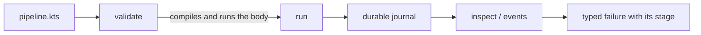
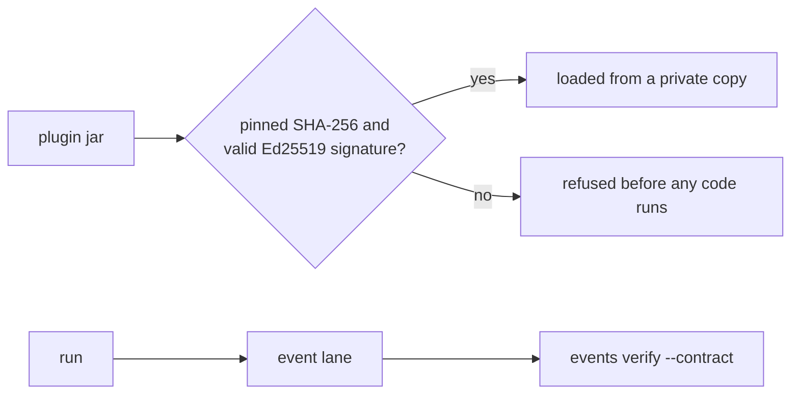
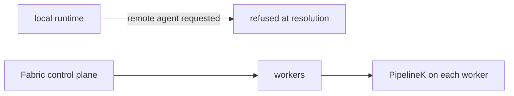
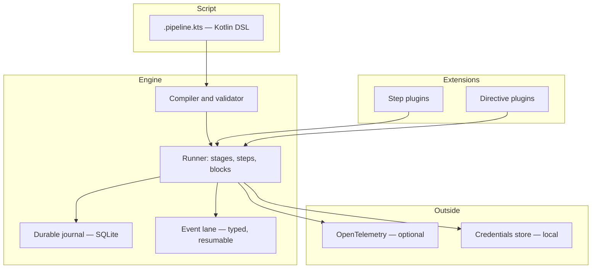

# PipelineK — Build, Verify & Execute with Confidence

[](https://github.com/Rubentxu/pipeline-kotlin/releases)
[](LICENSE)
[](https://adoptium.net/)
[](https://kotlinlang.org/)

**A local-first CI/CD engine with a Jenkins-familiar Kotlin DSL.**
PipelineK compiles, validates and runs your pipelines on your own machine, with a durable journal and typed events — no controller, no agent, no remote state.

**English | [Español](README.es.md)**

**[→ Quickstart](#quickstart) · [→ Features](#core-capabilities) · [→ Ecosystem](#plugin-ecosystem)**

---

## Why PipelineK?

Three problems show up in almost every team that runs CI.

**Feedback arrives late.** The pipeline runs minutes away, on someone else's machine, and you find out what broke when the job is already gone. PipelineK runs the same pipeline on your own machine, in seconds, before you push.

**Automation is locked to a provider.** The pipeline is a YAML file in a vendor's dialect, and moving it means rewriting it. PipelineK's pipeline is a Kotlin file you own, and the runner is a single binary with no service behind it.

**Failures are hard to understand.** A red build says "exit code 1" and nothing else. PipelineK emits typed events, journals every step with a fingerprint of its inputs, and attributes a failure to the stage it belongs to.

What PipelineK is **not**: it is not a scheduler, and it does not promise byte-identical builds across different machines. It is a pipeline *engine* — the thing that runs your pipeline, records what happened, and tells you precisely why it failed.

---

## Quickstart

**Requirements:** Java 21 or newer on the `PATH`, and Linux, macOS or Windows (WSL). Nothing needs `sudo`; nothing starts a daemon.

```bash
# The newest STABLE release. The digest is published with the release, so the
# bytes you run are the bytes that were signed.
TAG=$(curl -fsSL https://github.com/Rubentxu/pipeline-kotlin/releases.atom \
  | sed -n 's#.*releases/tag/\(v[^"]*\)".*#\1#p' | grep -v -- '-rc' | head -1)
BASE="https://github.com/Rubentxu/pipeline-kotlin/releases/download/${TAG}"

curl -fL -o manifest.json "$BASE/manifest.json"
ASSET=$(grep -o '"pipelinek-[^"]*\.zip"' manifest.json | grep -v sdk | head -1 | tr -d '"')

curl -fL -o "$ASSET" "$BASE/$ASSET"
curl -fL -o SHA256SUMS "$BASE/SHA256SUMS"
grep " ${ASSET}$" SHA256SUMS | sha256sum -c -

unzip -q "$ASSET"
PIPELINEK="./$(basename "$ASSET" .zip)/bin/pipelinek"

"$PIPELINEK" version     # → pipeline 0.94.2
"$PIPELINEK" doctor      # jdk / os / workdir / writable / script cache
```

The ZIP ships `bin/pipelinek` (UNIX) and `bin/pipelinek.bat` (Windows). You are left with a `pipelinek-<version>/` directory: use it from there, or put its `bin/` on your `PATH`.

### Your first pipeline

```kotlin
// hello.pipeline.kts
pipeline {
    stages {
        stage("hello") {
            echo("PIPELINE-OK")
        }
    }
}
```

```bash
"$PIPELINEK" validate hello.pipeline.kts   # VALIDATION SUCCESSFUL
"$PIPELINEK" run hello.pipeline.kts        # PIPELINE-OK … Pipeline finished with SUCCESS
```

`validate` compiles the script **and evaluates its body** — a `.pipeline.kts` is trusted code, not data. Use `validate --compile-only` when you only want to know that it compiles.

### Read the run afterwards

Give the run a journal and a control root, and every step, event and output stays readable:

```bash
"$PIPELINEK" run --db state/pipelinek.db --control-root state/ctl hello.pipeline.kts
# {"schema":"pipelinek.launch/1","runId":"34b28ddc-…","status":"Launched"}

"$PIPELINEK" inspect <runId> --db state/pipelinek.db --control-root state/ctl
"$PIPELINEK" events  --db state/pipelinek.db <runId>          # typed events, one JSON per line
"$PIPELINEK" observe <runId> --db state/pipelinek.db --control-root state/ctl --view events
```

`inspect` shows the stages, the steps and their outcomes; `events` reads the event lane; `observe` reads the run's console and output plane. The full verb list is `pipelinek --help`.

---

## Core capabilities

| Capability | What it gives you | Status |
|---|---|---|
| **Kotlin DSL** | `pipeline { stages { stage { … } } }` plus real Kotlin control flow, `script {}` blocks, `parallel`, `retry`, `timeout`, `catchError`, `whenGate` | Available |
| **Local execution** | One run per CLI invocation, in your own working directory. No controller, no agent, no daemon | Available |
| **Durable journal** | A SQLite journal (`--db`) plus a control root: a killed run leaves a record you can inspect, resume, cancel or recover | Available |
| **Typed events** | `CompilationStarted`, `RunStarted`, `StageStarted`, `StepStarted`, `StepFinished`, `StepFailed`, `RunFinished`, `EchoOutputCaptured` — with the failure's stage attached to the failure event | Available |
| **Structured CLI** | `validate`, `run`, `observe`, `console`, `events`, `inspect`, `credentials`, `doctor`, `version`, `capabilities`, `sdk-info`, `runs cancel`, `runs recover` — each verb prints its own usage | Available |
| **Plugin SDK** | `StepContract`, typed codecs, declared capabilities, a manifest with an API range. Plugin authors build against the published SDK alone | Available |
| **Plugin trust** | `--plugin-trust` admits a plugin only if its bytes match the pinned SHA-256 and carry a valid detached Ed25519 signature; `--require-plugin-trust` refuses anything unvouched, before its code runs | Available |
| **OpenTelemetry** | Optional OTLP export of timing, counts and buckets — never payloads. Off unless `PIPELINEK_OTEL_ENABLED=true` | Available |
| **Introspection & recovery** | `inspect`, `runs cancel`, `runs recover`, digested reads, output pinning, refusal retention | **Experimental** |

The last row is the honest one: the capabilities `runtime.inspect.v1`, `runtime.cancel.v1`, `runtime.recover.v1`, `output.read.digested.v1`, `output.pin.v1` and `output.refusal.retention.v1` are published as **experimental**. `pipelinek capabilities` prints the exact status of every key this build admits.

**What is published:** `output.follow.v2`, `events.follow.v3`, `events.stepoutcome.v1`, `events.failurestage.v1`.

---

## Plugin ecosystem

### Official plugins (bundled with the distribution)

| Plugin | Step keys | What it is for |
|---|---|---|
| **SCM Git** | `scm-git.checkout` | Clone a repository into the workspace, with the transcript journaled |
| **HTTP** | `http.request` | Make an HTTP request; needs the `network.egress`, `http.transport` and `credentials.basic` capabilities |
| **JUnit** | `junit.results` | Read JUnit XML reports and publish them as a test outcome |
| **Utilities** | `core-utils.findFiles`, `readJson`, `readYaml`, `sha256`, `unzip`, `zip`, `writeJson`, `writeYaml` | File and archive helpers for pipeline scripts |

Four more plugins ship in the distribution as working examples of the contract: `example-uppercase-plugin`, `example-directive-plugin`, `example-block-plugin` and `example-saga-plugin`. Their sources live in [`examples/`](examples/).

### Extended ecosystem

These projects are built around PipelineK. The **0.94.2 column** is the SDK range each one declares against the current release — a project pinned to an older SDK does not load with it.

| Project | What it is | Maturity | 0.94.2 |
|---|---|---|---|
| pipelinek-fabric | Distributed control plane: workers, podman and Kubernetes providers. *Repository not public yet* | Preview | Pinned to 0.62.0 |
| [pipelinek-studio](https://github.com/Rubentxu/pipelinek-studio) | Web UI, MCP stdio server and VS Code extension over a real PipelineK process | Preview | Pinned to 0.48.0-rc1 |
| [pipelinek-policy](https://github.com/Rubentxu/pipelinek-policy) | Policy checks as a plugin (`policy.check`) | Preview | Declares `[0.47.0, 0.49.0)` |
| [pipelinek-assurance](https://github.com/Rubentxu/pipelinek-assurance) | Assurance checks as a plugin | In development | Declares `[0.48.0, 0.52.0)`; its handler cannot execute live yet |
| [pipelinek-saga](https://github.com/Rubentxu/pipelinek-saga) | Saga contract for compensations | In development | Declares no range yet |
| pipelinek-fabric-backstage | Backstage integration for the Fabric control API. *Repository not public yet* | In development | Client is not sealed yet |
| [asdf-pipelinek](https://github.com/Rubentxu/asdf-pipelinek) | Version manager plugin for `asdf` and `mise`: resolves the newest stable release and verifies its SHA-256 | Preview | Resolves 0.94.2 |

**Maturity scale:** *Available* — shipped and supported in the release. *Preview* — works end to end, still moving. *In development* — real code, incomplete contract. *Exploratory* — an idea with a spike.

Nothing above is a promise of compatibility: a project declares the SDK range it was built against, and the runtime refuses a plugin outside that range before its classes load.

---

## Built for developers, agents and platforms

**For developers.** Write a pipeline in the editor you already use, run it on your machine in seconds, and get a typed failure that names the stage. A compiled-script cache makes the second run of the same script fast, and it is private by default: a cache directory that cannot be proven private is not used.

**For agents.** A pipeline is a typed, readable artifact, and every run leaves a machine-readable trail: typed events, a resumable cursor, and a durable journal. An agent can read a run, decide what to do next, and be refused with a precise reason when the answer is not there.

**For platform teams.** One binary, no daemon, no controller, no remote state. The runtime is designed to be embedded: a plugin declares the capabilities it needs, and the engine refuses anything it did not declare. Telemetry is optional and carries timing and counts — never payloads.

---

## Real-world workflows

### Local CI

The pipeline runs where the code is. The loop is: edit, validate, run, read the failure.



### Trusted verification

A plugin brought from outside is admitted only against bytes you pinned, and a run's event lane can be checked against a contract you wrote.



### Distributed execution

**Not in this runtime.** `agent(remoteUri = …)` is carried by the DSL and refused at resolution, because there is no remote allocator here. Distributed execution lives in **pipelinek-fabric**, a separate project on its own release line whose repository is not public yet.



---

## Architecture at a glance



Each boundary has one owner. The runner owns the write authority over a run; the journal is the durable record; the event lane is the read side a consumer paginates by cursor; plugins are admitted, never trusted by default.

- **CLI surface** — `pipelinek --help`
- **Contracts** — the KDoc on `StepContext.kt` (`:pipeline-step-sdk`), `TelemetryPolicy` (`:pipeline-runtime-api`), `OutputReadPort.kt` (`:pipeline-output`) and `EventRecordReadPort.kt` (`:pipeline-events`)
- **API reference** — `./pipelinek/gradlew -p pipelinek apiReferenceHtml`
- **Release provenance** — [RELEASE-SIGNING.md](RELEASE-SIGNING.md)

---

## Why choose PipelineK?

| If you need… | PipelineK… | Instead of… |
|---|---|---|
| A pipeline you can read and type-check | …is a Kotlin file, compiled before it runs | A YAML dialect owned by a provider |
| Feedback in seconds on your own machine | …runs locally, one binary, no service | A remote job queue with a queueing delay |
| A failure you can act on | …names the stage, the step and the outcome in typed events | "exit code 1" in a log tail |
| An auditable run | …journals every step and resumes a cursor for reading | A log file nobody can page through |
| Extensibility without a fork | …admits plugins by declared capability and API range | Forking the engine to add one step |
| Distributed execution | …is **not** this: it needs Fabric, on its own release line | Assuming a local runner schedules workers |

**Where it complements rather than replaces.** PipelineK does not try to be Jenkins or GitHub Actions: it has no controller, no agent protocol and no hosted runners. Its natural place is beside them — as the local engine that runs the same pipeline a developer runs, and as the runtime that a distributed platform such as Fabric drives.

**Limitations it keeps.** One run per invocation. No built-in scheduling. No provider-specific marketplace. No guarantee of identical builds on different machines. Remote allocation is refused by this runtime.

---

## Getting involved

**Try it.** [Download a release](https://github.com/Rubentxu/pipeline-kotlin/releases) and follow the [Quickstart](#quickstart). The multi-version installer keeps several releases side by side:

```bash
curl -fL -o install-pipelinek.sh \
  "https://raw.githubusercontent.com/Rubentxu/pipeline-kotlin/main/scripts/install-pipelinek.sh"
./install-pipelinek.sh install 0.94.2   # download, verify, install
./install-pipelinek.sh use 0.94.2       # switch the active release
export PATH="$HOME/.local/share/pipelinek/current/bin:${PATH}"
```

`asdf` and `mise` install PipelineK through the [asdf-pipelinek](https://github.com/Rubentxu/asdf-pipelinek) plugin:

```bash
asdf plugin add pipelinek https://github.com/Rubentxu/asdf-pipelinek
asdf install pipelinek 0.94.2

mise plugins add pipelinek https://github.com/Rubentxu/asdf-pipelinek
mise install pipelinek@0.94.2
```

**Explore.** [`examples/`](examples/) holds the four example plugins and an observability example — a local Collector configuration, PromQL and TraceQL queries, and a Grafana dashboard that runs them. `pipelinek capabilities` and `pipelinek sdk-info` print what this build admits and what a plugin builds against.

**Build a plugin.** The SDK is published with every release as `pipelinek-<version>.sdk.zip`, under the group `dev.rubentxu.pipeline.v2` (`pipeline-domain`, `pipeline-events`, `pipeline-output`, `pipeline-runtime-api`, `pipeline-scripting-api`, `pipeline-sdk-bom`). A plugin is an independent Gradle build that compiles against the SDK alone, declares a `StepContract` and a manifest with its API range, and is loaded from `--plugin-jar`. The four examples under `examples/` are exactly that, and they build outside this repository's build.

**Report an issue.** [Open an issue](https://github.com/Rubentxu/pipeline-kotlin/issues) with the version from `pipelinek version` and the output of `pipelinek doctor`.

**Contribute.** [AGENTS.md](AGENTS.md) states how the build is verified and what is out of bounds. The repository is MIT licensed — see [LICENSE](LICENSE).

---

<sub>PipelineK is under active development. Capabilities marked *experimental* may change; the published capabilities above are the ones this release guarantees.</sub>
