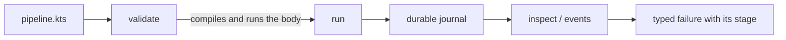
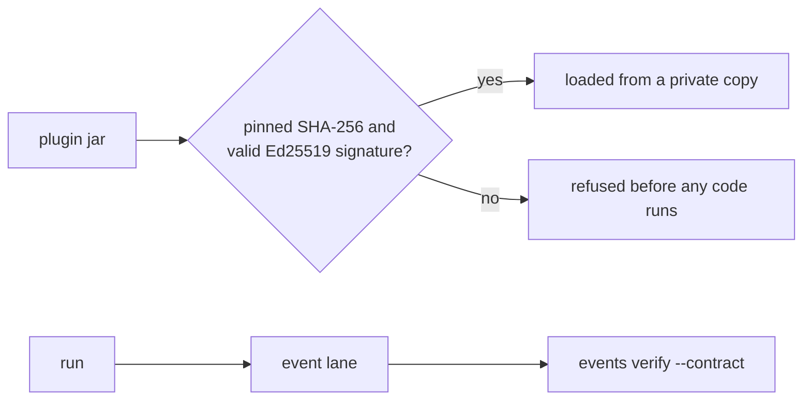
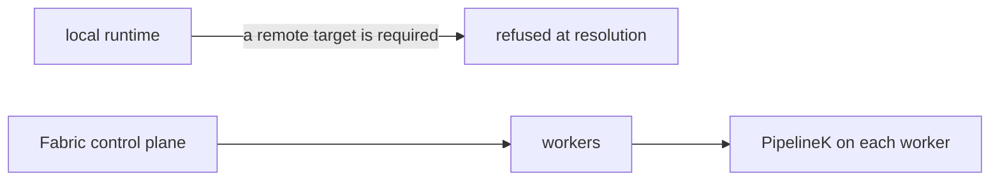
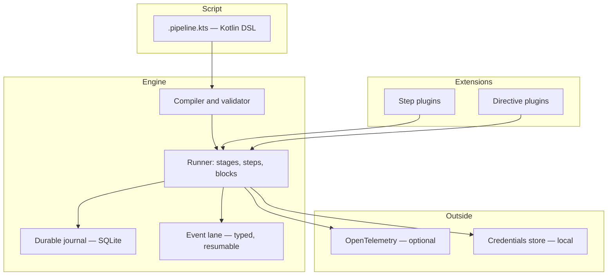

# PipelineK — Build, Verify & Execute with Confidence

[](https://github.com/Rubentxu/pipeline-kotlin/releases)
[](LICENSE)
[](https://adoptium.net/)
[](https://kotlinlang.org/)

**A local-first CI/CD engine with a Jenkins-familiar Kotlin DSL.**
PipelineK compiles, validates and runs your pipelines on your own machine, with a durable journal and typed events — no controller, no agent, no remote state.

**English | [Español](README.es.md)**

**[→ Quickstart](#quickstart) · [→ Features](#core-capabilities) · [→ Ecosystem](#plugin-ecosystem)**

---

## Why PipelineK?

Three problems show up in almost every team that runs CI.

**Feedback arrives late.** The pipeline runs minutes away, on someone else's machine, and you find out what broke when the job is already gone. PipelineK runs the same pipeline on your own machine, in seconds, before you push.

**Automation is locked to a provider.** The pipeline is a YAML file in a vendor's dialect, and moving it means rewriting it. PipelineK's pipeline is a Kotlin file you own, and the runner is a single binary with no service behind it.

**Failures are hard to understand.** A red build says "exit code 1" and nothing else. PipelineK emits typed events, journals every step with a fingerprint of its inputs, and attributes a failure to the stage it belongs to.

What PipelineK is **not**: it is not a scheduler, and it does not promise byte-identical builds across different machines. It is a pipeline *engine* — the thing that runs your pipeline, records what happened, and tells you precisely why it failed.

---

## Quickstart

**Requirements:** Java 21 or newer on the `PATH`, and Linux, macOS or Windows (WSL). Nothing needs `sudo`; no daemon starts itself.

```bash
# The newest STABLE release. The digest is published with the release, so the
# bytes you run are the bytes that were signed.
TAG=$(curl -fsSL https://github.com/Rubentxu/pipeline-kotlin/releases.atom \
  | sed -n 's#.*releases/tag/\(v[^"]*\)".*#\1#p' | grep -v -- '-rc' | head -1)
BASE="https://github.com/Rubentxu/pipeline-kotlin/releases/download/${TAG}"

curl -fL -o manifest.json "$BASE/manifest.json"
ASSET=$(grep -o '"pipelinek-[^"]*\.zip"' manifest.json | grep -v sdk | head -1 | tr -d '"')

curl -fL -o "$ASSET" "$BASE/$ASSET"
curl -fL -o SHA256SUMS "$BASE/SHA256SUMS"
grep " ${ASSET}$" SHA256SUMS | sha256sum -c -

unzip -q "$ASSET"
PIPELINEK="./$(basename "$ASSET" .zip)/bin/pipelinek"

"$PIPELINEK" version     # → pipeline 0.98.0
"$PIPELINEK" doctor      # jdk / os / workdir / writable / script cache
```

The ZIP ships `bin/pipelinek` (UNIX) and `bin/pipelinek.bat` (Windows). You are left with a `pipelinek-<version>/` directory: use it from there, or put its `bin/` on your `PATH`.

### Your first pipeline

```kotlin
// hello.pipeline.kts
pipeline {
    stages {
        stage("hello") {
            echo("PIPELINE-OK")
        }
    }
}
```

```bash
"$PIPELINEK" validate hello.pipeline.kts   # VALIDATION SUCCESSFUL
"$PIPELINEK" run hello.pipeline.kts        # PIPELINE-OK … Pipeline finished with SUCCESS
```

`validate` compiles the script **and evaluates its body** — a `.pipeline.kts` is trusted code, not data. Use `validate --compile-only` when you only want to know that it compiles.

A value the script builds and then drops is a **compile error**, not a step that silently never ran. A `scmGit(...)` that never reaches `checkout(...)` is refused with its line and column, inside a `stage { }` or in a helper function:

```text
build.pipeline.kts:9:13: Unused return value of 'scmGit'. It was coerced to 'Unit' due to a functional parameter type.
VALIDATION FAILED: 1 error
```

The rule covers every result that must be used, the standard library's too (`"x".uppercase()` on its own line is refused; `list.add(x)` is not). A scripted call such as `pwd()` already emits its step, so it compiles in statement position, as it does in a Jenkinsfile.

### Reading a variable of the environment

```kotlin
stage("build") {
    environment { env("TARGET", "staging") }
    sh("echo " + env("TARGET"))
}
```

`env("TARGET")` is how a script reads a variable: the one the stage declares with `environment { }` when it declares one, and otherwise the one the machine that builds the plan has. It is **not** `env.TARGET` — Kotlin has no dynamic properties, so a name that is only known at runtime cannot be a property of an object.

The value is read **while the plan is built**, so it travels inside the plan and a replay reproduces it. A variable that is not defined reads as `null` and not as an empty text, and the material of a credential is never among the answers: a credential reaches the step through the environment of the child process, never through the environment of the engine.

### What the pipeline declares for its stages

```kotlin
pipeline {
    environment {
        env("TARGET", "staging")
        env("REGISTRY", "registry.internal")
    }
    stages {
        stage("build") {
            sh("echo " + env("TARGET"))
        }
        stage("deploy") {
            environment { env("TARGET", "production") }
            sh("echo " + env("TARGET"))
        }
    }
}
```

`environment { }` also exists at **pipeline level**, with the same spelling it has inside a stage. What the pipeline declares is the DEFAULT of its stages: a stage that declares a variable of its own keeps it. The precedence is the one the gate already uses — a declaration beats a value that arrives from outside — and it is decided **name by name**: the `deploy` stage above runs with `TARGET=production` and with `REGISTRY=registry.internal`, and the pipeline's `TARGET` does not reach it.

There is **no `agent`** in the DSL, and that is a decision about the model and not about the spelling: PipelineK does not allocate an executor on an agent, and the run executes on the machine you invoked it on. The `agent { … }` of a Jenkinsfile has no counterpart here —write the steps of the stage directly— and the `node { … }` step of Jenkins has no counterpart here either: the language does not offer it, so a script that writes it does not compile, and a plan that carries its key is still refused. What survives of the agent is not a form but a **directive**: a plan that carries `core.agent` still carries the requirement, and a run that resumes it still checks it, so a stage that asks for a label the machine does not advertise is still refused before its body runs.

The order matters for a **read**: the pipeline's `environment { }` block has to be written **before** the `stages { }` block for a read inside a stage to see it. A read of a variable that is declared later answers the value the machine has, and not `null`: the variable is declared, only too late for that read. The variables reach the steps either way — they are the environment the steps of those stages run with.

A second `environment { }` block at pipeline level **adds** to the first one: the variables of both reach the stages, and the name both of them declare is the one of the later block.

The pipeline's variables are also what a stage's **gate** reads: the `deploy` stage above is gated with the same `TARGET=production` its steps run with, and the pipeline's `REGISTRY` is visible to that gate too.

### `post { }` closes the pipeline, not only a stage

```kotlin
pipeline {
    stages {
        stage("build") { sh("make") }
    }
    post {
        always { echo("the run ended") }
        success { echo("the run succeeded") }
        failure { echo("the run failed") }
    }
}
```

`post { }` also exists at **pipeline level**, with the same spelling and the same seven conditions it has inside a stage (`always`, `success`, `failure`, `unstable`, `aborted`, `unsuccessful`, `cleanup`). A stage's `post` closes **that stage**; the pipeline's closes **the pipeline**, and its conditions are decided over the result of the **whole run**: `success` means that every stage succeeded, `failure` that the run failed, and `aborted` that the run was stopped — which is a different statement from failing.

The engine has a **close point** for the pipeline, and the pipeline's `post` runs there: after the stages, before the run's own bookend. A finalizer that fails fails the run, exactly as a stage's finalizer fails the run it belongs to.

The pipeline's finalizers carry their own durable identity — the stage index **one past the last stage** — so they never share a journal row with a stage's finalizers, and the second attempt of a run finds them where the first attempt left them: the pipeline's `post` is not run again from scratch, the durable model serves the completion it already wrote.

A pipeline that declares no `post` closes with nothing to run.

### The `script { }` block holds steps

```kotlin
stage("build") {
    script {
        val branch = env("BRANCH")
        if (branch == "main") {
            echo("building main")
        }
        sh("make")
    }
}
```

`script { }` is a **block of steps**, the way a Jenkinsfile writes it: `echo("…")` inside it is a `core.echo` and `sh("…")` is a `core.sh`, each one a step of its own, with its own identity and its own policy. It is not a block of shell lines: a `core.sh` executes a subprocess and replays from the beginning, while a `core.echo` reads nothing and replays from its result. The identity of the steps is the identity of Jenkins.

The block carries the receiver of a stage, so it has the whole vocabulary (`echo`, `sh`, `dir`, `retry`, …). A block of shell **lines** is one step, written with `sh("""…""")`.

What the block adds is the Kotlin control flow of the author, and that control flow is evaluated **while the plan is built**: the `if` above decides which arm is declared, before the first step runs. A condition that has to be decided while the run runs is written with the `when*` gates.

### The `steps { }` block holds the steps of a stage

```kotlin
stage("build") {
    steps {
        sh("make")
    }
}
```

`steps { }` is the block a Jenkinsfile writes, and it is here with that name and that shape: the steps declared inside it are the steps of the stage that declares them, in the order they were declared, and the block declares no step of its own.

The body of the stage declares steps too, and the two are **one list**: the steps of the body and the steps of the block, in the order the author wrote them. Neither form is the one the product requires, and neither is the one it refuses.

A block that carries steps has **no authority over the stage**: a declaration that belongs to the stage —the `when*` gates, the declarative `environment`, the `options`, the `post` and the `directives`— is refused where it is written, and the refusal names the declaration, the block it was written in and the place where it belongs. A gate that a nested block dropped in silence would be a gate that does not gate, and the stage would run unconditionally.

### The body of a block declares steps, and nothing else

The body of a `steps { }` block —and of every other block that carries steps— receives a receiver with the **operations** of the DSL and nothing else: the steps it may declare, the wrappers that carry steps of their own, and the steps a plugin publishes. The configuration of the stage is not in that receiver, and that is the point: a `when*` gate, the declarative `environment`, the `options`, the `post` or the `directives` written inside a body are refused by the compiler instead of being dropped in silence.

**What moves for a pipeline that compiles today.** A body that declares steps does not move: the same call declares the same step, with the same values, at stage level and inside a body. Two things do:

- the configuration of the stage written inside a body —the `when*` gates, the declarative `environment`, the `options`, the `post` and the `directives`— no longer compiles. It never ran either: the refusal was already there, where it was written, and it named the declaration and the block. Move the declaration out of the block, to the body of the stage.
- the versioned form of a plugin's step —the one that names the version of the envelope explicitly— is not reachable from a body. The form that does not name it declares the same step, and it is the one a plugin writes.

**What the diagnostic says.** A validation that compiles the script names the declaration that was written in the wrong place, the file and the line it was written in, and what to write instead: `options` belongs to the STAGE, so it is declared in the body of the stage, outside every block that carries steps. What the compiler resolved earns no such advice —a step, a text, a comment, a function of your own with the same name, a plugin's step— because there is nothing wrong with any of them.

A consumer compiled against the previous release keeps linking and keeps running: the object the runtime hands to a body is the stage itself, so a block that a previous release compiled still receives what it expected.

### Edit pipelines in IntelliJ IDEA

The editor resolves a script against the classpath of the module it belongs to, and a `.pipeline.kts` outside any module gets no DSL and no diagnostics. `ide init` writes that module, as a Gradle project, from the installation you run it with:

```bash
"$PIPELINEK" ide init --dir my-pipelines
# ide-project /…/my-pipelines: ready
# created settings.gradle.kts
# created build.gradle.kts
# created gradle.properties
# created pipelines/
# installation /…/pipelinek-<version>/lib
# scripts /…/my-pipelines/pipelines
```

Put the scripts in `my-pipelines/pipelines/` and open `my-pipelines` in IntelliJ IDEA. The project compiles them with the jars in the `lib/` directory of the installation and with the compiler options of its script definition, so the editor marks a dropped `scmGit(...)` as an error at the line and column `validate` names, with the same words, and `compileKotlin` run in that directory refuses it the same way:

```text
e: file:///…/my-pipelines/pipelines/build.pipeline.kts:9:13 Unused return value of 'scmGit'. It was coerced to 'Unit' due to a functional parameter type.
```

- **It never replaces a file.** A directory that holds a different file at one of those paths is refused by name, and nothing is written. A second run on the project it wrote changes nothing.
- **It writes no Gradle wrapper.** IntelliJ IDEA writes one when it opens the project (2026.2 writes one for Gradle 9.6.0); the project builds with Gradle 8.14 and 9.6.
- **The project belongs to one installation.** `build.gradle.kts` names the absolute path of its `lib/` directory. After you install another version, delete `settings.gradle.kts`, `build.gradle.kts` and `gradle.properties` and run `ide init` again with the new launcher. A build whose installation is gone refuses to configure and says so.
- **No backslash in the paths.** Gradle reads a backslash in a path as a separator, so a project directory, an installation or a plugin jar whose path holds one is refused.
- **Your plugins, by path.** The project sees the plugins in the `lib/` directory of the installation and the jars you name with `--plugin-jar <jar>`, once per jar; `build.gradle.kts` names each by its absolute path, and `ide init` prints a `plugin` line for each. Before it writes anything, `ide init` checks those jars — the ones of the installation and the ones you brought — as `run` does before it loads them: their manifests, their API range and, with `--plugin-trust <file>` or `--require-plugin-trust`, your trust decision. A jar whose manifest, API range or trust decision `run` would refuse is refused with the same words and the same absolute path, and nothing is written. What `run` only learns by running the plugins' code is not checked here: a jar that passes these checks can still be one that `run` refuses once it loads it.
- **The check is made when the project is written.** Gradle and the editor read the jars later from those paths, and nothing checks them again: a jar replaced after `ide init` is compiled against as it is. Run `ide init` again with the same options to check them again; the project does not change. A build whose plugin jar is gone refuses to configure and says so.
- **The banner.** IntelliJ IDEA shows *"This script is not supposed to be inside source root"* over each script. Leave the scripts in `pipelines/`: the build compiles them there, and the editor highlights them there.
- **Only the editor.** IntelliJ IDEA's command-line inspector (`inspect.sh`) does not analyse `.pipeline.kts` files; on a CI machine, use `pipelinek validate` or `gradle compileKotlin`.

`ide init` is new in this tree: the 0.97.0 release does not carry it.

### Read the run afterwards

Give the run a journal and a control root, and every step, event and output stays readable:

```bash
"$PIPELINEK" run --db state/pipelinek.db --control-root state/ctl hello.pipeline.kts
# {"schema":"pipelinek.launch/1","runId":"34b28ddc-…","correlationId":"…","ownerId":"…","startedAtMs":1730000000000,"status":"Launched"}

"$PIPELINEK" inspect <runId> --db state/pipelinek.db --control-root state/ctl
"$PIPELINEK" events  --db state/pipelinek.db <runId>          # typed events, one JSON per line
"$PIPELINEK" observe <runId> --db state/pipelinek.db --control-root state/ctl --view events
```

`inspect` shows the stages, the steps and their outcomes; `events` reads the event lane; `observe` reads the run's console and output plane. The full verb list is `pipelinek --help`.

### Reading a run from outside

A run's facts are readable from outside the product, and only through the doors the product opens.

**What a consumer may read.** The published read ports are the whole of the read side:

- the event lane, as typed events, paged by sequence (`EventRecordReadPort`);
- the output plane, as committed bytes, addressed by stream and by cursor (`OutputReadPort`);
- the run's state, as an observation (`RuntimeObservation`).

**What a consumer may not do.** The write side of the event store, the output append port, the recovery entry point and the run's identity are not part of any published contract. A consumer that appended to a run's event lane, or committed to its output plane, would be a second authority over the facts of that run: read the plane, but do not write it, do not reserve it, do not recover it and do not prune it.

**Two doors, one fact.** The command line reads a run from the store; the service reads the same run from the same store and answers on a socket. `pipelinek inspect --state` and `pipelinek inspect --state --endpoint <socket>` print the same line and exit with the same code, because the value behind both is the same `RuntimeObservation`.

---

## Use the SDK from Maven or Gradle

The SDK is eight coordinates under the group `dev.rubentxu.pipelinek`:

| Coordinate | What it is |
|---|---|
| `pipelinek-domain` | the contracts: steps, events, outputs and the domains around them |
| `pipelinek-scripting-api` | the Kotlin DSL that writes a pipeline |
| `pipelinek-scripting-definition` | the definition of a `.pipeline.kts`: the `@KotlinScript` class an IDE discovers, with the imports and the refused diagnostics the runner applies |
| `pipelinek-events` | the typed event lane |
| `pipelinek-output` | the output plane |
| `pipelinek-runtime-api` | the runtime API a plugin talks to |
| `pipelinek-service-client` | the client of the local service, and the vocabulary of its wire |
| `pipelinek-sdk-bom` | the BOM: pins the seven above at one version |

The seven contracts are **experimental** — the maturity of each one is declared in
`pipelinek/contract/published-contract-maturity.json` and printed by
`pipelinek capabilities`.

`pipelinek-scripting-definition` is new in this tree: the 0.97.0 release does not
carry it, so the coordinates below resolve the other seven.

### Where the SDK is today

The SDK travels as `pipelinek-<version>.sdk.zip`, an asset of the GitHub release: a
Maven repository inside a ZIP. Unzip it and point your build at the directory.

```bash
curl -fL -o sdk.zip \
  https://github.com/Rubentxu/pipeline-kotlin/releases/download/v0.98.0/pipelinek-0.98.0.sdk.zip
unzip -q sdk.zip -d sdk
```

```kotlin
// build.gradle.kts
repositories {
    maven { url = uri("file://${System.getProperty("user.dir")}/sdk") }
}
dependencies {
    implementation("dev.rubentxu.pipelinek:pipelinek-domain:0.98.0")
    implementation("dev.rubentxu.pipelinek:pipelinek-scripting-api:0.98.0")
}
```

```xml
<!-- pom.xml -->
<repository>
  <id>pipelinek-sdk</id>
  <url>file://${project.basedir}/sdk</url>
</repository>
```

### The two remote channels

Both are wired, measured and fail-closed, and they serve the same coordinates
with the same bytes.

- **Maven Central**, through its portal. The bundle carries `sources.jar`,
  `javadoc.jar` and a detached signature for every artifact, signed with the key
  whose fingerprint this repository publishes (`RELEASE-SIGNING.md`). It needs a
  namespace and a token in the publisher's account, and the promotion certification
  of the candidate.
- **The Maven registry of GitHub Packages**, at
  `https://maven.pkg.github.com/Rubentxu/pipeline-kotlin`. The same coordinates and
  the same bytes; a build proves it before publishing that the bytes it serves are
  the bytes the signed bundle carries. It needs a token with `write:packages`.

**This release renames the coordinates.** The artifacts of the release before this
one were published as `dev.rubentxu.pipeline.v2:pipeline-*`; from this release they
are published as `dev.rubentxu.pipelinek:pipelinek-*`. One release has one name for the same
contracts, and this one carries the name of the solution: a build that depended on
the old names has to move to the new ones.

Both channels are measured the same way, and the measurement is what the channel
is worth: every published file matches the digest of the signed artifact byte for
byte, an independent consumer compiles against the published coordinates, the same
consumer fails to resolve when the SDK's group is withheld, and the admission gate
refuses to publish a version that is already published — a published version is
never replaced. A published coordinate is verifiable against the fingerprint in
`RELEASE-SIGNING.md`.

This is how a consumer resolves the published coordinates from each channel, with Maven
and with Gradle:

```kotlin
// build.gradle.kts — Maven Central
repositories { mavenCentral() }

// build.gradle.kts — the GitHub Packages registry
repositories {
    maven {
        url = uri("https://maven.pkg.github.com/Rubentxu/pipeline-kotlin")
        credentials {
            username = System.getenv("GITHUB_ACTOR")
            password = System.getenv("GITHUB_TOKEN")
        }
    }
}
```

```xml
<!-- pom.xml — Maven Central -->
<repository>
  <id>central</id>
  <url>https://repo.maven.apache.org/maven2</url>
</repository>

<!-- pom.xml — the GitHub Packages registry -->
<repository>
  <id>github-packages</id>
  <url>https://maven.pkg.github.com/Rubentxu/pipeline-kotlin</url>
</repository>
```

The dependency block is the same in all four cases:

```kotlin
dependencies {
    implementation("dev.rubentxu.pipelinek:pipelinek-domain:0.98.0")
}
```

The GitHub Packages registry asks for a token even to read a public package, so
that channel is for consumers who already hold one; Central is the channel that
needs none.

---

## Core capabilities

| Capability | What it gives you | Status |
|---|---|---|
| **Kotlin DSL** | `pipeline { stages { stage { … } } }` plus real Kotlin control flow, `script {}` and `steps {}` blocks, `parallel`, `retry`, `timeout`, `catchError`, `whenGate` | Available |
| **Local execution** | One run per CLI invocation, in your own working directory. No controller, no agent, no daemon that starts itself | Available |
| **Durable journal** | A SQLite journal (`--db`) plus a control root: a killed run leaves a record you can inspect, resume, cancel or recover | Available |
| **Typed events** | `CompilationStarted`, `RunStarted`, `StageStarted`, `StepStarted`, `StepFinished`, `StepFailed`, `RunFinished`, `EchoOutputCaptured` — with the failure's stage attached to the failure event | Available |
| **Structured CLI** | `validate`, `run`, `observe`, `console`, `events`, `inspect`, `credentials`, `doctor`, `version`, `capabilities`, `sdk-info`, `steps`, `describe`, `migrate`, `serve`, `runs cancel`, `runs recover` — each verb prints its own usage | Available |
| **Plugin SDK** | `StepContract`, typed codecs, declared capabilities, a manifest with an API range. Plugin authors build against the published SDK alone | Available |
| **Plugin trust** | `--plugin-trust` admits a plugin only if its bytes match the pinned SHA-256 and carry a valid detached Ed25519 signature; `--require-plugin-trust` refuses anything unvouched, before its code runs | Available |
| **OpenTelemetry** | Optional OTLP export of timing, counts and buckets — never payloads. Off unless `PIPELINEK_OTEL_ENABLED=true` | Available |
| **Introspection & recovery** | `inspect`, `runs cancel`, `runs recover`, digested reads, output pinning, refusal retention | **Experimental** |

The last row is the honest one: the capabilities `runtime.inspect.v1`, `runtime.cancel.v1`, `runtime.recover.v1` and `output.pin.v1` are published as **experimental**. `pipelinek capabilities` prints the exact status of every key this build admits.

**What is published:** `output.follow.v2`, `events.follow.v3`, `events.stepoutcome.v1`, `events.failurestage.v1`.

### The catalogue of steps and directives

`pipelinek steps` prints the index of what this build supports: every step and every directive of the composition it would run —the core, the plugins of the installation, and the ones you name with `--plugin-jar`. The index is read from the same registry a run is composed from, so it cannot name a step nobody registered, and it cannot omit one everybody can use.

It also carries the scopes the DSL writes —`retry`, `timeout`, `catchError`, `dir`, `withEnv`, `withCredentials`, `timestamps` and `warnError`—, which the engine executes from their declaration instead of from a registered handler.

Five entries publish a Jenkins equivalent that behaves differently here, and the card of each one says so: `timestamps` announces its scope with the `TimestampsEntered` and `TimestampsExited` events and decorates nothing; `milestone` observes the ordinal within the run and coordinates no builds; `publishHTML` writes the archive of reports per run and refuses `keepAll = true`; `input` treats the `submitter` as an attribution and not as an authorization; and `waitUntil` uses as its predicate the outcome of the steps its body declares.

```bash
$ pipelinek steps
directive  core.agent                        agent
step       core.echo                         echo
step       core.file.writeFile               writeFile
step       core.retry                        retry
step       core.sh                           sh
step       scm-git.checkout                  scm-git.checkout
```

`pipelinek steps --json` publishes the same catalogue as one document of the schema `pipelinek.steps/11`: one entry per key, with the effects the step declares, what a replay does with it, what the engine does with it when the run died with it still RUNNING, the capabilities it needs, the JSON Schema of its payload, the equivalent in Jenkins and the divergence of THAT entry. The document also carries a `divergences` section: the differences that are the same for every script —the ones the language imposes and the ones the product decides— each with its name and its motive. And a `forms` section: the shapes of Jenkins a script can be written in, the shape of PipelineK that replaces each one, why the compiler stops at each one, and the sentence the compiler prints when a diagnostic lands on one of them. The two sections answer two different questions, and each fact is said once: a divergence says how the two products differ, and a form says what the compiler does with a shape it recognizes.

When a `.pipeline.kts` is written in the form of Jenkins, the diagnostic says what to write instead. The compiler points at the token that is wrong —the quote of a Groovy string, the colon of a Groovy named argument, the `env` of `env.BRANCH_NAME`— and the suggestion names the form of PipelineK that replaces it:

```bash
$ pipelinek validate jenkins.pipeline.kts
[PipelineK] Compiling pipeline
[PipelineK] Compilation finished with 1 error (compiled)
jenkins.pipeline.kts:4:16: Too many characters in a character literal. In PipelineK: a string is written between double quotes: "make".
VALIDATION FAILED: 1 error
```

The suggestion is the sentence of the `forms` section of the catalogue, and it reaches the runner: the console, `validate` and `run`. It does not reach the IDE, which compiles the script with its own compiler and never passes through the runner's host.

`pipelinek describe sh` prints the card of one entry, named by its key (`core.sh`) or by its name (`sh`):

```bash
$ pipelinek describe sh
core.sh
  kind          step
  name          sh
  provider      core
  effects       EXECUTES_SUBPROCESS
  replay        RERUN
  recovery      ExternalSubprocess
  capabilities  shellOperations
  location      AGENT
  body          none
  input schema:
    {"$schema":"https://json-schema.org/draft/2020-12/schema","title":"core.sh input","type":"object","properties":{"script":{"type":"string","description":"the script the shell runs"},"encoding":{"type":"string","description":"the encoding the output is read with"},"label":{"type":"string","description":"the label the invocation carries"},"returnMode":{"type":"string","description":"what the step returns: the nothing, the output or the exit code, a ShellReturnMode of the product; the nothing when the payload omits it"}},"required":["script"]}
  output schema:
    (none)
  jenkins       sh
  divergence    Jenkins hands the captured standard output back to the script that wrote the call. Here the eager DSL DECLARES the shell and returns nothing: the captured output stays inside the typed output of the step, and the scripted form is the one that decodes it back to a String. A shell that exits non-zero under this mode is a failure and not an empty output.
  deprecation   (none)
```

The payload schema is the one the step's codec declares: 31 of the 33 core steps declare an input schema —only `core.agent` and `core.when` declare none— and nine entries declare a schema of the output, the eight of `core-utils` and `http.request`. A step that declares no schema publishes none, and its card says `(none)`.

The table of equivalences with Jenkins is NOT written here, and that is the point: it lives in the catalogue, which is built from the code —every step declares its equivalent and its divergence in the descriptor that describes it, and the catalogue reads them. A table written in a document is a second authority for a fact the code already owns, and it drifts the first time a step is added. This README names the verbs that read it (`pipelinek steps` for the index, `pipelinek describe` for the card of one entry, `pipelinek migrate` for what it offers for a step of Jenkins) and the document that carries it; the readable table is generated from that same code for the web.

A name nobody carries is refused with the entries that come close, and a name two entries carry is refused with both of them named — `core.pwd` and `core.pwd.tmp` are two different steps, and answering with one of them would be a coin toss dressed as an answer.

`pipelinek migrate` answers the question a migration starts with: for each step of Jenkins, WHAT does this product offer? It reads the same catalogue —the classification is a function of the entries the catalogue publishes and it adds nothing to them— and it says, for every name, the equivalent (the key the runtime resolves and the name the author writes) and the divergence of that equivalent with its motive. And it ends with the DIFFERENCES that apply to every script: the ten the catalogue declares, four of them imposed by the language and six decided by the product.

```bash
$ pipelinek migrate --jenkins sh --jenkins pwd --jenkins bat
sh
  status        the catalogue declares an equivalent
  equivalent    core.sh  (name: sh)
  divergence    Jenkins hands the captured standard output back to the script that wrote the call. Here the eager DSL DECLARES the shell and returns nothing: the captured output stays inside the typed output of the step, and the scripted form is the one that decodes it back to a String. A shell that exits non-zero under this mode is a failure and not an empty output.

pwd
  status        the catalogue declares an equivalent
  equivalent    core.pwd  (name: pwd)
  divergence    Jenkins hands back the path of the workspace when the step runs; here the path is the typed output of the step, and the eager DSL — whose plan is built before the workspace exists — answers the sentinel `<workspace>`. The real path arrives as the `PwdResolved` event of the step.
  equivalent    core.pwd.tmp  (name: pwd.tmp)
  divergence    Jenkins has ONE pwd step and the temporary directory is its tmp argument; here the temporary directory is a key of its own, core.pwd.tmp, and the plan carries it separately.

bat
  status        the catalogue declares no equivalent
  equivalent    (none)
  divergence    (none)

3 names: 2 with an equivalent, 1 without one

the differences that apply to every script:
  [language] when is a reserved word
    Kotlin reserves `when` as a keyword of the language, so the condition of a gate cannot be written `when(...)`: ...
  [language] the command of a shell step
    Groovy writes the command of a shell step between single quotes (`sh 'ls'`), and Kotlin writes it between double quotes. ...
  [language] the named arguments of a step
    A named argument is `name: value` in Groovy and `name = value` in Kotlin: ...
  [language] the dollar of a string
    Groovy has a single-quoted string that does not interpolate, and Kotlin has a triple-quoted one that interpolates. ...
  [product] the workspace of a stage
    The stages of a run SHARE one workspace by default: the directory the run was invoked in, or the one the operator named with `--workspace`. ...
  [product] the control flow of the body of a script
    The Kotlin of a stage is evaluated while the PLAN is built: ...
  [product] the gate compares against what is declared
    A `when*` gate compares the value the stage DECLARED, and not the value the agent has at runtime: ...
  [product] the predicate of the branch
    There is no `branch('main')`: the product has no branch of its own, and the condition on the branch is written with a variable that the SCRIPT declares. ...
  [product] the environment a script reads
    Jenkins evaluates `env.X` when the step RUNS, on the agent that runs it. ...
  [product] the declaration of a variable
    Jenkins declares a variable with an ASSIGNMENT inside the `environment { }` block (`FOO = 'x'`), and this product declares it with a CALL — `env("FOO", "x")` — inside that same block. ...

the forms the compiler recognizes, and the sentence it prints for each one, are published with the catalogue: pipelinek steps --json
```

A name the catalogue does not declare is reported as a name the catalogue does not declare, and NOT as a step that cannot be migrated: the catalogue is silent about the steps of the plugins that are not installed, and the product cannot say what Jenkins publishes. The report counts NAMES and not entries —`pwd` is declared by two entries, and the report shows both of them with the divergence of each.

The FORMS of Jenkins —the shapes a script can be written in, and the sentence the compiler prints when a diagnostic lands on one of them— are not repeated in the report: they are three of those ten differences written in another way, and the report says each difference once. They are published with the catalogue, which is where the compiler reads them from too.

`pipelinek migrate --json` publishes the same facts as the document of the schema `pipelinek.migrate/8`: one row per name with its status and its equivalents, the aggregate of the names, and the section of the differences.

The INVENTORY of the steps a Jenkinsfile uses is not the product's work: the report starts from the names it is given, and the reading of a Jenkinsfile belongs to the tool that asks the question.

### The local service

`pipelinek serve` runs a local service on a Unix domain socket, so a client can ask about the runs of a machine —and, with the right scope, start one of them or cancel one that is going. It is opt-in in the literal sense: nothing starts it for you, and it serves until you stop it. What it leaves behind when it stops is nothing that RUNS — the socket goes — and what it WROTE stays: the authorizations, the record of the starts and the directory of the supervised runs are the operator's files, next to the socket, and they are not deleted.

```bash
pipelinek serve --db ./state/pipelinek.db --control-root ./state/durable --socket ./state/pipelinek.sock
```

All three paths are required and none of them has a default: the service reads the substrate you name and listens where you say, so what the socket says about a run is comparable with what `inspect --state` says over the same inputs. The substrate itself is prepared by a step of its OWN —`pipelinek substrate init --db <path>`— which creates the file with the shape the service reads and says what it did: the path, whether it was created or was already there, and the tables it carries. The service does not create the substrate it serves and does not create the control root it is about to read; a `--db` that is not there is refused by name instead of leaving an empty file where the operator kept their facts. The service writes ONE fact in the substrate, and only when it may cancel: the terminal of a run it closes — the runs it starts write the rest, in the store you named. Opening that store read-write also PREPARES it: the schema is created when it is missing and the write-ahead sidecars appear on every run, so an existing but empty file becomes a store. What the service never does is create the substrate that is not there. What the service writes besides that is its own, next to the socket: the file of the authorizations it owns, the record of the starts (`starts`) and the directory of the supervised runs (`supervisions`).

The socket is a file of the filesystem, and its mode is the boundary. The socket is `rw-------`, and its directory has to be private (`rwx------` when the service creates it) — if the directory grants anything to the group or to others, the service refuses to start rather than publish a socket those users could open.

Every request carries a **credential**: a token the service issued, in the `auth` field. A request without one is refused by name (`not-authorized`), and so is a request about a run the credential's scope does not cover (`run-not-authorized`).

One request per line, one answer per line, in JSON, with the version of the protocol in the `schema` field and the kind of the line in `kind`:

```json
{"schema":"pipelinek.service/2","op":"run.state","runId":"34b28ddc-…","auth":"…"}
{"schema":"pipelinek.service/2","kind":"answer","result":{"state":"terminal","attempt":1,"at":0,"outcome":"succeeded","terminalAt":0}}
{"schema":"pipelinek.service/2","kind":"refused","refusal":{"kind":"unknown-run","runId":"34b28ddc-…"}}
```

The service reads three things: `version` (the version of the product and of the protocol), `health` (the service and the substrate it was composed with) and `run.state` (the state of one run, the same answer `inspect --state` prints over the same store). It can also START a run, CANCEL one and ANSWER the question of one, which are a fourth, a fifth and a sixth door, each with a right of its own. Every refusal carries a name — `unknown-run`, `incompatible-protocol`, `unknown-op`, `unknown-operation`, `request-too-large`, `too-many-connections`, `not-authorized`, `run-not-authorized`, `too-many-subscriptions`, `start-not-authorized`, `script-not-admitted`, `workspace-not-admitted`, `idempotency-conflict`, `too-many-supervised-runs`, `run-start-refused`, `run-configuration-refused`, `configuration-provider-refused`, `credential-provider-refused`, `cancel-not-authorized`, `run-cancel-refused`, `answer-not-authorized`, `input-answer-refused`, `parameters-refused`, `describe-parameters-refused` — so a client reads a word and not a sentence.

A client **negotiates** by asking `version` first. A service of the same protocol answers it with its protocol and its build; a service of another protocol refuses it with `incompatible-protocol`, before any question about a run; and a build of this protocol that lacks a question the client asks refuses that question with `unknown-op`. The protocol has no capability operation of its own: what this build admits, and whether each capability is published, experimental or deprecated, is what `pipelinek capabilities` prints, and a client does not read an experimental capability as a stable one.

#### Who may ask, and what the boundary really is

The service issues one credential itself the first time it starts and keeps it in the file it owns next to the socket, `authorizations`, mode `0600`. One authorization per line — a token, a label and a scope:

```text
<token> <label> <scope>
```

The scope is `all`, `none`, or the run ids it covers, and it may carry the suffixes `+start`, `+cancel` and `+answer` when the client may also start runs, cancel them and answer their questions. The label is for the operator and **never travels**: a label that travels can be enumerated by a client that presents tokens until one is accepted.

A line may end with a fourth field, `credentials=<id>:<kind>,...`, that names the credentials the runs started by that token may ask for. The kind is the FORM in which the credential may be handed over: `string` (one secret), `file` (a file and the name it had), `private-key` (a key and the passphrase it may carry), `keystore` (a keystore and the password it may carry) and `archive` (an archive of entries). The GRANT says the form and the request does not: a run asks for a credential by name and the authorization says how it may travel, so a controller is never asked for a form the operator did not grant. A credential that is not of the form its grant names is refused (`credential-kind-not-brokered`) instead of being handed over in another one. The field is the allowlist of the broker each run gets: a run receives no secret when it starts and asks for one only when it enters `withCredentials`, over a private socket below `brokers/` next to the service socket. A credential the line does not name is refused by name (`credential-not-granted`) even when the local store holds it, and a run that was started with the broker never falls back to the local store.

A service whose authorizations grant no credential never opens the store and never asks for its passphrase. A service that grants one opens the local store when it starts and **does not start** if the store is missing, cannot be made private to its owner, fails its integrity check or does not unlock with `PIPELINE_STORE_PASSPHRASE` (exit code `4`): a service that waited for the first request would be alive and would refuse every credential of every run. It never asks at a terminal. The limit of the section below applies to the broker too: the token of the run and the socket separate runs from each other, not two live processes of the same user.

Two profiles, and each one says out loud, when the service starts, what it promises:

- **`trusted-local`** (the default) keeps the authorization in that file, and the file is readable by every process of the same user. What it protects is the **file system**: nothing outside that user may read the authorization or open the socket. What it does **not** protect is the authorization from another process of the same user.
- **`private-auth`** reads the authorization from the service's **standard input** and writes it nowhere, so there is no file for another process of the same user to read. What it protects is the **disk**: no file carries the authorization. What it does **not** protect is the authorization from a process of the same user that reads the service's standard input while it starts.

Neither profile separates two processes of the same user, and the service says that too: the JVM does not expose the credentials of the peer of a Unix socket, so nothing in this build can tell who connected. What a credential separates is the *identities the operator names* — a client that presents the token and a client that does not — and not two processes running as the same user. Read it as a boundary over the **service**, not over the **data**: the same substrate is readable from the command line, with no authorization at all.

Both profiles are profiles of **authentication**: they differ in where the authorization comes from and in nothing else. Neither of them is a profile of isolation, and neither one is named as if it were. The word `isolated` belongs to a separation a host has to **prove** — a run that asks for an isolated environment is admitted only against what the provider attests — and to the `--isolated` option of the run verb, which names a managed scratch workspace and no boundary at all. A profile that reads an authorization from a place proves no separation of processes, files or sockets.

The profile that `0.96.0` named `isolated` is named **`private-auth`** now, and the withdrawal is a deliberate break of the words this product serves, recorded with its evidence in [`pipelinek/contract/published-contract-exceptions.json`](pipelinek/contract/published-contract-exceptions.json). A service that is asked for `--trust-profile isolated` is refused by name (`trust-profile-unknown`), and the usage line names the two words this build serves: `trusted-local` and `private-auth`.

Both sources are read under a declared limit: **ten mebibytes** (10 485 760 bytes), the limit the product reads every file under. A file of authorizations that does not fit is refused by name, with the limit and the size it has, and none of its content is read into the memory of the service — the file is measured before it is read. The standard input is read one byte more than the limit and no further, so a stream that does not fit is refused in the same way and never read whole.

The service holds sixteen connections at once and serves eight subscriptions at once, and the two budgets are separate on purpose: a subscription occupies its connection while it lasts, while a question occupies it for a line. With one budget, sixteen subscribers could take every slot and deny `version` and `health` — the two questions that say whether the service is alive. A subscription over the budget is refused by name (`too-many-subscriptions`).

A slot is given back when its client is gone, and the service does not wait for the client to say so. Every line the service writes has a deadline (ten seconds): a client that stops reading is closed once one write has waited that long, and its connection and its subscription slot go back to the budget. A street whose run has nothing to say checks, between two rounds, that its client is still there, so a subscriber that leaves while the run is quiet is noticed within a few tens of milliseconds and not at the next frame. The check has one consequence worth knowing: a client that shuts down the sending half of its connection while it keeps reading is, for the service, a client that has left. A subscriber keeps its end open until it has read what it wants.

The `run.state` answer carries the WHOLE observation: the attempt, the lease and its fencing token, the journal position, the tails of the output and the terminal with its outcome. A client that rebuilds it gets the same `RuntimeObservation` the command line renders, and there is no second shape of the same fact.

#### Starting a run

The service can also START a run. It is a separate door with a right of its own, because starting a run is not a question about a run: the scope of a client that may start says so in its own words.

The scope of an authorization grows with the suffix `+start`: `all+start` may read every run AND start runs, `none+start` may start runs and read nothing. A scope without the suffix starts nothing, and the refusal is a name of its own (`start-not-authorized`) — not `not-authorized`, because the token was accepted and what it lacks is the right.

The scope governs READING, and the service does not widen it because a run was started: a `none+start` client receives the `runId` of the run it started, and that identifier is one it cannot ask about with the same credential. A client that has to follow the run it starts needs a scope that reads runs as well (`all+start`).

The operator declares what the service may start, and the declaration is part of the command:

```bash
pipelinek serve --db ./state/pipelinek.db --control-root ./state/durable --socket ./state/pipelinek.sock \
  --scripts ./pipelines --workspaces ./scratch \
  --run-deadline-ms 900000 --max-supervised-runs 4
```

`--scripts` is the directory of the scripts a client may name and `--workspaces` the directory of the workspaces. A client names a script RELATIVE TO that directory —`sub/build.kts` is a name, `/etc/passwd` and `../secret` are not— and a name that leaves the directory —absolute, walking up, or a link that points out of it— is refused by name (`script-not-admitted`, `workspace-not-admitted`). Without `--scripts` the service starts and starts nothing: a service that could run whatever it is asked to run would be a command line with a socket in front of it. `--run-deadline-ms` is how long a supervised run may live, `--start-deadline-ms` how long the service waits for a child to take its lease (30 s by default — raise it on a machine where starting a JVM and compiling a script takes longer, or the service refuses a run that was about to start), `--max-supervised-runs` how many the service watches at once (`too-many-supervised-runs`), and `--run-allow-network` says whether a supervised run may reach the network.

The request names a script and, maybe, a workspace and an idempotency key:

```json
{"schema":"pipelinek.service/2","op":"run.start","script":"build.kts","workspace":"scratch","idempotencyKey":"order-42","auth":"…"}
{"schema":"pipelinek.service/2","kind":"answer","result":{"runId":"34b28ddc-…","correlationId":"…","ownerId":"…","startedAtMs":0}}
```

The answer is the identity of a run and NOT its outcome: the run is still going when the answer is written, and what it concludes is another question's answer (`run.state`). The answer is written only after the child took its lease and printed its own receipt of the launch, so "started" means "this run exists and owns itself".

#### A run with a configuration

The request may also carry a **configuration**: the NAME/VALUE pairs that the steps of THAT run will see in their environment. It is optional, and its absence means "no configuration" — the run is the run it always was.

```json
{"schema":"pipelinek.service/2","op":"run.start","script":"build.kts","idempotencyKey":"order-42","configuration":{"BUILD_PROFILE":"release"},"auth":"…"}
{"schema":"pipelinek.service/2","kind":"answer","result":{"runId":"34b28ddc-…","correlationId":"…","ownerId":"…","startedAtMs":0,"configuration":{"BUILD_PROFILE":"release"}}}
```

The answer **echoes** the configuration, and that is the point: the schema of the wire does not change when an operation gains a field, so a service that does not know the field ignores it in silence and starts the run WITHOUT the configuration — and the client, which sent it and saw a well formed answer, believes in a configuration that is not there. The echo turns that silence into a fact, and the typed client that compares the echo with what it sent turns the fact into a named negative (`unreadable`: the run EXISTS, so the operator has to be able to cancel it).

The configuration is a **public channel, and it says so**. There is no oracle that tells a secret from a plain text, so the service cannot promise to keep a secret: the values are written in the snapshot the service owns (mode `0600`, in its own supervision directory), they are in the environment of the steps, and if a step prints them they are in the output of the run. What the service refuses is the vocabulary of the product — `PIPELINE_*`, `PIPELINEK_*` and `DURABLE_SH_*`, the names the sandbox removes from an environment, and `JAVA_HOME`/`M2_HOME`/`PATH`, which the launcher consumes to build the PATH of a step — by name, with `run-configuration-refused` and a reason (`the-configuration-name-is-reserved`, `the-configuration-name-is-denied`, `the-configuration-name-is-a-path-anchor`, …). A configuration that breaks a rule does not take the client's key: the client can fix it and repeat with the same key.

#### A run with parameters, and the description of its parameters

A script declares its parameters the way a Jenkinsfile does —`parameters { string("target", defaultValue = "staging"); boolean("dryRun"); choice("region", listOf("eu", "us"), defaultValue = "eu") }`— and a client can ask the service what they are BEFORE it starts the run. The value by default is named `defaultValue`, the name Jenkins gives it; the historical spelling `default` still compiles and still declares the same value, and it carries a deprecation notice that names `defaultValue`. The service answers from a **manifest the operator approved**, and never compiles the script to answer: compiling a script runs code of the script, and a client that may ask for a description may not run it.

The operator writes the manifest on their side and places it next to the script, inside the directory of `--scripts`:

```bash
pipelinek validate --parameter-manifest scripts/build.kts > scripts/build.kts.parameters.json
```

The manifest carries the declaration, its digest and the digest of the script's bytes, and nothing of the script's body. The request names the script, and the answer carries the JSON Schema of the values a start accepts (every value is a text; a `boolean` is described with `"true"` and `"false"`, a `choice` with its texts), the declaration itself in the shape a start carries it, and its digest:

```json
{"schema":"pipelinek.service/2","op":"describe.parameters","script":"build.kts","auth":"…"}
{"schema":"pipelinek.service/2","kind":"answer","result":{"description":{"$schema":"https://json-schema.org/draft/2020-12/schema","type":"object","properties":{"target":{"type":"string","default":"staging"},"dryRun":{"type":"string","enum":["true","false"]},"region":{"type":"string","enum":["eu","us"],"default":"eu"}},"required":["dryRun"],"propertyNames":{…},"additionalProperties":false},"contract":[{"name":"target","type":"string","defaultValue":"staging"},{"name":"dryRun","type":"boolean"},{"name":"region","type":"choice","defaultValue":"eu","choices":["eu","us"]}],"contractSha256":"…"}}
```

The typed client checks `contractSha256` against the `contract` it received and reads an answer whose digest does not match as `unreadable`. A start then carries the values and the declaration they were filled in against, and the child checks the values against the declaration of the script it compiled:

```json
{"schema":"pipelinek.service/2","op":"run.start","script":"build.kts","idempotencyKey":"order-42","parameters":{"dryRun":"false"},"parameterContract":[{"name":"target","type":"string","defaultValue":"staging"},…],"auth":"…"}
```

A description the service cannot produce is refused with `describe-parameters-refused` and a reason: `the-script-has-no-approved-manifest`, `the-manifest-is-not-readable`, `the-manifest-contract-does-not-match-its-digest`, `the-script-changed-since-its-manifest-was-approved` (the script was edited after the manifest was approved: the operator approves a new one), `the-script-is-not-readable`, or a reason of the rules of the parameters when the declaration is one a start would refuse. Values that break the declaration are refused with `parameters-refused` and a reason (`the-parameter-is-missing`, `the-parameter-is-unknown`, `the-parameter-has-the-wrong-type`, …): the client fixes the value and sends it again. A name a start would not admit is `script-not-admitted` here too, so describing is never a way to look outside the directory of the scripts.

#### A run whose configuration a controller supplies

The values do not have to travel in the request: the run may name a **provider** and the keys it wants, and the service asks the controller that registered that provider for them BEFORE it launches anything. The controller is a client of the same socket, and its session is made of four operations, each one a line, each one on a connection of its own:

```json
{"schema":"pipelinek.service/2","op":"config.provider.register","provider":"vault","keys":[{"name":"BUILD_PROFILE","type":"string","sensitivity":"non-secret"}],"auth":"…"}
{"schema":"pipelinek.service/2","kind":"answer","result":{"sessionId":"8c3f…","leaseMillis":15000}}
{"schema":"pipelinek.service/2","op":"config.provider.poll","sessionId":"8c3f…","waitMillis":5000,"auth":"…"}
{"schema":"pipelinek.service/2","kind":"answer","result":{"state":"asked","requestId":"b71d…","keys":["BUILD_PROFILE"]}}
{"schema":"pipelinek.service/2","op":"config.provider.answer","sessionId":"8c3f…","requestId":"b71d…","revision":"r7","values":{"BUILD_PROFILE":"release"},"auth":"…"}
{"schema":"pipelinek.service/2","op":"run.start","script":"build.kts","idempotencyKey":"order-42","configurationProvider":{"provider":"vault","keys":["BUILD_PROFILE"]},"auth":"…"}
```

`config.provider.close` ends the session. Every one of them needs the right to START runs, because a session is how a start gets its values. The service never calls the controller: the controller **polls**, holding a call for at most `waitMillis` (the service caps it), and the poll is also what renews the lease of the session. A session that is not renewed lapses, and a run that was waiting for it is refused.

A refusal of any operation of the session has the kind `configuration-provider-refused` and a reason; a start that could not get its values is refused with `run-configuration-refused` and a reason, and it releases the key, so the client can repeat the request with the same key once the controller is back. What the service promises about the answer:

- **Exactly the asked keys, with the declared type.** An answer with a key nobody asked for, or without one that was asked, or with a value that is not a `string`, an `integer` or a `boolean` as declared, is refused to the controller (`answer-key-unexpected`, `answer-key-missing`, `answer-value-wrong-type`) AND fails the run that asked (`provider-answer-refused`): a controller is not given a second try with another value.
- **No secret is configuration.** A key declares a sensitivity, and the only one the service accepts is `non-secret`: a key labelled as a secret is refused when the session registers (`a-secret-is-not-configuration`), and a label the service does not know is not read as `non-secret` (`sensitivity-label-unknown`). The label is a declaration and not a detector — the same warning as before applies to what the controller chooses to send.
- **No fallback.** A provider name belongs to the credential that registered it, and a live duplicate is refused (`provider-name-taken`). A run asks the session of ITS credential and nobody else's: if that session is not there, the run is refused (`provider-not-registered`), and if it closes while the run waits, the refusal is at once (`provider-gone`). A controller that is silent is a `provider-timeout` after a deadline of 10 seconds, and no run was started.
- **One snapshot per run.** The answer is merged under the explicit `configuration` of the request, goes through the same rules, and the run keeps exactly that snapshot. The snapshot gains a `provenance` — the provider, its revision, the digest of what the source gave and the origin and type of each key — and the run re-checks that the digest it carries is the digest of its values.

All of it is askable afterwards, without a value:

```json
{"schema":"pipelinek.service/2","op":"run.configuration","runId":"34b28ddc-…","auth":"…"}
{"schema":"pipelinek.service/2","kind":"answer","result":{"runId":"34b28ddc-…","digest":"…","precedence":["request","provider"],"entries":[{"name":"BUILD_PROFILE","origin":"provider","type":"string"}],"provider":"vault","revision":"r7","sourceDigest":"…"}}
```

`run.configuration` is a read of the run, with the same authorization as `run.state`, and it answers from the snapshot the run itself reads — there is no second store to drift. A provider that took no part leaves `provider`, `revision` and `sourceDigest` out. The service keeps at most four sessions, so the polls that wait cannot fill the threads that answer questions; a fifth registration is refused (`too-many-provider-sessions`). The typed client has one method for each operation (`registerProvider`, `pollProvider`, `answerProvider`, `closeProvider`, `runConfiguration`) and `startRun` takes the reference to the provider.

The configuration is the **lowest** layer of the environment: the `environment { }` of a stage is composed on top of it and the `withEnv` scope on top of that, and the more specific scope wins. The values reach the steps through the environment the run already composes, so there is no new precedence rule to learn.

#### A run whose credentials a controller keeps

The values above were not secrets. A credential is, and the service does not want to hold one: a service that keeps a secret hands it out over a socket to a run that asks for it, and the operator would rather the secret never arrived at all. The controller that starts the run can keep it, and the service asks for it at the moment the run needs it.

```bash
pipelinek serve --db ./state/pipelinek.db --control-root ./state/durable --socket ./state/pipelinek.sock --credential-sessions
```

`--credential-sessions` is an OPT-IN, and it changes what the service holds: with it the service does **not** open the local credential store at all —not the file, not the passphrase— so the only source of a credential is the controller that registered the session of the run. Without it the store is the only source, the four operations of the session are refused by name (`credential-sessions-not-composed`), and a start that names a credential provider is refused before it becomes a claim. The alternative considered and rejected: opening both and preferring the controller —it would make a controller that is gone fall back, in silence, to a secret on disk, which is the one thing this capability promises not to do.

The session is made of four operations, like the configuration one, and the controller **polls** for the requests:

```json
{"schema":"pipelinek.service/2","op":"credential.provider.register","provider":"controller","auth":"…"}
{"schema":"pipelinek.service/2","kind":"answer","result":{"sessionId":"c1d2…","leaseMillis":15000}}
{"schema":"pipelinek.service/2","op":"credential.provider.poll","sessionId":"c1d2…","waitMillis":5000,"auth":"…"}
{"schema":"pipelinek.service/2","kind":"answer","result":{"state":"asked","requestId":"a91f…","correlationId":"34b2…","credentialId":"deploy-key","kind":"string"}}
{"schema":"pipelinek.service/2","op":"credential.provider.answer","sessionId":"c1d2…","requestId":"a91f…","decision":"grant","value":"czNjcjN0…","auth":"…"}
{"schema":"pipelinek.service/2","op":"run.start","script":"build.kts","idempotencyKey":"order-42","credentialProvider":"controller","auth":"…"}
```

`credential.provider.close` ends the session. The value travels as Base64 and is capped at 32 KiB. Every one of the four operations needs the right to START runs, because a session is how a run gets its credentials. What the service promises about the answer:

- **The run asks for it when it needs it, and only then.** The run holds no secret until it enters `withCredentials`; the ask is bound to the run that asked, to the credential that started it and to the credential the operator granted to it.
- **One answer per request, by the session it was handed to.** A second answer to the same `requestId` is refused (`request-unknown`), and so is an answer from another credential or another session (`provider-session-unknown`): the name of the provider belongs to the credential that registered it, and nobody else can answer what it was asked.
- **No fallback, ever.** A controller that denies makes the run fail with `credential-provider-denied`; one that closes its session while the run waits is refused at once (`provider-gone`); one that is silent is a `provider-timeout` after eight seconds. In no case is the credential looked up in the local store or in another provider.
- **The secret travels by the private socket and is written nowhere else.** It is in the request line of the answer, in the socket of the broker of the run and in the environment of the step that asked for it —and nowhere else: not in the store of the events, not in the output plane, not in the observation of the run, not in the argv of the child. The service never renders it: the type that carries it redacts its own `toString`.

Neither profile separates two processes of the same user, and the credential sessions do not change that: what separates identities is the TOKEN the operator issued, and the JVM cannot see the UID of the peer of a Unix socket. The session adds one rule on top of it —a session belongs to the credential that registered it, so a client that presents another one can neither register the name, nor receive what was asked, nor answer the request.

The key is what makes a retry safe: the same key with the same request answers with the SAME run, and the same key with another request is a conflict (`idempotency-conflict`). The promise is durable while the service can write its file — the service keeps the record of the starts in the file it owns next to the socket, `starts` — so a client that retries after a restart gets the run that already started. The CLAIM of a key is written BEFORE the child is launched, and a claim that cannot be written is not a claim: the start is refused by name (`run-start-refused`, with the reason `the-start-cannot-be-recorded`) and no child is launched, because a start that cannot be remembered is a start that cannot be promised. What degrades when the disk refuses the write of the OUTCOME is the RECORD of a run that already started: the record stays in memory, the client is still answered with the run that started, and the degradation is said out loud in the log of the service —which start it was, which run is at stake, and what the operator has to do about it. The key is NEVER started twice: the claim of the key is on the disk, and a claim is not free, so a service that restarts after such a failure recovers the key as CLAIMED, with an unknown effect, and the retry is refused instead of starting a second run.

The child is a process, launched through the port that already exists for launching processes, and it is the same `pipelinek run` the operator would write on the command line. The run writes in the same store and the same control root the service reads, so a run started over the socket is a run that `run.state`, `events.follow` and `output.follow` can answer about — and it outlives the connection that asked for it.

A crash is the other side of the same promise. The claim of a key is on the disk BEFORE the child is launched, so a service that died in that window leaves a key whose effect is UNKNOWN: the run may be alive, and the service cannot tell which. A retry with that key is refused by name (`run-start-refused`, with the reason `the-effect-of-this-key-is-unknown`) and no second run is started — the key promises one request, and the service does not guess which of the two it would be. The refusal carries the way out: it names the correlation of the lost start, which is what lets the run be found, and the operations that reconcile it over the substrate —`runs cancel` when the run is still there, and `runs recover` when its work finished without a terminal. Reconciling that run is the operator's. The KEY stays claimed while the service lives, and no verb releases it: freeing it is the operator's, over the record of the starts the service owns.

#### Cancelling a run

The service can also CANCEL a run. It is a fifth door with a right of its own, because closing a run is not a question about a run: the scope of a client that may cancel says so in its own words.

The right grows with the suffix `+cancel`, and it composes with `+start`: `all+start+cancel` may read every run, start runs and cancel them. A scope that names no run may not carry the right to cancel — there is nothing for it to cancel — and the service refuses to read such a scope. A client with no right to cancel is refused by name (`cancel-not-authorized`), and the right is asked BEFORE the scope, so a client that may cancel nothing learns nothing about the runs that exist.

```json
{"schema":"pipelinek.service/2","op":"run.cancel","runId":"34b28ddc-…","reason":"the operator changed their mind","auth":"…"}
{"schema":"pipelinek.service/2","kind":"answer","result":{"runId":"34b28ddc-…","outcome":"cancelled","terminalAtMs":1730000000000}}
```

Cancelling CLOSES the run: the child is ended, the run's terminal fact is written in the durable facts, and the run is terminal for every reader afterwards. The order is the contract — the child is gone BEFORE the terminal is written, because only the owner of a run may write its terminal, and the owner of a live run is its child.

The answer is the terminal of the run, and it is DURABLE when the answer travels: the fact is committed before the service answers, so a client that reads the answer and then asks about the run reads the same terminal, and never an EOF where the product promised a fact.

Cancelling twice is not an error. The second call answers `already-cancelled` with the SAME terminal, because a run is closed once and not twice. A run that reached a terminal of its own is not cancelled again, and a run nobody knows is refused by name: both are `run-cancel-refused`, carrying the reason (`the-run-is-already-terminal`, `the-run-is-unknown`).

A cancel never crosses a LIVE lease: the service does not take the lease of a run another process is publishing, and the refusal names the holder (`the-lease-is-held-by-another`). That is why the child is ended first — the child IS the holder, and a holder that is dead is taken over, which is what makes the cancel the RECONCILIATION of a run whose writer died without ever saying how it ended. A writer that is still ALIVE is not reconciled by the verb: it holds the lock, the refusal names it, and the run is freed only when that process ends.

A service that may not cancel runs opens the substrate READ-ONLY and says so when it starts (`substrate read-only`). A service that may cancel them opens it read-write, because the terminal of a cancelled run is a fact and the service is the one that writes it.

#### Answering a question of a run

A run that reaches `input("…")` PUBLISHES a question and waits. The service shows it and takes the answer, as a sixth and a seventh door with ONE right of their own: `+answer`. Listing and answering are both closed to a client without it, because to see a question is to see what the pipeline is about to do.

```json
{"schema":"pipelinek.service/2","op":"inputs.list","runId":"34b28ddc-…","auth":"…"}
{"schema":"pipelinek.service/2","kind":"answer","result":{"inputs":[{"opId":"34b28ddc-…-s0-0","message":"Deploy to production?","ok":"Proceed","publishedAtMs":1730000000000}]}}
{"schema":"pipelinek.service/2","op":"input.answer","runId":"34b28ddc-…","opId":"34b28ddc-…-s0-0","decision":"proceed","auth":"…"}
{"schema":"pipelinek.service/2","kind":"answer","result":{"runId":"34b28ddc-…","opId":"34b28ddc-…-s0-0","decision":"proceed","outcome":"answered"}}
```

The decision is `proceed` or `abort`, and means what it means in the pipeline: `proceed` lets the body of the step run, `abort` closes the step and the body never runs. The right grows with the suffix `+answer` and composes with the others (`all+start+cancel+answer`); a scope that names no run may not carry it. A client without the right is refused by name (`answer-not-authorized`), and the right is asked BEFORE the scope, so a client that may answer nothing learns nothing about the runs that exist.

WHO answered is a fact of the credential and never a claim of the request. The request carries no name: the service writes, as the `submitter` of the run's own history, the label of the authorization the token belongs to. The `declaredSubmitter` a question may show is what the pipeline author WROTE in the step; it says whom they expect and it authorizes nobody.

A question has ONE answer. Two clients that answer at the same time do not make the run continue twice: one is recorded and the other is refused (`input-answer-refused`, reason `the-question-was-already-answered`). Repeating the same answer with the same authorization answers `already-answered`. The other reasons are `the-run-is-unknown`, `the-run-is-already-terminal`, `the-question-is-unknown` and `the-question-expired`, and each one is a refusal and never a silent success.

The state lives on the disk, next to the run, so it survives a restart of the service and a disconnection of the client: the new service lists the question that still waits and takes the answer once, and a question already answered is not asked again.

What this door does NOT do, said once: the channel between the service and the run is a directory of the control root, so any process of the same user with write access to it can still answer; a JVM cannot read the user of the peer of a socket, and the service separates identities that the operator ISSUED, not processes of one user. The `declaredSubmitter` is not an enforced list of responders. Questions published by an older build (no `runId`) and files above 16 KiB are invisible, which fails closed.

#### Subscriptions

A subscription is a connection that stays open and receives a **street** of lines. There are two, and they are never mixed: the events of a run and the console of a run are two different positions with no total order between them, so a client that wants both opens two connections.

```json
{"schema":"pipelinek.service/2","op":"events.follow","runId":"34b28ddc-…","auth":"…","after":"evt-cursor-v1:34b28ddc-%E2%80%93:12"}
{"schema":"pipelinek.service/2","kind":"record","cursor":"evt-cursor-v1:34b28ddc-%E2%80%93:13","hasMore":true,"record":{"type":"event","kind":"RunStarted","sequence":13}}
{"schema":"pipelinek.service/2","kind":"end","reason":"terminal-observed","cursor":"evt-cursor-v1:34b28ddc-%E2%80%93:19"}
```

The console street is the same shape with `op` `output.follow` and a cursor of the other family, `out-frame-ord-v1:<ordinal>`.

`after` is optional: absent means "from the beginning". The cursor is the position the client resumes from, and it travels **decoded**: a token of the other plane, a token that does not decode, and a token minted for another run are three different facts, and all three are refused by name (`invalid-cursor`) before the street opens. The server keeps no state per client — the cursor lives in the client — so reconnecting from the last cursor you persisted loses nothing the store still retains, and two clients of the same run never see each other.

`hasMore` says whether more of that lane follows the record. It does **not** say the run is over: the only end of a street is the `end` line, and a page with `hasMore: false` is not an ending.

The end of a street carries one word, `terminal-observed`: the run's terminal fact was observed. It says nothing about whether the run **succeeded** — that is `run.state`'s answer, or the `outcome` of the terminal event, and a street that carried it would be a second opinion about the run's fate. A street that cannot observe the terminal fact does not end: it refuses, naming the fact that stopped it (`unknown-run`, `cursor-beyond-tail`, `storage-failed`, `output-plane-refused`).

A row of the event history that this build cannot read is not a hole: it travels as a record of its own, with its position and its kind, so a client can act on it instead of guessing.

The socket file is deleted when the service stops. A socket left behind by a crash is recognised for what it is and replaced on the next start; a socket another service is already listening on is never displaced, and a path that is not a socket is never deleted.

#### Talking to the service from a program

The wire's vocabulary is a **published artifact**: `pipelinek-service-client` carries the requests, the refusals, the codec and a typed client, so a consumer writes no copy of any of them.

```kotlin
val client = ServiceClient(Path.of("/run/pipelinek/service.sock"), token, Duration.ofSeconds(10))

when (val answer = client.runState("34b28ddc-…")) {
    is ServiceAnswer.Answered -> println(answer.value)   // a RuntimeObservation
    is ServiceAnswer.Refused -> println(answer.refusal.kind)
    is ServiceAnswer.Unreachable -> println("there is no service")
    is ServiceAnswer.Unreadable -> println("it speaks another protocol")
    ServiceAnswer.TimedOut -> println("it did not answer in time")
}
```

The token is REQUIRED: a client that could be built without one would connect, write a line and be refused with `not-authorized`, and a client that cannot work should not compile.

`runState` returns the same `RuntimeObservation` the command line renders, so the answer a client reads and the line an operator sees are the same fact.

`startRun` asks the service to start a run and returns its identity — the run id, the correlation, the owner and the moment it took its ownership — as a `ServiceRunStart`:

```kotlin
val started = client.startRun("build.kts", workspace = "scratch", idempotencyKey = "order-42")
```

The key makes the retry safe: the same key with the same request answers with the same run, and the same key with another request is refused with `idempotency-conflict`. The client does not own the run: the answer is the identity of a run that keeps going after the connection closes.

`startRun` also takes the configuration of the run, and the returned `ServiceRunStart` carries the configuration the run WILL have:

```kotlin
val started = client.startRun(
    "build.kts",
    idempotencyKey = "order-42",
    configuration = mapOf("BUILD_PROFILE" to "release"),
)
println(started.configuration) // mapOf("BUILD_PROFILE" to "release")
```

The client **compares** the echoed configuration with the one it sent, and a difference is an `unreadable` answer, not a run that quietly has another configuration. The same key with another configuration is an `idempotency-conflict`: the fingerprint of a request covers its configuration, so a key names one request and not one script.

The command line can speak to a service too, with `--endpoint`:

```bash
pipelinek inspect --state --endpoint ./state/pipelinek.sock 34b28ddc-…
```

`--endpoint` is admitted by **one** mode of **one** verb: `inspect --state`, the only surface this CLI publishes that the service answers with the same rendering. Every other verb refuses the option **by name**, and there is no fallback: a service that is not there is reported as not there, never answered from the local store.

The command line reads the token from the `PIPELINEK_SERVICE_TOKEN` variable, or from the file the service owns next to its socket, or from the file `--authorization-file` names. It never prints it: a secret this CLI prints ends up in a scrollback, in a log and in a shell history.

The client's deadline closes the connection it opened and touches nothing else: the questions the service answers are read-only, so a client that goes away leaves a run exactly as it was. A run the client STARTED keeps going: the answer is the identity of a run, not its owner.

#### What it costs

The service saves the cost of ASKING, not the cost of RUNNING. A question over the socket is answered by a process that is already up, so it pays a connection and a line; a verb of the command line pays a JVM start every time. A run the service starts still costs a JVM, because the service launches the same `pipelinek run` you would type: the socket makes the questions about runs cheap and keeps the asker from owning the run, and it does not make the run faster.

The slots of `--max-supervised-runs` go back when the child has EXITED, which is a moment after its terminal can be read. A client that starts the next run the instant it sees the terminal of the last one can be refused with `too-many-supervised-runs`: that refusal means "full for now", and asking again is the answer.

What the service holds does not grow with the number of requests or runs it has served, and each ceiling has a reason. The worker threads are two fixed pools, one for questions and one for starts and cancels, each as big as the connections the service admits at once (`too-many-connections` beyond it). The resident memory of the JVM rises while the pages of its young generation are touched for the first time, and how far it goes depends on the heap the JVM sizes from the memory of the machine; what stays alive after a collection is flat. The descriptors on the event store are the pooled connections plus the reads served at the same moment: SQLite keeps the descriptor of a connection that closed while another connection of the same process holds the file open in WAL mode, reuses it for the next one, and lets all of them go when the service stops. The ceiling is therefore set by the most reads that were ever concurrent, not by how many were made.

`scripts/bench-service-cost.py` measures both costs on the machine in front of it —the start of the command line against a request over the socket, `run.start` and a run to its terminal, and the memory, threads and descriptors of the service before and after the runs, and what is left when it stops— and writes every sample to a JSON report next to the hardware, the JDK and the revision it ran on. It is a measurement and not a gate: it states no threshold, and the figures belong to the machine that produced them.

### Running the service from an installation

An installation is a directory with the launcher in `bin/` and the jars in `lib/`. `scripts/install-pipelinek.sh` puts every release under `$PIPELINEK_HOME/versions/<release>` (default `~/.local/share/pipelinek`) and points `current` at the one in use, so the launcher of the installation in use is `~/.local/share/pipelinek/current/bin/pipelinek`. The ZIP carries no executable bit —a ZIP is a container of names and bytes, not of modes— and the installer sets it on the file it installs.

The service needs three paths and has no default for any of them. Give the socket a directory of its own, and keep the state out of the installation:

```bash
mkdir -p ./state/socket && chmod 700 ./state/socket
~/.local/share/pipelinek/current/bin/pipelinek serve \
  --db           ./state/pipelinek.db \
  --control-root ./state/durable \
  --socket       ./state/socket/pipelinek.sock
```

| Path | What it is | Mode |
|---|---|---|
| `./state/socket/pipelinek.sock` | the socket the clients ask at | `rw-------` |
| `./state/socket/authorizations` | the tokens the service serves, one per line | `0600` |
| `./state/socket/brokers/<lease>/broker.sock` | the socket of the broker of ONE run | `rw-------` |

**The directory of the socket is the boundary, and the mode of the socket is not the whole of it.** The JVM binds a Unix socket with the mode of the process —measured on this machine, `0755`— and the service tightens it to `rw-------` right after the bind. The window between the two is crossed by nobody, because the directory is not walkable: the service creates it `rwx------` when it is not there, and refuses to start when it is there and grants anything to the group or to the others. A socket that cannot be tightened is a failure to start and not a warning.

**What the service does not create.** It does not create the substrate: a `--db` that is not there is refused by name, instead of leaving an empty file where the operator kept their facts. It does not create the control root either —it reads the durable state of the runs where the operator says it is.

**Stopping it.** SIGINT (Ctrl-C) and SIGTERM stop it cleanly: the socket is deleted, and the authorizations and the rest of the state stay, because they are the operator's files. Measured: a SIGKILL leaves the socket file behind, and the next start finds it, sees that nobody answers on it and removes it. One caveat, worth knowing before the service is put in the background: a shell that ignores SIGINT —a non-interactive shell ignores it for the jobs it starts in the background— hands that disposition to the JVM, and a JVM does not catch a signal that was ignored when it started. In that case Ctrl-C does nothing, and SIGTERM is the signal that stops it.

**The two sockets.** The socket of the service answers the questions of the clients. The socket of the broker answers ONE run: it is created when a run enters `withCredentials`, under `brokers/` next to the service socket, in a directory of its own that is `rwx------`, with the token of the session in a file of its own that is `0600`. Both are sockets the JVM binds —`0755` at birth, tightened by the product— and both are the same kind of boundary: the token separates the identities the operator NAMES, and not two processes of the same user, because the JVM does not expose the credentials of the peer of a Unix socket.

**The token of the installation.** The service writes the file of authorizations it serves next to its socket when that file is not there, and tightens it to `0600` when it is. The token a client presents is the first word of its first line. The command line reads the token from `PIPELINEK_SERVICE_TOKEN`, from the file next to the socket or from the file `--authorization-file` names, and it never prints it.

### The OCI profile

The distribution is also a container, and the container is a PACKAGING of it: `pipelinek/pipeline-application/oci/Containerfile` holds the ZIP an operator downloads, unpacked, and `scripts/build-oci-image.sh` asks a container runtime to build it. Nothing in the ordinary build calls that script, and the product runs without a container runtime.

| | |
|---|---|
| user | `1000:1000` (`pipelinek`), never root |
| home | `/var/lib/pipelinek`, the owner of the state |
| socket | `/var/lib/pipelinek/socket/pipelinek.sock`, `rw-------` |
| tokens | `/var/lib/pipelinek/socket/authorizations`, `0600` |
| control root | `/var/lib/pipelinek/control` |
| substrate | `/var/lib/pipelinek/state/store.db` |

**Why the client runs as the same uid.** The service tightens its socket to `rw-------`, and the JVM does not expose the credentials of the peer of a Unix socket: the mode of the socket and the token are the two halves of one boundary, and neither is enough alone. A client of the same environment runs as the SAME uid and presents the token it reads from the file beside the socket. Measured on this machine with rootless podman: a client container with the same uid read the state of a run over the socket, and a client container with another uid was refused — it could neither open the socket nor read the token. A client that runs as root inside the container is not stopped by the mode, because root holds the capabilities that ignore it.

**The volumes are named, and that is what makes them rootless.** A rootless runtime maps the host's directories into the container through a user namespace, and a directory the host owns arrives owned by an id the service cannot write as. A NAMED volume is created by the runtime FROM the image, so it arrives with the ownership and the modes declared above.

**What has to be there before the service starts, in this order.** The three named volumes, and then the container: the image's entrypoint PREPARES the substrate before it serves it, so a first start against empty volumes starts, and there is no step to take by hand.

```bash
# 1. the three NAMED volumes
podman volume create pipelinek-socket
podman volume create pipelinek-control
podman volume create pipelinek-state

# 2. the container: it PREPARES the substrate before it serves it
podman run -d --name pipelinek-service \
  -v pipelinek-socket:/var/lib/pipelinek/socket \
  -v pipelinek-control:/var/lib/pipelinek/control \
  -v pipelinek-state:/var/lib/pipelinek/state \
  localhost/pipelinek:0.98.0
```

**The service serves a substrate; it does not create one.** The preparation is a step of its OWN —`pipelinek substrate init --db <path>`— and the container takes it before the service is asked to serve: the entrypoint of the image runs that verb and then hands over to the launcher. Outside a container the same step is taken by hand, and its result is legible: the path, whether the substrate was created or was already there, and the tables it carries. The service itself still refuses a substrate that is not there and says so —`the substrate cannot be served: the store is not there`— because the producer's lane owns that file. A run creates the store of its own lane, and the run's data then lives in the volume:

```bash
podman run --rm \
  -v pipelinek-state:/var/lib/pipelinek/state \
  -v pipelinek-control:/var/lib/pipelinek/control \
  -v "$PWD":/scripts:ro,z \
  localhost/pipelinek:0.98.0 \
  run --db /var/lib/pipelinek/state/store.db \
       --control-root /var/lib/pipelinek/control \
       /scripts/my.pipeline.kts
```

**The client of the same environment** asks over the socket, and the token is the one the service wrote beside it:

```bash
podman run --rm \
  -v pipelinek-socket:/var/lib/pipelinek/socket \
  localhost/pipelinek:0.98.0 \
  inspect <runId> --state --endpoint /var/lib/pipelinek/socket/pipelinek.sock
```

**Stopping it** sends SIGTERM, and the container behaves like the installation does: the socket is deleted, the authorizations stay, and the next start binds it again and answers about the same runs, because their data is in the volume. Measured on this machine: the run read by the client before the restart was the run read after it.

**On a system with SELinux enforcing**, a directory bound into the container needs the label (`:z` or `:Z`), or the container reads nothing: a named volume needs no label, because the runtime creates it. **What the profile does not do**: it mounts no Docker socket, asks for no privileged container and no host network, and starts no orchestrator. The image is a packaging, and the service inside it is the same process an installation runs.

### Telemetry

Telemetry is optional, and what it carries is **timing, counts and buckets — never payloads**. No script text, no command and no transcript travel in a signal: that content lives in the output plane and in the journal, and a second copy of it in telemetry would be a second place a secret could hide.

| | |
|---|---|
| Attributes | `run.id`, `stage.index`, `step.index`, `script.origin`, `failure.class` |
| Dimensions | `operation_kind`, `status`, `failure_class` |

The conventions are the OpenTelemetry CI/CD ones, pinned at `1.44.0` and declared a release candidate: the pin is part of what the product promises, and it is read from the product, not from the payload. Nothing is exported unless `PIPELINEK_OTEL_ENABLED=true`, and the endpoint, the protocol and the credentials come from the environment — so the same build points at a local Collector, at Tempo, at Jaeger or at nothing at all.

The local service publishes through the same switch, and it measures what a CLIENT pays, not what happened to a run: that is in the Event Plane, and a second copy of it here could disagree with the first. Each request it serves is one span — `pipelinek.service.query`, `pipelinek.service.mutation` or `pipelinek.service.subscription` — and one measurement whose `operation_kind` is `service.query`, `service.mutation` or `service.subscription`. The `status` of the measurement says who has to act: `success`; `refused` when a rule of the service refused what the client asked (the span ends with `failure.class` `rejected`); `worker_error` when the store the service reads from failed or contradicted itself; and `cancelled` when the answer was never delivered, because the client went away or the service was stopping. The span of the last two ends with `failure.class` `failed`.

A span carries `run.id` only when the request was authorized and named a run. A refused request is counted but never named, because a client that is not authorized chooses that text. The credential of the client, the id of an input question, the idempotency key, the script and the configuration of a start never travel, and `run.id` is never a dimension of a metric: it would make one series per run. The span of a request hangs from the session parent of the process, like every outermost span, so a service started with a well-formed `PIPELINEK_OTEL_TRACEPARENT` in its environment joins that trace. A subscription is measured for as long as its connection lives and ends coarsely: its stream returned, or it failed.

---

## Plugin ecosystem

### Official plugins (bundled with the distribution)

| Plugin | Step keys | What it is for |
|---|---|---|
| **SCM Git** | `scm-git.checkout` | Clone a repository into the workspace, with the transcript journaled |
| **HTTP** | `http.request` | Make an HTTP request; needs the `network.egress`, `http.transport` and `credentials.basic` capabilities |
| **JUnit** | `junit.results` | Read JUnit XML reports and publish them as a test outcome |
| **Utilities** | `core-utils.findFiles`, `core-utils.readJson`, `core-utils.readYaml`, `core-utils.sha256`, `core-utils.unzip`, `core-utils.zip`, `core-utils.writeJson`, `core-utils.writeYaml` | File and archive helpers for pipeline scripts |

Four more plugins ship in the distribution as working examples of the contract: `example-uppercase-plugin`, `example-directive-plugin`, `example-block-plugin` and `example-saga-plugin`. Their sources live in [`examples/`](examples/).

**The quota of a read.** `core-utils.readJson` and `core-utils.readYaml` read a document under a declared limit: **ten mebibytes** (10 485 760 bytes), the same limit the `readFile` step reads a file under and the limit the product reads every file under. A document over it is refused with a failure that names the limit and the size the file has, and none of its content is produced: the file is measured BEFORE it is read, so a document that does not fit is never held whole. A document that fits is read exactly as it was.

### Extended ecosystem

These projects are built around PipelineK. The **0.98.0 column** is the SDK range each one declares against the current release — a project pinned to an older SDK does not load with it.

| Project | What it is | Maturity | 0.98.0 |
|---|---|---|---|
| pipelinek-fabric | Distributed control plane: workers, podman and Kubernetes providers. *Repository not public yet* | Preview | Pinned to 0.62.0 |
| [pipelinek-studio](https://github.com/Rubentxu/pipelinek-studio) | Web UI, MCP stdio server and VS Code extension over a real PipelineK process | Preview | Pinned to 0.48.0-rc1 |
| [pipelinek-policy](https://github.com/Rubentxu/pipelinek-policy) | Policy checks as a plugin (`policy.check`) | Preview | Declares `[0.47.0, 0.49.0)` |
| [pipelinek-assurance](https://github.com/Rubentxu/pipelinek-assurance) | Assurance checks as a plugin | In development | Declares `[0.48.0, 0.52.0)`; its handler cannot execute live yet |
| [pipelinek-saga](https://github.com/Rubentxu/pipelinek-saga) | Saga contract for compensations | In development | Declares no range yet |
| pipelinek-fabric-backstage | Backstage integration for the Fabric control API. *Repository not public yet* | In development | Client is not sealed yet |
| [asdf-pipelinek](https://github.com/Rubentxu/asdf-pipelinek) | Version manager plugin for `asdf` and `mise`: resolves the newest stable release and verifies its SHA-256 | Preview | Resolves 0.98.0 |

**Maturity scale:** *Available* — shipped and supported in the release. *Preview* — works end to end, still moving. *In development* — real code, incomplete contract. *Exploratory* — an idea with a spike.

Nothing above is a promise of compatibility: a project declares the SDK range it was built against, and the runtime refuses a plugin outside that range before its classes load.

### Writing a plugin

A plugin is an independent Gradle build that compiles against the published SDK and nothing else. It declares a `StepContract` — the family key, the descriptor, the typed codecs and the capabilities it requires — and a manifest with the API range it was built against.

The SDK ships with every release as `pipelinek-<version>.sdk.zip`: eight artifacts (`pipelinek-domain`, `pipelinek-events`, `pipelinek-output`, `pipelinek-runtime-api`, `pipelinek-scripting-api`, `pipelinek-scripting-definition`, `pipelinek-service-client`, `pipelinek-sdk-bom`) and a BOM that pins their versions together; 0.97.0 shipped all of them but `pipelinek-scripting-definition`. `pipelinek sdk-info` prints the group and the exact coordinates a plugin builds against.

A plugin is loaded from `--plugin-jar`. With `--plugin-trust <file>` it is admitted only if its bytes match the SHA-256 the operator pinned and it carries a valid detached Ed25519 signature; with `--require-plugin-trust`, a plugin nobody vouched for is refused before any of its code runs.

**Declaring a step: the `StepEmitter` contract.** A plugin that teaches the DSL its own step declares it through `StepEmitter`, the public interface of the scripting API with two members: `registryStep` declares a step, `registryBlock` declares a step that carries a body. Nothing else is on it — no agent, no options, no post conditions, no `when` predicate — so a plugin's step does not depend on how a stage is configured.

The contract has two routes, and a plugin publishes both:

```kotlin
// the route of the contract: every scope that hosts steps accepts it
fun <B : StepEmitter<B>> StepEmitter<B>.uppercase(text: String) {
    registryStep(
        stepKey = UppercaseStepDefinition.KEY,
        encodedInput = UppercaseCodec.encode(UppercaseInput(text)),
    )
}

// the historic route: the receiver a published script and a precompiled
// plugin name
fun StageScope.uppercase(text: String) {
    val emitter: StepEmitter<StageScope> = this
    emitter.uppercase(text)
}
```

**The receiver is part of the descriptor — keep the historic one.** The receiver of a Kotlin extension is the FIRST parameter of its JVM signature, so a compiled consumer names the descriptor, receiver included. A consumer compiled against `uppercase(StageScope, String)` raises `NoSuchMethodError` when the facade moves to another receiver, even when the source still reads the same. A plugin therefore keeps its historic route exactly as it was and ADDS the route of the contract: the two declare the same step, and the one that runs is the one of the contract.

**The route of the contract takes the plugin's own arguments.** A plugin whose step has more options than a function should name one by one passes its typed value instead — `httpRequest(HttpRequestInput(...))` — and the route that names the options one by one stays where it has always been, on a stage.

**Where a plugin's step may go.** A stage, a `steps { }` block, a `script { }` block, a wrapper and a branch of a `parallel { }` block admit it. The conditions that close a stage do not: they run the steps the DSL provides, and a plugin's step there is refused with a message that names the step it refused and the restriction. The four plugins under `examples/` are written this way.

---

## Built for developers, agents and platforms

**For developers.** Write a pipeline in the editor you already use, run it on your machine in seconds, and get a typed failure that names the stage. A compiled-script cache makes the second run of the same script fast, and it is private by default: a cache directory that cannot be proven private is not used.

**For agents.** A pipeline is a typed, readable artifact, and every run leaves a machine-readable trail: typed events, a resumable cursor, and a durable journal. An agent can read a run, decide what to do next, and be refused with a precise reason when the answer is not there.

**For platform teams.** One binary, no daemon that starts itself, no controller, no remote state. The runtime is designed to be embedded: a plugin declares the capabilities it needs, and the engine refuses anything it did not declare. The network is behind a capability — a plugin that wants to reach it declares `network.egress`, and a step that wants it must have declared it.

---

## Real-world workflows

### Local CI

The pipeline runs where the code is. The loop is: edit, validate, run, read the failure.



### Trusted verification

A plugin brought from outside is admitted only against bytes you pinned, and a run's event lane can be checked against a contract you wrote.



### Distributed execution

**Not in this runtime.** There is no remote allocator here, and the DSL has no way to ask for one: the run executes on the machine you invoked it on. A plan that carries a remote requirement is refused at resolution, naming the selector it asked for. Distributed execution lives in **pipelinek-fabric**, a separate project on its own release line whose repository is not public yet.



---

## Architecture at a glance



Each boundary has one owner. The runner owns the write authority over a run; the journal is the durable record; the event lane is the read side a consumer paginates by cursor; plugins are admitted, never trusted by default.

- **CLI surface** — `pipelinek --help`
- **Contracts** — the KDoc on `StepContext.kt` (`:pipeline-step-sdk`), `RunTelemetry.kt` (`:pipeline-runtime-api`), `OutputReadPort.kt` (`:pipeline-output`) and `EventRecordReadPort.kt` (`:pipeline-events`)
- **API reference** — `./pipelinek/gradlew -p pipelinek apiReferenceHtml`
- **Release provenance** — [RELEASE-SIGNING.md](RELEASE-SIGNING.md)

---

## Why choose PipelineK?

| If you need… | PipelineK… | Instead of… |
|---|---|---|
| A pipeline you can read and type-check | …is a Kotlin file, compiled before it runs | A YAML dialect owned by a provider |
| Feedback in seconds on your own machine | …runs locally, one binary, no service | A remote job queue with a queueing delay |
| A failure you can act on | …names the stage, the step and the outcome in typed events | "exit code 1" in a log tail |
| An auditable run | …journals every step and resumes a cursor for reading | A log file nobody can page through |
| Extensibility without a fork | …admits plugins by declared capability and API range | Forking the engine to add one step |
| Distributed execution | …is **not** this: it needs Fabric, on its own release line | Assuming a local runner schedules workers |

**Where it complements rather than replaces.** PipelineK does not try to be Jenkins or GitHub Actions: it has no controller, no agent protocol and no hosted runners. Its natural place is beside them — as the local engine that runs the same pipeline a developer runs, and as the runtime that a distributed platform such as Fabric drives.

**Limitations it keeps.** One run per invocation. No built-in scheduling. No provider-specific marketplace. No guarantee of identical builds on different machines. Remote allocation is refused by this runtime.

---

## Getting involved

**Try it.** [Download a release](https://github.com/Rubentxu/pipeline-kotlin/releases) and follow the [Quickstart](#quickstart). The multi-version installer keeps several releases side by side:

```bash
curl -fL -o install-pipelinek.sh \
  "https://raw.githubusercontent.com/Rubentxu/pipeline-kotlin/main/scripts/install-pipelinek.sh"
./install-pipelinek.sh install 0.98.0   # download, verify, install
./install-pipelinek.sh use 0.98.0       # switch the active release
export PATH="$HOME/.local/share/pipelinek/current/bin:${PATH}"
```

`asdf` and `mise` install PipelineK through the [asdf-pipelinek](https://github.com/Rubentxu/asdf-pipelinek) plugin:

```bash
asdf plugin add pipelinek https://github.com/Rubentxu/asdf-pipelinek
asdf install pipelinek 0.98.0

mise plugins add pipelinek https://github.com/Rubentxu/asdf-pipelinek
mise install pipelinek@0.98.0
```

**Explore.** [`examples/`](examples/) holds the four example plugins and an observability example — a local Collector configuration, PromQL and TraceQL queries, and a Grafana dashboard that runs them. The [catalogue of examples](examples/catalogue/) holds the worked examples of the capabilities above: each one is a pipeline you can run, with a README that explains its stages, its steps and what it expects. The release harness is what runs them. `pipelinek capabilities` and `pipelinek sdk-info` print what this build admits and what a plugin builds against.

**Build a plugin.** The contract, the SDK and the trust flags are in [Writing a plugin](#writing-a-plugin). The four examples under `examples/` are exactly that, and they build outside this repository's build.

**How the build is verified.** `scripts/verify-all.sh` runs three legs: **unit tests** for the domain rules, **integration tests** that compose two or more real modules with every effect that would leave the process replaced by a fake, and **mutants** over the seams the modules declare — a surviving mutant is a hole in the test that was supposed to kill it. The gate also reads this README against the code: `DocumentationDriftTest` fails when the two disagree, so this document cannot promise what the build does not do.

**Report an issue.** [Open an issue](https://github.com/Rubentxu/pipeline-kotlin/issues) with the version from `pipelinek version` and the output of `pipelinek doctor`.

**Contribute.** [AGENTS.md](AGENTS.md) states how the build is verified and what is out of bounds. The repository is MIT licensed — see [LICENSE](LICENSE).

**Authorship.** The copyright holder declares that every author, committer and contributor name, e-mail address and account in the history of this repository (for example `Ruben`, `Rubentxu`, `RubentxuDev`, `Haizea`, `Ilargia`, `Pablo Cabrera`, `SocketStudio`, `Nomeacuerdo`, `haizea-cg`, `ilargia15` and `JuanNadie74`) is an alias, an additional account or an e-mail address of the copyright holder himself, not of a third party, and that the automated agents and bots in it acted on his instructions. This is the holder's own declaration; it is not checked against any identity record.

---

<sub>PipelineK is under active development. Capabilities marked *experimental* may change; the published capabilities above are the ones this release guarantees.</sub>
