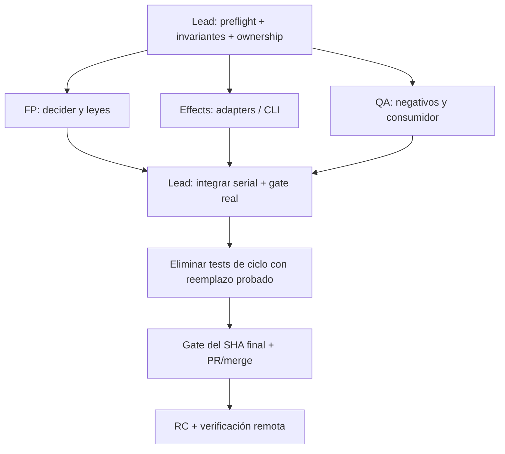

# Agent Teams — paralelismo útil sin carreras ni otra autoridad

**Objetivo:** reducir calendario sin multiplicar Gradle, tests ni PRs. Esta guía es operativa y subordinada a `ROADMAP.md`/SDDK/ADRs. Solo usar Agent Teams si el cliente/agente realmente ofrece coordinación de teammates. Si no, ejecutar la misma matriz de modo secuencial; no simular un equipo inexistente. Un *team* no es excusa para publicar resultados sin verificar.

## Roles y propiedad de escrituras

| Rol | Puede investigar / cambiar | NO debe hacer | Entrega al integrador |
|---|---|---|---|
| **Lead/Integrador (único)** | Roadmap/SDDK/commits, decisiones ADR, coordinación de PR, selección final de cambios, distribución, tag/release | Ejecutar dos Gradle en mismo worktree, integrar sin pruebas frescas, inventar PASS | Registro SHA, gates ejecutados, PR integrada, RC real |
| **Team Domain/FP** | Deciders puros `ImpactResolver`, `Cycle.decide`, `ConsoleOperationSelection` y leyes en sus propios módulos, según hito | Cambiar shell, publicador, specs aceptadas sin permiso | Diff pequeño, contrato afectado, test rojo→verde |
| **Team Runtime/Effects** | `CycleRunner`, OutputRead adapters, CLI del H3, archivos que solo suyo modifica | Inventar segundo status/replay, modificar decider que otro teammate edita | Implementación I/O con frontera y canario |
| **Team Gradle/CI** | `v2/pipeline-application/build.gradle.kts`, gates/scripts del H1, métricas de DAG | Tocar scripts de release de H2 mientras otro escribe; ejecutar Gradle simultáneo en mismo árbol | Prueba `--dry-run`, XML ejecutado, p50/p95 |
| **Team SDK/Distribution** | BOM/SDK/pipeline-release/PR #142 reconciliado, inventor de assets | Publicar a repo remoto sin autorización; merge/tag | Maven consumer proof, manifest real, change proposal |
| **Team QA/Adversarial** | Diseña mutantes y prueba efímera en tmp externo; audita evidence/retirement | Cambiar código productivo para que pase el test; borrar heredados; declarar `CERTIFIED` | Defecto causal y oráculo discriminante |

**Regla:** Lead es responsable de una única `CandidateId` y una única rama de integración. Los teammates NO deben editar a la vez el mismo fichero; si colisionan, uno emite recomendaciones y el owner único aplica. Para compilar en paralelo, usar **worktrees separados** con builds/distintos directorios `build/` y coordinar caches; `v2/settings.gradle.kts` bloquea builds **del mismo checkout** y no permite acelerar lanzando varios allí.

## DAG de paralelización por hito



### Asignaciones concretas

| Hito | Paralelizar investigación sin tocar mismos archivos | Serializar |
|---|---|---|
| H0 | FP verifica `Cycle.decide` y escribe propiedades; QA documenta ataques de symlink/exit; Effects analiza `CycleRunner` | `CycleRunner` y `CycleCli` juntos si editan el mismo flujo; Lead repara en paralelo publicador mínimo de §8 antes de RC; gate/cleanup |
| H1 | FP clasifica inputs/guarantees; Gradle team inspecciona DAG/tags; QA mide XML/caché | `GateCli` + `ImpactResolver` al integrar; una sola invocación pesada por checkout |
| H2 | SDK team Maven/BOM/consumer; release team investiga PR #142 y manifiesto; QA escenario de instalación | Decisión ADR, publicación/`gh`, mutación de scripts compartidos, tag |
| H3 | Domain revisa ordinal/cursor/refusal; Runtime revisa `MainConsoleCli` y efecto reader; QA prepara script CLI con frames | Evitar que 2 agentes cambien `MainConsoleCli.kt`/`OutputFrameIndex` a la vez; benchmark contra mismas muestras |
| H4 | QA inventario PR #140 + equivalencias; team externo consulta harness real; Domain clasifica contratos/fit | Deshabilitar/borrar heredados, validar veredictos, PR/release |

## Protocolo de handoff breve (no nuevos ledgers en repositorio)

Cada teammate devuelve al lead en mensaje o archivo temporal fuera de Git:

```text
HITO: H1
OWNER: Gradle
BASE_SHA: <real>
FILES_OWNED: <lista exacta>
DELIVERABLE: <capacidad observable>
CHANGED_FILES: <lista real>
COMMANDS_EXIT_XML: <argv,exit,ejecutados,skipped; NOT_RUN si falta>
ADVERSARIAL: <mutante y efecto>
RISKS: <riesgos, incertidumbre>
READY_TO_INTEGRATE: yes|no, con motivo
```

**Límite de paralelismo sugerido:** 2–3 investigadores/devs independientes + lead; más solo si hay propiedad de ficheros, pasos y consumidores disjuntos. No paralelizar tres suites pesadas sobre checkout compartido, ni crear una PR/RC por cada actor. Implementación de cada hito en commits atómicos, una integración mayor con valor y una RC al cierre.

## Barreras de calidad

- Antes de paralelizar: el Lead congela una base SHA y el caso observacional/productivo que el bloque va a cerrar. Si hay cambios en `origin/main`, resuelve drift al integrar; un test del teammate en vieja base = `STALE`.
- No hay gate global del team: el lead ejecuta solo el gate existente, de la rama integrada, después de eliminar efímeras. La skill `delivery-first-testing` es **router de razonamiento**; sus lentes `ready` son guías, no autoridad de CI.
- Un riesgo crítico de secreto, integridad, recovery o publicación interrumpe únicamente la parte afectada; otros entregables independientes avanzan, pero ninguna release se declara PASS con hueco obligatorio.
- No anunciar trabajo background autónomo que no pueda ejecutarse en la sesión. Si el entorno no tiene Agent Teams, cada tarea se asigna secuencialmente con el mismo protocolo y un único integrador.
