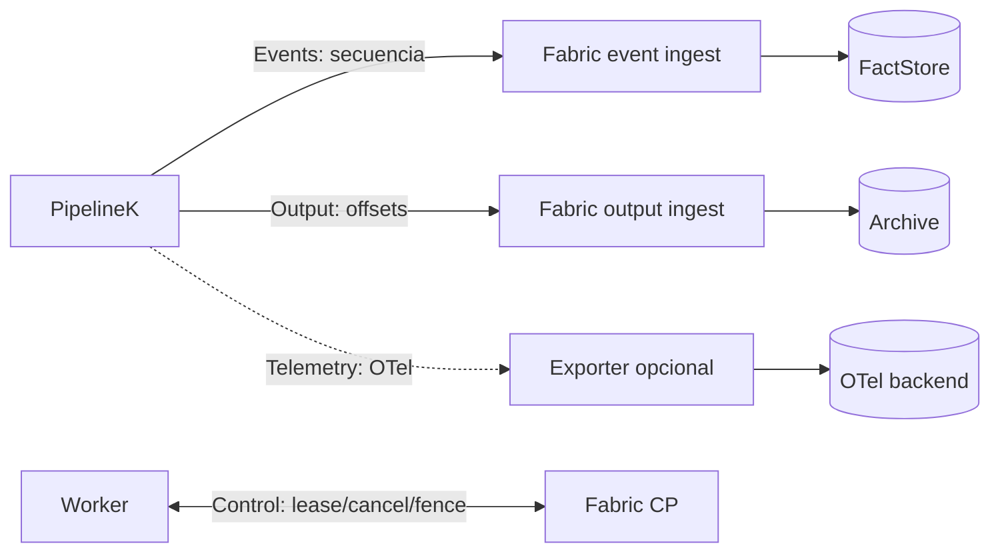

# Arquitectura objetivo y seams

## Diagrama — componentes y dependencias

```mermaid
flowchart TB
  subgraph Clients[Clientes intercambiables]
    J[Jenkins plugin] 
    C[CLI agent-first]
    U[UI / Backstage futura]
  end
  subgraph CP[Fabric Control Plane]
    A[Control API + Follow/Watch]
    R[Run registry / leases]
    S[Scheduler y Admission]
    Q[Query + read model]
    G[Governor]
    CAT[Archivo metadata/manifest]
  end
  subgraph FW[Fabric Worker]
    RE[Reconciler]
    RS[Runtime adapter]
    REP[Replicator + outbox]
    PG[Pressure sensors]
  end
  subgraph PK[PipelineK autónomo]
    EX[Execution/Recovery journal]
    EP[Event plane]
    OP[Output plane]
    OT[OTel opt-in]
  end
  PROC[Procesos y plugins]
  OBJ[(Archive local/S3)]
  IDX[(Indexador opcional Elastic/Loki)]
  J --> A
  C --> A
  U --> A
  A --> R
  A --> Q
  S --> R
  Q --> CAT
  G --> Q
  R <-->|asignaciones y observaciones| RE
  RE --> RS --> EX
  EX --> PROC
  PROC --> OP
  EX --> EP
  OP --> REP
  EP --> REP
  PG --> RE
  PG --> REP
  REP <-->|ACK durables| CAT
  CAT --> OBJ
  OBJ -.-> IDX
  IDX -.-> Q
  OT -.-> IDX
```

## Fronteras normativas

1. **Ejecución** — solo PipelineK decide resultados de steps y replay de operaciones. Fabric nunca reconstruye outcomes de stdout. Los comandos de Fabric expresan intención y se concilian con observaciones.
2. **Estado deseado** — Fabric Run Registry asigna trabajo y ownership; Worker Reconciler acerca realidad al estado deseado y verifica cada comando. Desconexión != muerte del run.
3. **Output** — PipelineK único escritor canónico de bytes de observación redactados, por stream/operación/canal; valores tipados NO se exportan como consola. Fabric conserva otra réplica autorizada con el mismo rango/digest.
4. **Eventos** — EventStore y secuencia por run; en Fabric `ProjectionReducer` produce los read models. Un EventCursor no se mezcla con offsets de output.
5. **Telemetría** — spans/métricas independientes, sampling permitido según política, nunca sustituyen hechos durables.
6. **Control** — comandos, leases, fencing, cancelaciones y avisos de vida: vía prioritaria sin espera detrás de bytes masivos.
7. **Archivo** — `ArchiveWritePort`/`ArchiveReadPort`/manifiestos en Fabric; implementación local y S3. Elastic/Loki son índices optativos, no autoridad de byte offsets.
8. **Vistas** — Jenkins/CLI pueden ser lentos. Pierden frecuencia de actualización, no verdad durable. ACL antes de consultas y exportaciones.
9. **Plugins** — estructura hexagonal: domain no importa grpc/http/s3/elastic/jenkins; implementaciones se inyectan en composición.

## Diagrama — los cuatro carriles lógicos

No implica cuatro sockets ni cuatro bases de datos: son **aislamientos de política, orden y garantía**. gRPC flow-control no equivale a ACK durable; un mismo canal físico puede tener streams lógicos distintos si se demuestra que P0 no sufre head-of-line blocking. Si no se demuestra, separar conexiones o reservar un control path.

## Secuencias críticas

### Happy path

1. Fabric admite run, verifica capacidades, reserva recursos y otorga token de fencing.
2. Worker recibe trabajo mediante carrier persistente, confirma asignación y reconcilia.
3. Adaptador arranca o reatacha PipelineK. La aceptación de comando no es ejecución efectiva.
4. PipelineK produce hechos semánticos y bytes; escribe y compromete localmente.
5. Followers leen desde posiciones durables; outbox registra referencias/payloads antes del envío.
6. Fabric valida owner/token, integridad, versión, continuidad y commits de almacenamiento; publica manifiesto atómicamente respecto a su propio catálogo.
7. Fabric envía ACK correspondiente exactamente a rangos ya comprometidos; Worker puede soltar pin tras ACK.
8. Jenkins y CLI obtienen snapshot/follow y leen bytes desde Fabric; nada de esto bloquea la ejecución.
9. `RunConcluded` y todos los streams sellados se observan por separado, y solo entonces `ConsoleComplete` es demostrable.

### Reconexión / recuperación

1. Pérdida de conexión cambia `ConnectionDegraded`, no `RunFailed`.
2. Runtime sigue mientras la política de recursos permita persistir; outbox retiene y aplica límites.
3. Al reconectar, renegociar features/protocol version y fencing; rechazar writers obsoletos.
4. Comparar ACK durable más reciente, reenviar rangos faltantes verificando digest. No inferir confirmación de intervalos anteriores.
5. Si el proceso externo terminó, consultar journal/recovery antes de replay; efecto incierto => FailClosed/Unobservable.
6. Si falta un segmento retenido, emitir `Gap/Corrupt/Unrecoverable` y no fingir página vacía.

### Archivo remoto

1. Rotación de segmentos inmutables tras commits; metadatos necesarios para mapear offset→objeto.
2. Escribir bytes al ArchivePort; verificar longitud/digest y durabilidad declarada; confirmar manifiesto en catálogo (operación propia idempotente).
3. ACK a replicador solo si objeto y manifiesto satisfacen garantías; búsqueda en indexador asíncrona no participa en ACK.
4. Reconciliar objetos huérfanos y manifiestos colgantes; borrar local únicamente sin pins y según retención.
5. Lectura usa `readRange`+extent, nunca reconstruye consola concatenando stdout luego stderr; para vista combinada usa índice de frames y posición virtual.

## Arquitectura emergente y limitación de complejidad

- **Primer release utilizable:** embedded read/port de PipelineK y Jenkins con consola progresiva; no S3 obligatorio.
- **Primera escala:** archivo local persistente y S3 como plugin. Evitar capa de abstracción genérica de almacenamiento del universo: únicamente byte ranges, manifests, retention y errors pertinentes.
- **Escala posterior:** búsqueda documental opcional, subida directa a object storage, índices full-text, despliegues multi-controller, Kubernetes Capacity Provider, solo tras benchmark/UAT. Ninguno bloquea funcionalidad inicial.
- **Cero morralla:** estado temporal y spool bajo directorio de usuario/volumen elegido, no bajo fuente del repo ni dentro del workspace del job sin contrato explícito.
